# ARIA — Recopilación para el UX Data Mapping

> Borrador de **recolección** (no es la presentación final). Fuentes verificadas el 2026-11-02 contra el código y la app corriendo en `http://localhost`.

## 0. Cómo se recopiló

- **Vistas, componentes y llamadas API**: grafo del proyecto (`src/infrastructure/agents/project_graph/project_graph.json`, generado por `make project-graph`) — vista → componentes (transitivo) → función API del frontend.
- **Rutas y campos de respuesta**: cada llamada se cruzó contra el **OpenAPI real** del backend en ejecución (`/openapi.json`); los campos son los de los schemas Pydantic. Los ⚠ marcan llamadas que no se pudieron emparejar.
- **Acceso por rol**: `ROLE_NAV` en `frontend_mockup/src/hooks/useRole.ts`.
- **Capturas**: Playwright contra nginx (`http://localhost`) con usuarios locales de prueba (`qa@aria.local` = channel_manager, `qa-manager@aria.local` = manager).
- **Referencia previa**: `UXData_mapping_ARIA_AGENTE_PREVENCION_DE_FRAUDE_v1.2.pptx` (141 diapositivas, 5 vistas, plantilla BBVA).

**Lo que NO está todavía** (requiere leer cada componente): *Properties list* (estado local por vista) y el cómo se pinta cada campo (columna "Rendered as / Where" del v1.2). Hoy el documento llega hasta *vista → componentes → servicio → campos del response*.

## 1. Índice de vistas

| Ruta | Vista | Roles con acceso | Componentes propios | Servicios propios | En v1.2 |
|---|---|---|---|---|---|
| `/login` | Acceso | — | 0 | 2 | **No** |
| `/dashboard` | Dashboard | manager, release_manager, channel_manager, ops_analyst | 12 | 8 | Sí (Dashboard View) |
| `/cola` | En proceso | manager, release_manager, channel_manager, fraud_analyst, ops_analyst | 17 | 8 | Sí (In Progress View) |
| `/alerta/$id` | Detalle de alerta | manager, release_manager, channel_manager, fraud_analyst, ops_analyst | 4 | 11 | **No** |
| `/historico-fraude` | Histórico de Gestión de Fraude | manager, release_manager, channel_manager, fraud_reviewer | 12 | 10 | **No** |
| `/monitor` | Monitor del Agente | manager, release_manager, channel_manager, data_analyst, ops_analyst | 12 | 8 | **No** |
| `/configuracion` | Configuración | manager, release_manager, channel_manager | 60 | 86 | Sí (Configuration View) |
| `/biblioteca` | Biblioteca | manager, release_manager, channel_manager, data_analyst | 32 | 65 | Sí (Library View) |
| `/testing` | Testing | release_manager, channel_manager, data_analyst | 16 | 19 | Sí (Testing View) |
| `/testing/$runId` | Detalle de prueba | release_manager, channel_manager, data_analyst | 27 | 4 | Sí (Testing View, 4.6–4.8) |
| `/testing/scenarios/$scenarioId` | Escenario de simulación | release_manager, channel_manager, data_analyst | 1 | 5 | **No** |
| `/modelos` | Modelos | channel_manager, data_analyst | 16 | 26 | **No** |
| `/backups` | Respaldos | manager | 0 | 2 | **No** |
| `/` | Inicio | — | 0 | 0 | **No** |

Vistas nuevas respecto al v1.2: **Login, Detalle de alerta, Histórico de gestión de fraude, Monitor del agente, Escenario de simulación, Modelos, Respaldos**, además del asistente ARIA (panel flotante).

## 2. Roles y navegación

| Rol | Vistas (orden del menú) |
|---|---|
| `manager` | `/dashboard`, `/cola`, `/historico-fraude`, `/monitor`, `/configuracion`, `/backups`, `/biblioteca` |
| `release_manager` | `/dashboard`, `/cola`, `/historico-fraude`, `/monitor`, `/configuracion`, `/testing`, `/biblioteca` |
| `channel_manager` | `/dashboard`, `/cola`, `/historico-fraude`, `/monitor`, `/testing`, `/biblioteca`, `/configuracion`, `/modelos` |
| `data_analyst` | `/monitor`, `/testing`, `/biblioteca`, `/modelos` |
| `fraud_analyst` | `/cola` |
| `ops_analyst` | `/dashboard`, `/cola`, `/monitor` |
| `fraud_reviewer` | `/historico-fraude` |

Redirección: si la ruta no está en `ROLE_NAV[rol]`, `DashboardLayout` lleva a la primera ruta del rol. `/alerta/$id` hereda el acceso de `/cola`. Sin sesión → `/login?redirect=…`.

## 3. Componentes comunes (layout de todas las vistas)

`DashboardLayout` envuelve todas las vistas salvo login: menú lateral (`AppSidebar`), botón "Volver", banner de API caída (`useApiHealth`), barra inferior opcional (Configuración) y el panel flotante del asistente (`AgentPanel`).

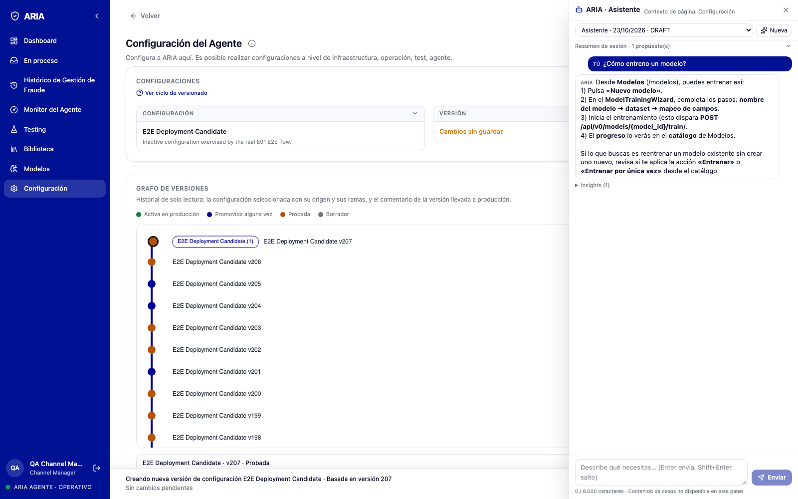

| Componente | Archivo | Descripción |
|---|---|---|
| `AppSidebar` | `components/AppSidebar.tsx` | Sidebar de navegación principal con opción de colapsar/expandir, resaltado de la ruta activa y accesos a secciones del producto. Muestra un bloque de usuario/rol y dispa… |
| `DashboardLayout` | `components/DashboardLayout.tsx` | Layout base de la aplicación que compone sidebar, contenido principal, botón de volver y un panel inferior opcional. Gestiona el estado colapsado del sidebar, el redirec… |
| `LogoutDialog` | `components/LogoutDialog.tsx` | Diálogo de confirmación para cerrar sesión, con estados de carga/error. Si detecta una alerta tomada por el usuario, ofrece la opción de liberarla antes de cerrar sesión. |
| `agent/AgentPanel` | `components/agent/AgentPanel.tsx` | Panel del asistente ARIA: chat denso con insights propuestos dentro del feed, borradores con confirmación explícita y resumen de sesión. Avisa cuando una sesión del opti… |
| `ui/alert-dialog` | `components/ui/alert-dialog.tsx` | Componentes para un diálogo de confirmación/alerta modal basado en Radix (overlay, contenido, encabezado, pie, título, descripción, acción y cancelar). Su responsabilida… |
| `ui/button` | `components/ui/button.tsx` | Botón reutilizable para disparar acciones o navegación con estilos consistentes. Gestiona variantes (default, outline, link, etc.), tamaños y la opción de renderizarse c… |
| `ui/side-drawer` | `components/ui/side-drawer.tsx` | Cajón lateral derecho (overlay) para formularios de crear/editar, construido con Radix Dialog para gestionar foco, cierre por Esc y click fuera. Incluye cabecera con tít… |

### Servicios comunes

| Función (frontend) | Método y ruta (backend) | Qué hace | Caso de uso | Request | Response (campos) | Usado en |
|---|---|---|---|---|---|---|
| `operations.listAnalystQueue` | GET `/api/v0/analyst-queue` | List Analyst Queue | `ListAnalystQueueUseCase` | — | `AnalystQueueAlertResponse[]`: `alert_id`, `event_id`, `event_type`, `status`, `customer_id`, `created_at`, `schema_version`, `configuration_ref` … (+5) | `LogoutDialog` |
| `operations.releaseAlert` | POST `/api/v0/analyst-queue/{alert_id}/release` | Release Alert | `ReleaseEscalatedAlertUseCase` | — | `ResourceReservationResponse`: `id`, `resource`, `alert_id`, `holder`, `holder_name`, `reserved_at`, `expires_at`, `status` … (+3) | `LogoutDialog` |
| `agent.changeAgentInsight` | POST `/api/v0/agent/sessions/{session_id}/insights/{insight_id}/confirm` `/api/v0/agent/sessions/{session_id}/insights/{insight_id}/reject` | Confirm Insight \| Reject Insight | — | — | `AgentInsightResponse`: `insight_id`, `kind`, `statement`, `scope`, `status`, `proposed_by`, `source_message_id`, `created_at` … (+1) | `agent/AgentPanel` |
| `agent.confirmFlagDraft` | POST `/api/v0/agent/sessions/{session_id}/flag-drafts/{package_id}/confirm` | Confirm Flag Draft | `ConfirmFlagDraftUseCase` | `ConfirmFlagDraftRequest`: `item_id` | — | `agent/AgentPanel` |
| `agent.confirmModusOperandiDraft` | POST `/api/v0/agent/sessions/{session_id}/modus-operandi-drafts/{package_id}/confirm` | Confirm Modus Operandi Draft | `ConfirmModusOperandiDraftUseCase` | `ConfirmAgentDraftRequest`: `item_id` | `ConfirmAgentDraftResponse`: `confirmation_id`, `package_id`, `item_id`, `entity_id` | `agent/AgentPanel` |
| `agent.confirmResourceDraft` | POST `/api/v0/agent/sessions/{session_id}/resource-drafts/{package_id}/confirm` | Confirm Resource Draft | `ConfirmResourceDraftUseCase` | `ConfirmResourceDraftRequest`: `item_id` | — | `agent/AgentPanel` |
| `agent.confirmSimilarCaseDraft` | POST `/api/v0/agent/sessions/{session_id}/similar-case-drafts/{package_id}/confirm` | Confirm Similar Case Draft | `ConfirmSimilarCaseDraftUseCase` | `ConfirmSimilarCaseDraftRequest`: `item_id` | — | `agent/AgentPanel` |
| `agent.confirmTaxonomyDraft` | POST `/api/v0/agent/sessions/{session_id}/taxonomy-drafts/{package_id}/confirm` | Confirm Taxonomy Draft | `ConfirmTaxonomyDraftUseCase` | `ConfirmTaxonomyDraftRequest`: `item_id` | — | `agent/AgentPanel` |
| `agent.confirmWatchlistDraft` | POST `/api/v0/agent/sessions/{session_id}/watchlist-drafts/{package_id}/confirm` | Confirm Watchlist Draft | `ConfirmWatchlistDraftUseCase` | `ConfirmWatchlistDraftRequest`: `item_id` | — | `agent/AgentPanel` |
| `agent.createAgentSession` | POST `/api/v0/agent/sessions` | Create Session | `CreateAgentSessionUseCase` | `CreateAgentSessionRequest`: `mode`, `scope`, `requested_budget` | `AgentSessionResponse`: `session_id`, `mode`, `status`, `created_at`, `updated_at`, `scope`, `objective_id`, `objective_version` … (+7) | `agent/AgentPanel` |
| `agent.generateFlagDraft` | POST `/api/v0/agent/sessions/{session_id}/flag-drafts` | Generate Flag Draft | `GenerateFlagDraftUseCase` | `GenerateFlagDraftRequest`: `client_message_id`, `operation`, `target_id` | — | `agent/AgentPanel` |
| `agent.generateModusOperandiDraft` | POST `/api/v0/agent/sessions/{session_id}/modus-operandi-drafts` | Generate Modus Operandi Draft | `GenerateModusOperandiDraftUseCase` | `GenerateModusOperandiDraftRequest`: `client_message_id`, `operation`, `target_id` | `AgentDraftPackageResponse`: `package_id`, `session_id`, `status`, `content_hash`, `content`, `verifications` | `agent/AgentPanel` |
| `agent.generateResourceDraft` | POST `/api/v0/agent/sessions/{session_id}/resource-drafts` | Generate Resource Draft | `GenerateResourceDraftUseCase` | `GenerateResourceDraftRequest`: `client_message_id`, `resource` | — | `agent/AgentPanel` |
| `agent.generateSimilarCaseDraft` | POST `/api/v0/agent/sessions/{session_id}/similar-case-drafts` | Generate Similar Case Draft | `GenerateSimilarCaseDraftUseCase` | `GenerateSimilarCaseDraftRequest`: `client_message_id`, `operation`, `target_id` | — | `agent/AgentPanel` |
| `agent.getAgentSessionSummary` | GET `/api/v0/agent/sessions/{session_id}/summary` | Get Session Summary | — | — | `AgentSessionSummaryResponse`: `session_id`, `version`, `content`, `covers_seq_from`, `covers_seq_to`, `created_at` | `agent/AgentPanel` |
| `agent.listAgentDraftActions` | GET `/api/v0/agent/draft-actions` | Get Agent Draft Actions | — | — | — | `agent/AgentPanel` |
| `agent.listAgentInsights` | GET `/api/v0/agent/sessions/{session_id}/insights` | List Insights | `ManageAgentInsightUseCase` | — | `AgentInsightResponse[]`: `insight_id`, `kind`, `statement`, `scope`, `status`, `proposed_by`, `source_message_id`, `created_at` … (+1) | `agent/AgentPanel` |
| `agent.listAgentMessages` | GET `/api/v0/agent/sessions/{session_id}/messages` | List Messages | — | query: `after_seq`, `limit` | `AgentMessageResponse[]`: `message_id`, `client_message_id`, `seq`, `role`, `content`, `created_at`, `redaction_counts`, `extracted_insight_ids` … (+2) | `agent/AgentPanel` |
| `agent.listAgentSessions` | GET `/api/v0/agent/sessions` | List Sessions | — | query: `limit` | `AgentSessionResponse[]`: `session_id`, `mode`, `status`, `created_at`, `updated_at`, `scope`, `objective_id`, `objective_version` … (+7) | `agent/AgentPanel` |
| `agent.sendAgentMessage` | POST `/api/v0/agent/sessions/{session_id}/messages` | Send Message | `ChatWithAgentUseCase` | `SendAgentMessageRequest`: `client_message_id`, `content`, `page_path` | `AgentChatTurnResponse`: `user_message`, `assistant_message`, `proposed_insights` | `agent/AgentPanel` |
| `knowledgeLibrary.listFlagLibraryEntries` | GET `/api/v0/library/flags` | List Flag Library Entries | `ListFlagLibraryEntriesUseCase` | query: `active_only` | `FlagLibraryEntrySchema[]`: `id`, `flag_type`, `name`, `description`, `evolved_variables`, `modus_operandi_library_ids`, `active`, `created_at` … (+1) | `agent/AgentPanel` |
| `knowledgeLibrary.listModusOperandiLibraryEntries` | GET `/api/v0/library/modus-operandi` | List Modus Operandi Library Entries | `ListModusOperandiLibraryEntriesUseCase` | query: `active_only` | `ModusOperandiLibraryEntrySchema[]`: `id`, `title`, `narrative`, `taxonomy_library_id`, `evolved_variables`, `active`, `created_at`, `updated_at` … (+1) | `agent/AgentPanel` |
| `knowledgeLibrary.listSimilarCaseLibraryEntries` | GET `/api/v0/library/similar-cases` | List Similar Case Library Entries | `ListSimilarCaseLibraryEntriesUseCase` | query: `active_only` | `SimilarCaseLibraryEntrySchema[]`: `id`, `text`, `modus_operandi_library_id`, `taxonomy_library_id`, `active`, `created_at`, `updated_at` | `agent/AgentPanel` |
| `knowledgeLibrary.listTaxonomyLibraryEntries` | GET `/api/v0/library/taxonomies` | List Taxonomy Library Entries | `ListTaxonomyLibraryEntriesUseCase` | query: `active_only` | `TaxonomyLibraryEntrySchema[]`: `id`, `code`, `name`, `description`, `variables`, `examples`, `active`, `created_at` … (+1) | `agent/AgentPanel` |
| `watchlist.listWatchlists` | GET `/api/v0/watchlists` | List Watchlists | `ListWatchlistsUseCase` | query: `list_type`, `active_only` | `WatchlistSchema[]`: `id`, `name`, `description`, `list_type`, `element_count`, `active`, `created_at`, `updated_at` | `agent/AgentPanel` |
| `auth.getCurrentUser` | GET `/api/v0/auth/me` | Me | — | — | `UserResponse`: `id`, `email`, `name`, `role`, `permissions` | `components/AppSidebar`, `components/DashboardLayout` |
| `auth.login` | POST `/api/v0/auth/login` | Login | — | `LoginRequest`: `email`, `password` | `LoginResponse`: `id`, `email`, `name`, `role`, `permissions`, `access_token`, `token_type`, `expires_in` | `components/AppSidebar`, `components/DashboardLayout` |
| `auth.logoutSession` | POST `/api/v0/auth/logout` | Logout | — | — | — | `components/AppSidebar`, `components/DashboardLayout` |

---

## 4.1 Acceso — `/login`

- **Archivo**: `routes/login.tsx`  
- **Roles**: —  
- **Descripción**: Pantalla de acceso a ARIA con correo y contraseña.

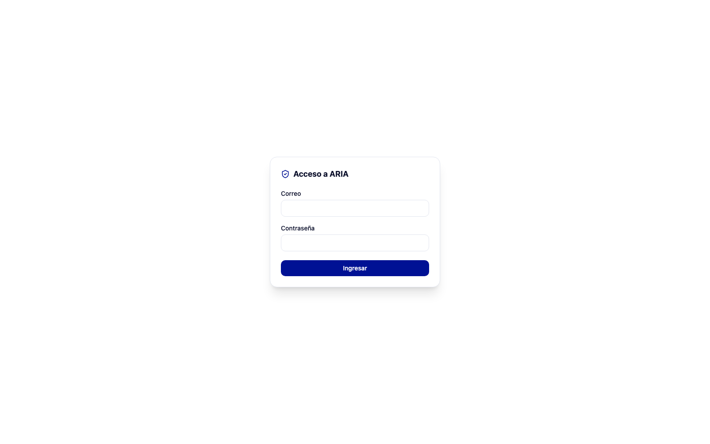

### Servicios propios

| Función (frontend) | Método y ruta (backend) | Qué hace | Caso de uso | Request | Response (campos) | Usado en |
|---|---|---|---|---|---|---|
| `auth.login` | POST `/api/v0/auth/login` | Login | — | `LoginRequest`: `email`, `password` | `LoginResponse`: `id`, `email`, `name`, `role`, `permissions`, `access_token`, `token_type`, `expires_in` | `routes/login` |
| `auth.getCurrentUser` | GET `/api/v0/auth/me` | Me | — | — | `UserResponse`: `id`, `email`, `name`, `role`, `permissions` | `hooks/useRole` |

---

## 4.2 Dashboard — `/dashboard`

- **Archivo**: `routes/dashboard.tsx`  
- **Roles**: `manager`, `release_manager`, `channel_manager`, `ops_analyst`  
- **Descripción**: Panel operativo: alertas vivas por etapa, capacidad de analistas y desbordamiento, con filtros por segmento, canal, subcanal, monto y método de resolución. Permite exportar un reporte.
- **Pestañas**: Tiempo real · Histórico · Por dimensión

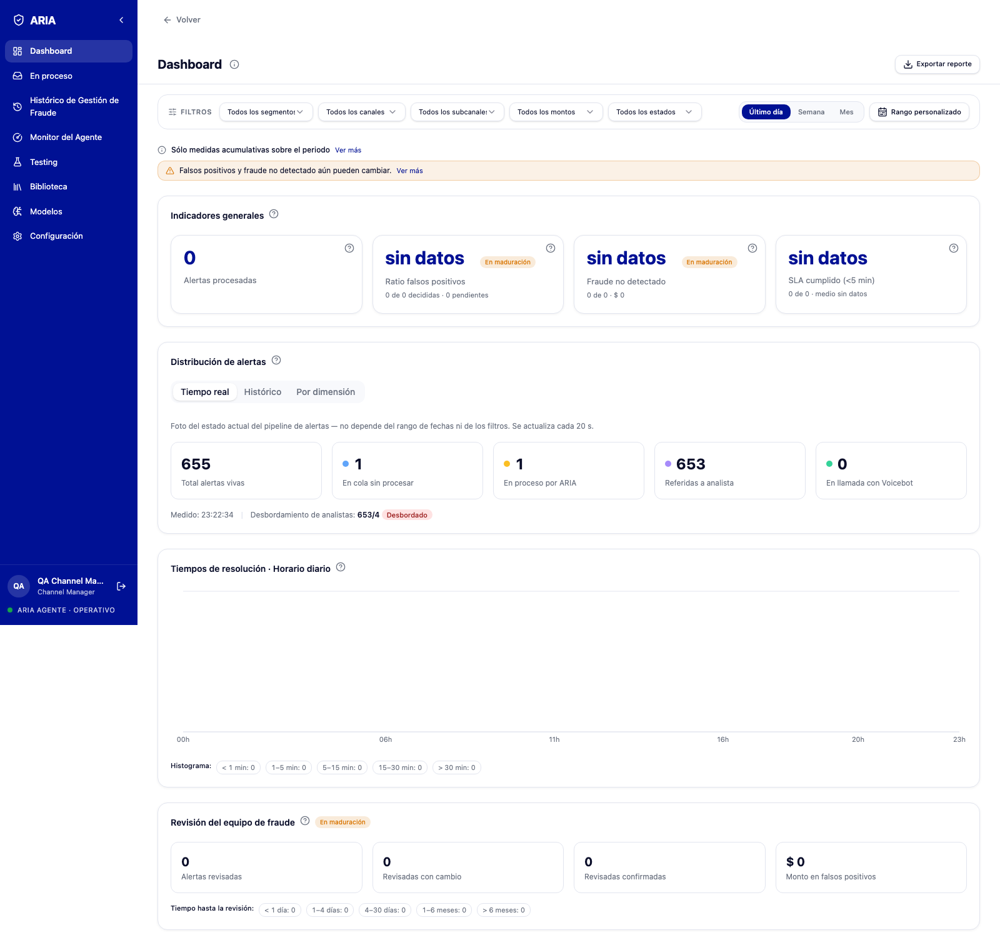

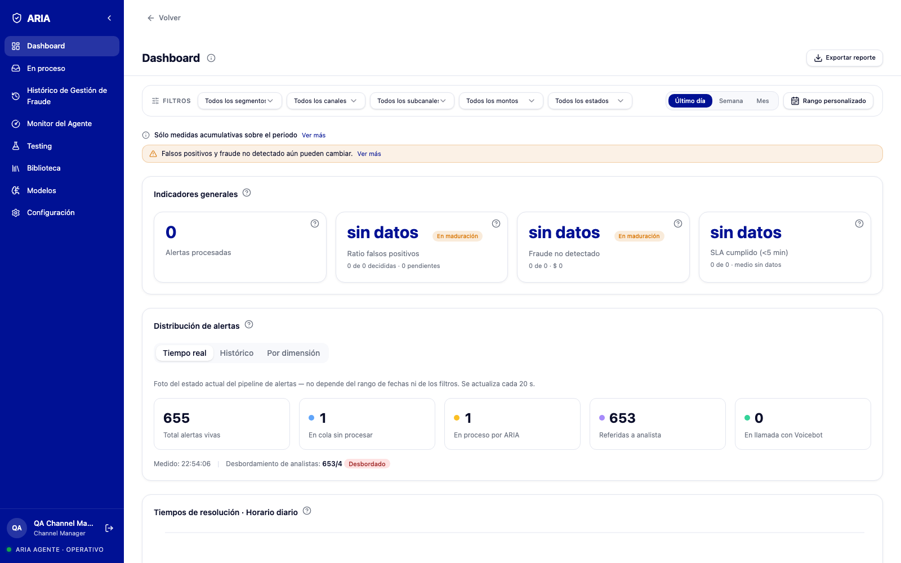

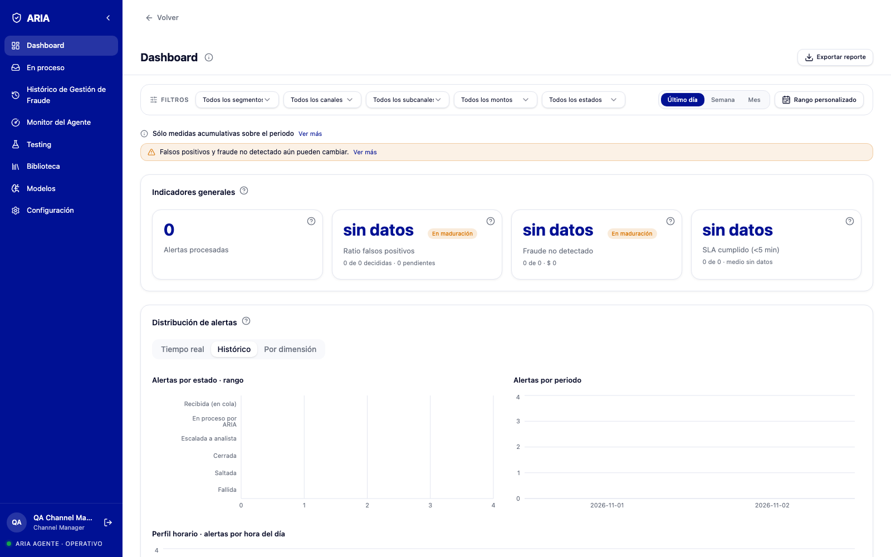

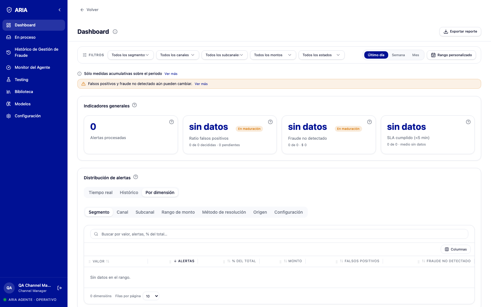

**Acciones del usuario** (10): Aplicar; Ayuda; Cancelar; Columnas; Exportar reporte; Ir al final; Ir al inicio; Limpiar filtros; Página anterior; Página siguiente

### Componentes propios

| Componente | Archivo | Descripción |
|---|---|---|
| `ColumnVisibilityMenu` | `components/ColumnVisibilityMenu.tsx` | Menú desplegable "Columnas" para mostrar/ocultar columnas de una tabla mediante checkboxes. Incluye un hook para persistir la preferencia por tabla en localStorage sin r… |
| `MetricsFilterBar` | `components/MetricsFilterBar.tsx` | Barra de filtros reutilizable para vistas de métricas, basada en selects configurables por dimensión y por rango de fechas. Construye opciones desde fuentes consultadas … |
| `PageHeader` | `components/PageHeader.tsx` | Encabezado fijo para páginas de alertas con filtros: muestra el título (y un badge opcional) a la izquierda y agrupa acciones de la página a la derecha. Su responsabilid… |
| `aria/CapabilityInfo` | `components/aria/CapabilityInfo.tsx` | Botón de información (ícono i) que abre diagramas explicativos junto al título: ciclo del evento al aprendizaje en el Dashboard (con conteos vivos por etapa), embudo de … |
| `metrics/MetricsShared` | `components/metrics/MetricsShared.tsx` | Conjunto de componentes reutilizables para pantallas de métricas: control de rango (presets y calendario) y badges/avisos informativos. Su responsabilidad es gestionar l… |
| `ui/DataTable` | `components/ui/DataTable.tsx` | Tabla reutilizable: cabeceras ordenables, búsqueda, filtros, paleta de columnas, acciones a la izquierda, paginación con primera/última página y scroll interno. |
| `ui/PaginationFooter` | `components/ui/PaginationFooter.tsx` | Pie de paginación para listas o tablas: muestra un resumen de resultados (rango y total) y controles para navegar entre páginas (inicio, anterior, siguiente, final). Tam… |
| `ui/calendar` | `components/ui/calendar.tsx` | Calendario interactivo basado en DayPicker para seleccionar y navegar fechas. Se encarga del layout, estilos/clases y de los controles de navegación (meses y flechas) us… |
| `ui/dropdown-menu` | `components/ui/dropdown-menu.tsx` | Conjunto de componentes para menús desplegables basados en Radix, con ítems, submenús y opciones tipo checkbox/radio. Se encarga de la estructura, accesibilidad y estilo… |
| `ui/popover` | `components/ui/popover.tsx` | Componentes de popover basados en Radix Popover (root, trigger, anchor y content). Su responsabilidad es mostrar contenido flotante alineado respecto a un disparador con… |
| `ui/select` | `components/ui/select.tsx` | Select desplegable basado en Radix Select para que el usuario elija un valor de una lista. Provee trigger, contenido con viewport y scroll buttons, labels e items con in… |
| `ui/tabs` | `components/ui/tabs.tsx` | Componentes de pestañas basados en Radix (TabsList, TabsTrigger y TabsContent) para organizar contenido en secciones conmutables. Su responsabilidad es renderizar la est… |

### Servicios propios

| Función (frontend) | Método y ruta (backend) | Qué hace | Caso de uso | Request | Response (campos) | Usado en |
|---|---|---|---|---|---|---|
| `metrics.getLiveAlertFunnel` | GET `/api/v0/metrics/live` | Get Live Alert Funnel | — | — | `LiveAlertFunnelResponse`: `received`, `processing`, `escalated`, `voicebot_in_call`, `measured_at` | `/dashboard` |
| `operations.getOperationsCapacity` | GET `/api/v0/operations/capacity` | Get Operations Capacity | — | — | `OperationsCapacityResponse`: `analysts`, `voicebot`, `bidi`, `updated_at` | `/dashboard` |
| `channelLibrary.listChannelLibraryEntries` | GET `/api/v0/library/channels` | List Channel Library Entries | `ListChannelLibraryEntriesUseCase` | query: `active_only` | `ChannelLibraryEntrySchema[]`: `id`, `code`, `name`, `description`, `active`, `created_at`, `updated_at` | `MetricsFilterBar` |
| `configurations.listConfigurations` | GET `/api/v0/configurations` | List Configurations | `ListConfigurationsUseCase` | — | `ConfigurationSummaryResponse[]`: `configuration_id`, `version`, `name`, `description`, `active`, `ever_activated`, `ever_tested`, `created_at` … (+2) | `MetricsFilterBar` |
| `operations.getOperationalSettings` | GET `/api/v0/operational-settings` | Get Operational Settings | `GetOperationalSettingsUseCase` | — | `OperationalSettingsSchema-Output`: `agent_enabled`, `analyst_enabled`, `voicebot_enabled`, `max_instances`, `auto_scale`, `voicebot_max_concurrent_calls`, `analyst_capacity`, `queue_max_lifetime_value` … (+16) | `MetricsFilterBar` |
| `operations.listOperationalSettingsHistory` | GET `/api/v0/operational-settings/history` | List Operational Settings History | `ListOperationalSettingsHistoryUseCase` | query: `limit` | `OperationalSettingsChangeResponse[]`: `id`, `changed_by`, `changed_at`, `changes` | `MetricsFilterBar` |
| `metrics.getMetricsOverview` | GET `/api/v0/metrics/overview` | Get Metrics Overview | — | query: `from`, `to`, `segment`, `channel`, `subchannel`, `amount_tier`, `status`, `configuration_id`, `resolution_method` | `MetricsOverviewResponse`: `range`, `periods`, `warnings`, `totals`, `funnel_by_status`, `fraud_quality`, `resolution_time`, `distributions` … (+1) | `components/MetricsFilterBar`, `routes/dashboard` |
| `metrics.getVersionEvents` | GET `/api/v0/metrics/version-events` | Get Version Events | — | query: `from`, `to`, `segment`, `channel`, `subchannel`, `amount_tier`, `status`, `configuration_id`, `resolution_method` | `VersionEventResponse[]`: `kind`, `label`, `version`, `configuration_id`, `at` | `routes/dashboard` |

---

## 4.3 En proceso — `/cola`

- **Archivo**: `routes/cola.tsx`  
- **Roles**: `manager`, `release_manager`, `channel_manager`, `fraud_analyst`, `ops_analyst`  
- **Descripción**: Cola de trabajo. Pestaña «Pending Alerts for Analyst»: alertas escaladas que esperan analista (Ver, Seguir o Tomar caso). Pestaña «Alertas en proceso»: casos que ARIA todavía analiza.
- **Pestañas**: Pending Alerts for Analyst · Alertas en proceso
- **Navega a**: `/alerta/$id`

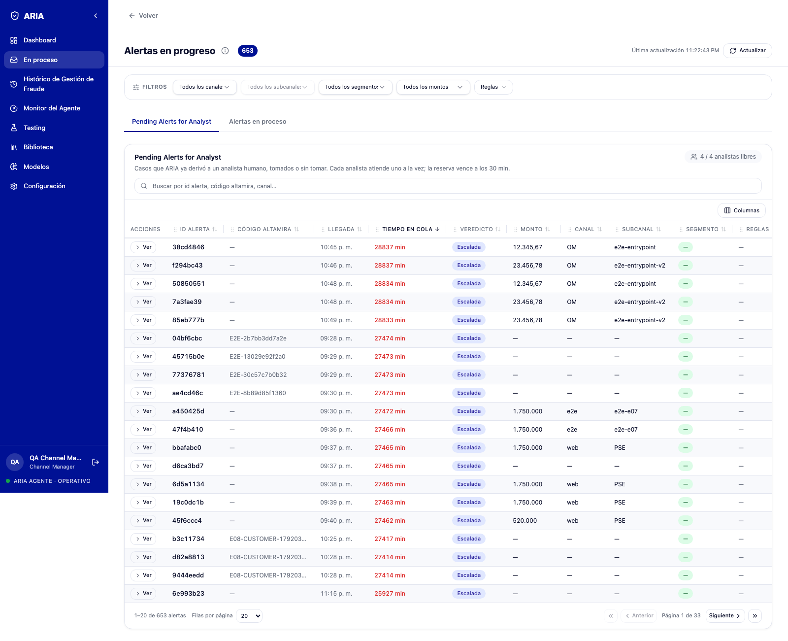

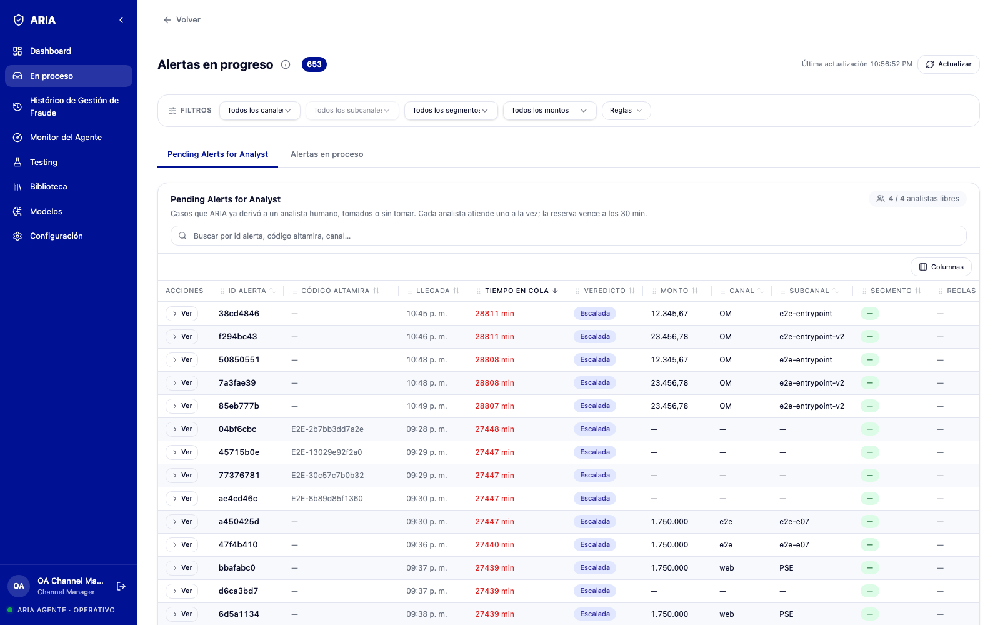

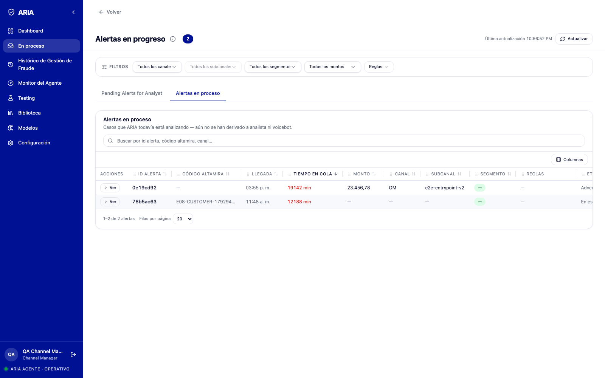

**Acciones del usuario** (13): Actualizar; Columnas; Ir al final; Ir al inicio; Limpiar filtros; Página anterior; Página siguiente; Reglas; Reportar campo; Seguir; Tomar; Tomar caso; Ver

### Componentes propios

| Componente | Archivo | Descripción |
|---|---|---|
| `AlertFiltersBar` | `components/AlertFiltersBar.tsx` | Barra de filtros comunes para tablas de alertas, combinando selección de canal/subcanal/segmento, rango de monto y reglas. También expone utilidades para contar filtros … |
| `ChannelFilter` | `components/ChannelFilter.tsx` | Conjunto de selects para filtrar por canal, subcanal (dependiente del canal) y segmento. Carga los segmentos desde el catálogo de canales (Biblioteca) y resetea el subca… |
| `ColumnVisibilityMenu` | `components/ColumnVisibilityMenu.tsx` | Menú desplegable "Columnas" para mostrar/ocultar columnas de una tabla mediante checkboxes. Incluye un hook para persistir la preferencia por tabla en localStorage sin r… |
| `PageHeader` | `components/PageHeader.tsx` | Encabezado fijo para páginas de alertas con filtros: muestra el título (y un badge opcional) a la izquierda y agrupa acciones de la página a la derecha. Su responsabilid… |
| `RefreshControl` | `components/RefreshControl.tsx` | Control de actualización que muestra la hora de la última actualización y un botón "Actualizar" con animación de giro. Su función es disparar la acción de refresco y pre… |
| `RulesFilter` | `components/RulesFilter.tsx` | Filtro compacto multi-selección para "Reglas" que abre un popover con una lista seleccionable y contador de seleccionadas. Su responsabilidad es permitir elegir y altern… |
| `alert/AlertSchemaView` | `components/alert/AlertSchemaView.tsx` | Vista para inspeccionar datos de una alerta contra una versión de esquema, organizando campos y formateando valores (incluye locales para números/fechas). Permite marcar… |
| `aria/CapabilityInfo` | `components/aria/CapabilityInfo.tsx` | Botón de información (ícono i) que abre diagramas explicativos junto al título: ciclo del evento al aprendizaje en el Dashboard (con conteos vivos por etapa), embudo de … |
| `testing/Hint` | `components/testing/Hint.tsx` | Componente de ayuda contextual que muestra un tooltip al interactuar con un elemento disparador. Incluye una variante "InfoHint" que renderiza un icono accesible para de… |
| `ui/DataTable` | `components/ui/DataTable.tsx` | Tabla reutilizable: cabeceras ordenables, búsqueda, filtros, paleta de columnas, acciones a la izquierda, paginación con primera/última página y scroll interno. |
| `ui/PaginationFooter` | `components/ui/PaginationFooter.tsx` | Pie de paginación para listas o tablas: muestra un resumen de resultados (rango y total) y controles para navegar entre páginas (inicio, anterior, siguiente, final). Tam… |
| `ui/command` | `components/ui/command.tsx` | Interfaz de comandos/búsqueda (cmdk) para filtrar y seleccionar opciones en una lista. Incluye variante en diálogo (CommandDialog), entrada con icono de búsqueda, grupos… |
| `ui/dialog` | `components/ui/dialog.tsx` | Componentes reutilizables para construir un modal (diálogo) con overlay, contenido centrado y botón de cierre. Proporciona encabezado, pie, título y descripción con esti… |
| `ui/dropdown-menu` | `components/ui/dropdown-menu.tsx` | Conjunto de componentes para menús desplegables basados en Radix, con ítems, submenús y opciones tipo checkbox/radio. Se encarga de la estructura, accesibilidad y estilo… |
| `ui/popover` | `components/ui/popover.tsx` | Componentes de popover basados en Radix Popover (root, trigger, anchor y content). Su responsabilidad es mostrar contenido flotante alineado respecto a un disparador con… |
| `ui/select` | `components/ui/select.tsx` | Select desplegable basado en Radix Select para que el usuario elija un valor de una lista. Provee trigger, contenido con viewport y scroll buttons, labels e items con in… |
| `ui/tooltip` | `components/ui/tooltip.tsx` | Conjunto de componentes de tooltip basado en Radix (Provider, Root, Trigger y Content) para mostrar información contextual al interactuar con un elemento. Su responsabil… |

### Servicios propios

| Función (frontend) | Método y ruta (backend) | Qué hace | Caso de uso | Request | Response (campos) | Usado en |
|---|---|---|---|---|---|---|
| `alertSchema.getActiveAlertSchema` | GET `/api/v0/alert-schema/active` | Get Active Schema | `GetActiveAlertSchemaUseCase` | — | `AlertSchemaVersionResponse`: `version`, `status`, `fields`, `field_roles`, `proposed_by`, `proposed_at`, `approved_by`, `approved_at` … (+4) | `/cola` |
| `operations.getOperationsCapacity` | GET `/api/v0/operations/capacity` | Get Operations Capacity | — | — | `OperationsCapacityResponse`: `analysts`, `voicebot`, `bidi`, `updated_at` | `/cola` |
| `operations.listAnalystQueue` | GET `/api/v0/analyst-queue` | List Analyst Queue | `ListAnalystQueueUseCase` | — | `AnalystQueueAlertResponse[]`: `alert_id`, `event_id`, `event_type`, `status`, `customer_id`, `created_at`, `schema_version`, `configuration_ref` … (+5) | `/cola` |
| `operations.listInProcessAlerts` | GET `/api/v0/analyst-queue/in-process` | List In Process Alerts | `ListInProcessAlertsUseCase` | — | `InProcessAlertResponse[]`: `alert_id`, `event_id`, `event_type`, `status`, `customer_id`, `created_at`, `schema_version`, `input` … (+2) | `/cola` |
| `operations.takeAlert` | POST `/api/v0/analyst-queue/{alert_id}/take` | Take Alert | `TakeEscalatedAlertUseCase` | — | `ResourceReservationResponse`: `id`, `resource`, `alert_id`, `holder`, `holder_name`, `reserved_at`, `expires_at`, `status` … (+3) | `/cola` |
| `alertSchema.createAlertSchemaSuggestion` | POST `/api/v0/alert-schema/suggestions` | Create Suggestion | `CreateAlertSchemaSuggestionUseCase` | `CreateAlertSchemaSuggestionRequest`: `alert_id`, `field`, `location`, `comment` | `AlertSchemaSuggestionResponse`: `id`, `alert_id`, `field`, `location`, `comment`, `created_by`, `created_at` | `alert/AlertSchemaView` |
| `channelLibrary.listChannelLibraryEntries` | GET `/api/v0/library/channels` | List Channel Library Entries | `ListChannelLibraryEntriesUseCase` | query: `active_only` | `ChannelLibraryEntrySchema[]`: `id`, `code`, `name`, `description`, `active`, `created_at`, `updated_at` | `ChannelFilter` |

---

## 4.4 Detalle de alerta — `/alerta/$id`

- **Archivo**: `routes/alerta.$id.tsx`  
- **Roles**: `manager`, `release_manager`, `channel_manager`, `fraud_analyst`, `ops_analyst`  
- **Descripción**: Detalle de una alerta: resumen, razonamiento del agente, datos de la alerta, historial y resolución. Permite tomar, liberar, resolver o cerrar el caso y agregarlo a un dataset.
- **Pestañas**: Resumen · Razonamiento del agente · Data alerta · Usuario · Historial
- **Navega a**: `/cola`

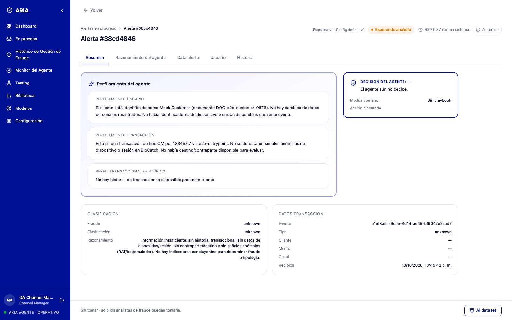

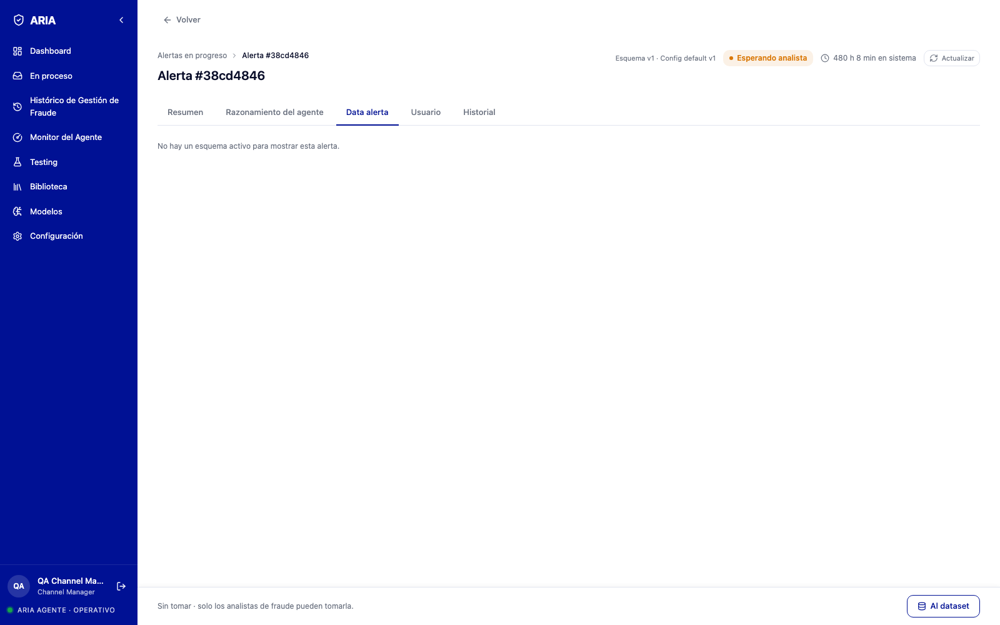

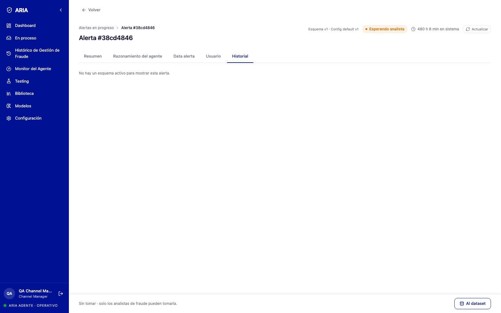

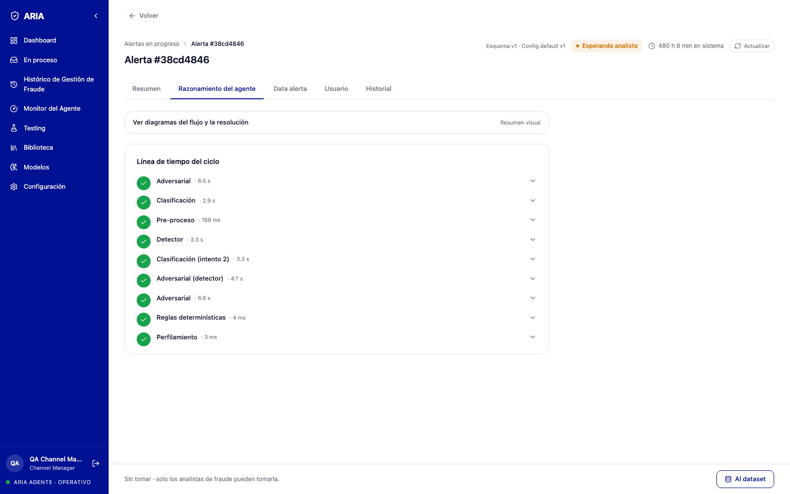

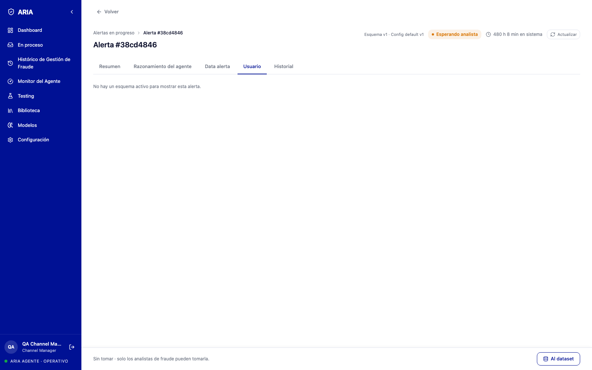

**Acciones del usuario** (10): Actualizar; Agregar; Al dataset; Alertas en progreso; Cancelar; Cerrar; Liberar; Reportar campo; Resolver; Tomar caso

### Componentes propios

| Componente | Archivo | Descripción |
|---|---|---|
| `alert/AlertFlowDiagrams` | `components/alert/AlertFlowDiagrams.tsx` | Diagrama colapsable del detalle de alerta: etapas agrupadas del pipeline con las ya ejecutadas resaltadas y la ruta de resolución elegida. |
| `alert/AlertSchemaView` | `components/alert/AlertSchemaView.tsx` | Vista para inspeccionar datos de una alerta contra una versión de esquema, organizando campos y formateando valores (incluye locales para números/fechas). Permite marcar… |
| `testing/Hint` | `components/testing/Hint.tsx` | Componente de ayuda contextual que muestra un tooltip al interactuar con un elemento disparador. Incluye una variante "InfoHint" que renderiza un icono accesible para de… |
| `ui/tooltip` | `components/ui/tooltip.tsx` | Conjunto de componentes de tooltip basado en Radix (Provider, Root, Trigger y Content) para mostrar información contextual al interactuar con un elemento. Su responsabil… |

### Servicios propios

| Función (frontend) | Método y ruta (backend) | Qué hace | Caso de uso | Request | Response (campos) | Usado en |
|---|---|---|---|---|---|---|
| `alertSchema.getActiveAlertSchema` | GET `/api/v0/alert-schema/active` | Get Active Schema | `GetActiveAlertSchemaUseCase` | — | `AlertSchemaVersionResponse`: `version`, `status`, `fields`, `field_roles`, `proposed_by`, `proposed_at`, `approved_by`, `approved_at` … (+4) | `/alerta/$id` |
| `alertSchema.getAlertRaw` | GET `/api/v0/alerts/{alert_id}/raw` | Get Raw Alert | — | — | — | `/alerta/$id` |
| `alertSchema.getAlertSchemaVersion` | GET `/api/v0/alert-schema/versions/{version}` | Get Schema Version | `GetAlertSchemaVersionUseCase` | — | `AlertSchemaVersionResponse`: `version`, `status`, `fields`, `field_roles`, `proposed_by`, `proposed_at`, `approved_by`, `approved_at` … (+4) | `/alerta/$id` |
| `alerts.curateAlertToDataset` | POST `/api/v0/alerts/{alert_id}/curate-to-dataset` | Curate Alert To Dataset | `CurateAlertToDatasetUseCase` | `CurateAlertToDatasetRequest`: `dataset_name`, `justification`, `configuration_id`, `version` | `CurateAlertToDatasetResponse`: `dataset_name`, `total_rows`, `status`, `feedback_id`, `configuration_id`, `version` | `/alerta/$id` |
| `datasets.getDatasets` | GET `/api/v0/datasets` | List Datasets | `ListDatasetsUseCase` | — | `DatasetResponse[]`: `name`, `row_count` | `/alerta/$id` |
| `operations.getAlertDetail` | GET `/api/v0/analyst-queue/{alert_id}` | Get Alert Detail | `ListInProcessAlertsUseCase` | — | `AlertDetailResponse`: `alert_id`, `event_id`, `event_type`, `status`, `customer_id`, `created_at`, `schema_version`, `configuration_ref` … (+10) | `/alerta/$id` |
| `operations.releaseAlert` | POST `/api/v0/analyst-queue/{alert_id}/release` | Release Alert | `ReleaseEscalatedAlertUseCase` | — | `ResourceReservationResponse`: `id`, `resource`, `alert_id`, `holder`, `holder_name`, `reserved_at`, `expires_at`, `status` … (+3) | `/alerta/$id` |
| `operations.resolveAlert` | POST `/api/v0/analyst-queue/{alert_id}/resolve` | Resolve Alert | `ResolveEscalatedAlertUseCase` | `ResolveEscalatedAlertRequest`: `decision`, `notes` | `ResourceReservationResponse`: `id`, `resource`, `alert_id`, `holder`, `holder_name`, `reserved_at`, `expires_at`, `status` … (+3) | `/alerta/$id` |
| `operations.takeAlert` | POST `/api/v0/analyst-queue/{alert_id}/take` | Take Alert | `TakeEscalatedAlertUseCase` | — | `ResourceReservationResponse`: `id`, `resource`, `alert_id`, `holder`, `holder_name`, `reserved_at`, `expires_at`, `status` … (+3) | `/alerta/$id` |
| `alertSchema.createAlertSchemaSuggestion` | POST `/api/v0/alert-schema/suggestions` | Create Suggestion | `CreateAlertSchemaSuggestionUseCase` | `CreateAlertSchemaSuggestionRequest`: `alert_id`, `field`, `location`, `comment` | `AlertSchemaSuggestionResponse`: `id`, `alert_id`, `field`, `location`, `comment`, `created_by`, `created_at` | `alert/AlertSchemaView` |

---

## 4.5 Histórico de Gestión de Fraude — `/historico-fraude`

- **Archivo**: `routes/historico-fraude.tsx`  
- **Roles**: `manager`, `release_manager`, `channel_manager`, `fraud_reviewer`  
- **Descripción**: Histórico de gestión de fraude: alertas ya marcadas, con su marca y resultado, filtros por rango, búsqueda y paginación. Desde aquí se revisa y corrige la marca real de fraude (Revisar fraude) y se consulta la auditoría de cada revisión.
- **Navega a**: `/alerta/$id`

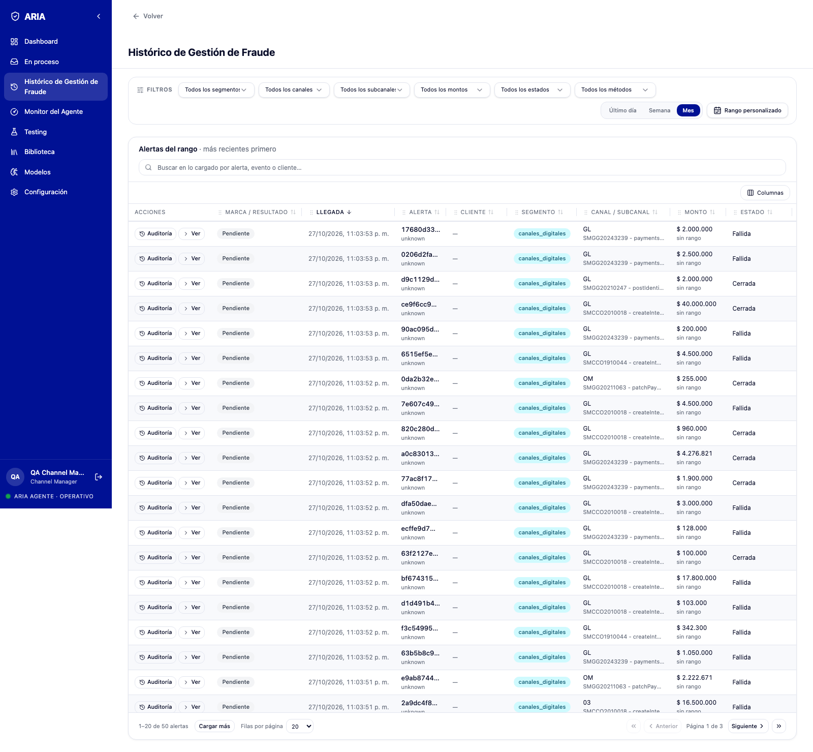

**Acciones del usuario** (14): Aplicar; Auditoría; Cancelar; Cargar más; Columnas; Continuar; Ir al final; Ir al inicio; Limpiar filtros; Página anterior; Página siguiente; Revisar; Revisar fraude; Ver

### Componentes propios

| Componente | Archivo | Descripción |
|---|---|---|
| `ColumnVisibilityMenu` | `components/ColumnVisibilityMenu.tsx` | Menú desplegable "Columnas" para mostrar/ocultar columnas de una tabla mediante checkboxes. Incluye un hook para persistir la preferencia por tabla en localStorage sin r… |
| `MetricsFilterBar` | `components/MetricsFilterBar.tsx` | Barra de filtros reutilizable para vistas de métricas, basada en selects configurables por dimensión y por rango de fechas. Construye opciones desde fuentes consultadas … |
| `PageHeader` | `components/PageHeader.tsx` | Encabezado fijo para páginas de alertas con filtros: muestra el título (y un badge opcional) a la izquierda y agrupa acciones de la página a la derecha. Su responsabilid… |
| `fraude/FraudReview` | `components/fraude/FraudReview.tsx` | Flujo para revisar y corregir la marca real de fraude de una alerta, con resultado real, nota obligatoria y confirmación; queda auditado. |
| `metrics/MetricsShared` | `components/metrics/MetricsShared.tsx` | Conjunto de componentes reutilizables para pantallas de métricas: control de rango (presets y calendario) y badges/avisos informativos. Su responsabilidad es gestionar l… |
| `ui/DataTable` | `components/ui/DataTable.tsx` | Tabla reutilizable: cabeceras ordenables, búsqueda, filtros, paleta de columnas, acciones a la izquierda, paginación con primera/última página y scroll interno. |
| `ui/PaginationFooter` | `components/ui/PaginationFooter.tsx` | Pie de paginación para listas o tablas: muestra un resumen de resultados (rango y total) y controles para navegar entre páginas (inicio, anterior, siguiente, final). Tam… |
| `ui/calendar` | `components/ui/calendar.tsx` | Calendario interactivo basado en DayPicker para seleccionar y navegar fechas. Se encarga del layout, estilos/clases y de los controles de navegación (meses y flechas) us… |
| `ui/dialog` | `components/ui/dialog.tsx` | Componentes reutilizables para construir un modal (diálogo) con overlay, contenido centrado y botón de cierre. Proporciona encabezado, pie, título y descripción con esti… |
| `ui/dropdown-menu` | `components/ui/dropdown-menu.tsx` | Conjunto de componentes para menús desplegables basados en Radix, con ítems, submenús y opciones tipo checkbox/radio. Se encarga de la estructura, accesibilidad y estilo… |
| `ui/popover` | `components/ui/popover.tsx` | Componentes de popover basados en Radix Popover (root, trigger, anchor y content). Su responsabilidad es mostrar contenido flotante alineado respecto a un disparador con… |
| `ui/select` | `components/ui/select.tsx` | Select desplegable basado en Radix Select para que el usuario elija un valor de una lista. Provee trigger, contenido con viewport y scroll buttons, labels e items con in… |

### Servicios propios

| Función (frontend) | Método y ruta (backend) | Qué hace | Caso de uso | Request | Response (campos) | Usado en |
|---|---|---|---|---|---|---|
| `channelLibrary.listChannelLibraryEntries` | GET `/api/v0/library/channels` | List Channel Library Entries | `ListChannelLibraryEntriesUseCase` | query: `active_only` | `ChannelLibraryEntrySchema[]`: `id`, `code`, `name`, `description`, `active`, `created_at`, `updated_at` | `MetricsFilterBar` |
| `configurations.listConfigurations` | GET `/api/v0/configurations` | List Configurations | `ListConfigurationsUseCase` | — | `ConfigurationSummaryResponse[]`: `configuration_id`, `version`, `name`, `description`, `active`, `ever_activated`, `ever_tested`, `created_at` … (+2) | `MetricsFilterBar` |
| `operations.getOperationalSettings` | GET `/api/v0/operational-settings` | Get Operational Settings | `GetOperationalSettingsUseCase` | — | `OperationalSettingsSchema-Output`: `agent_enabled`, `analyst_enabled`, `voicebot_enabled`, `max_instances`, `auto_scale`, `voicebot_max_concurrent_calls`, `analyst_capacity`, `queue_max_lifetime_value` … (+16) | `MetricsFilterBar` |
| `operations.listOperationalSettingsHistory` | GET `/api/v0/operational-settings/history` | List Operational Settings History | `ListOperationalSettingsHistoryUseCase` | query: `limit` | `OperationalSettingsChangeResponse[]`: `id`, `changed_by`, `changed_at`, `changes` | `MetricsFilterBar` |
| `alerts.listFraudLabelReviews` | GET `/api/v0/alerts/{alert_id}/fraud-reviews` | List Fraud Label Reviews | — | — | `FraudLabelReviewSchema[]`: `id`, `alert_id`, `from_label`, `to_label`, `reviewed_by`, `reviewed_at`, `channel`, `note` | `fraude/FraudReview` |
| `alerts.reviewFraudLabel` | POST `/api/v0/alerts/{alert_id}/fraud-review` | Review Fraud Label | — | `FraudReviewRequest`: `fraud_label`, `note` | `FraudReviewResponse`: `review`, `mark`, `fraud_label`, `marked_at`, `fraud_reviewed_at`, `fraud_review_count` | `fraude/FraudReview` |
| `alerts.getFraudReviewImport` | GET `/api/v0/alerts/fraud-review-imports/{task_id}` | Get Fraud Label Review Import | — | — | `FraudLabelReviewImportResponse`: `task_id`, `status`, `total`, `applied`, `failed`, `rows`, `error` | `routes/historico-fraude` |
| `alerts.uploadFraudReviewImport` | POST `/api/v0/alerts/fraud-review-imports` | Upload Fraud Label Review Import | — | — | `UploadFraudLabelReviewImportResponse`: `task_id`, `status` | `routes/historico-fraude` |
| `metrics.getMetricsOverview` | GET `/api/v0/metrics/overview` | Get Metrics Overview | — | query: `from`, `to`, `segment`, `channel`, `subchannel`, `amount_tier`, `status`, `configuration_id`, `resolution_method` | `MetricsOverviewResponse`: `range`, `periods`, `warnings`, `totals`, `funnel_by_status`, `fraud_quality`, `resolution_time`, `distributions` … (+1) | `components/MetricsFilterBar` |

---

## 4.6 Monitor del Agente — `/monitor`

- **Archivo**: `routes/monitor.tsx`  
- **Roles**: `manager`, `release_manager`, `channel_manager`, `data_analyst`, `ops_analyst`  
- **Descripción**: Monitor del agente: indicadores operativos y de calidad de ARIA, analistas, voicebot y Bidi (falsos positivos, fraude no detectado, pasos fallidos). Permite exportar reporte.
- **Pestañas**: Indicadores generales · Indicadores de área · Analistas y otros canales · Explicabilidad · Indicadores técnicos · % Recomendaciones · Optimizador

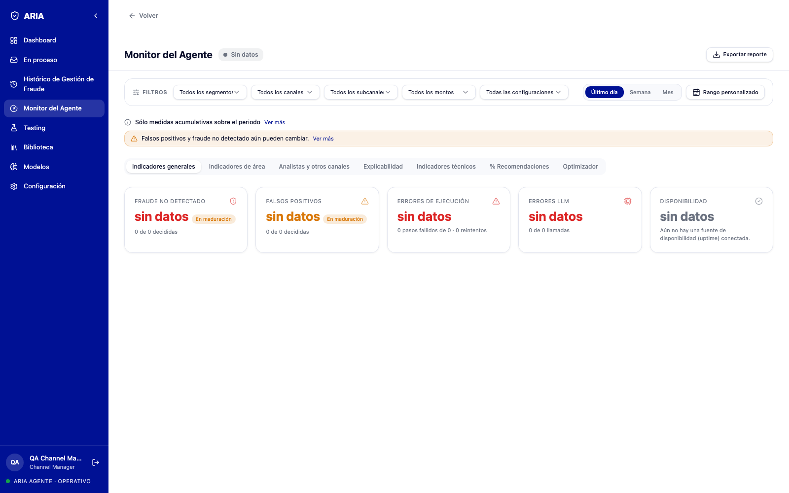

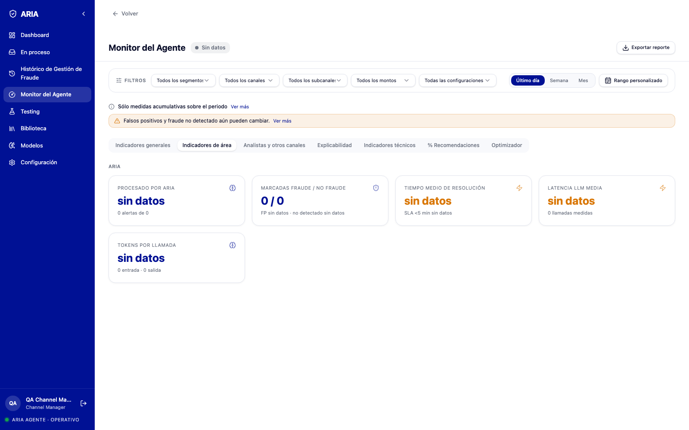

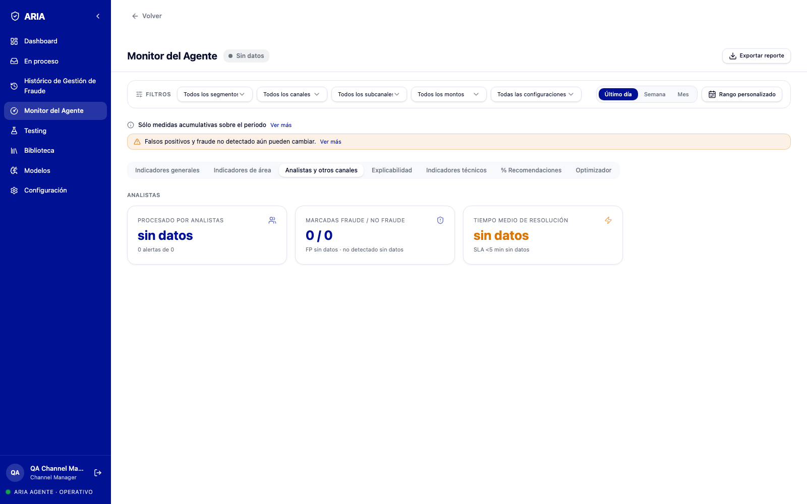

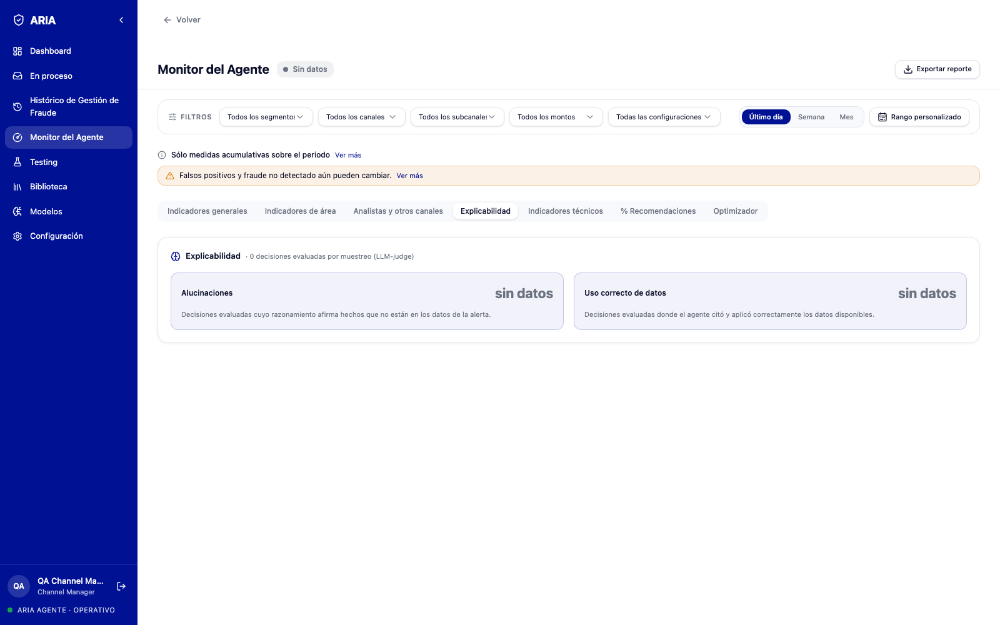

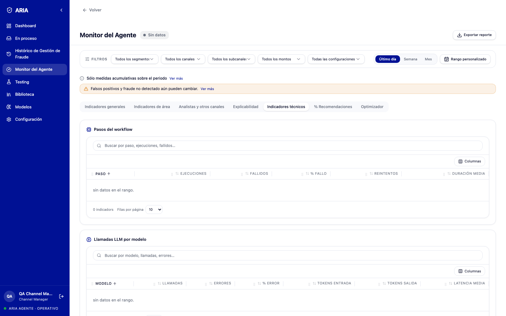

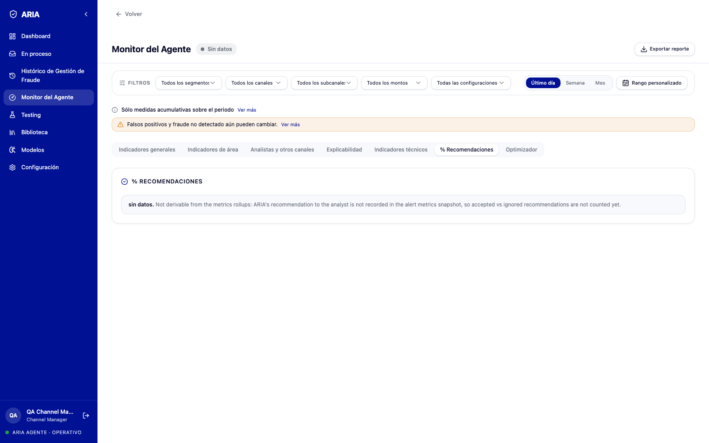

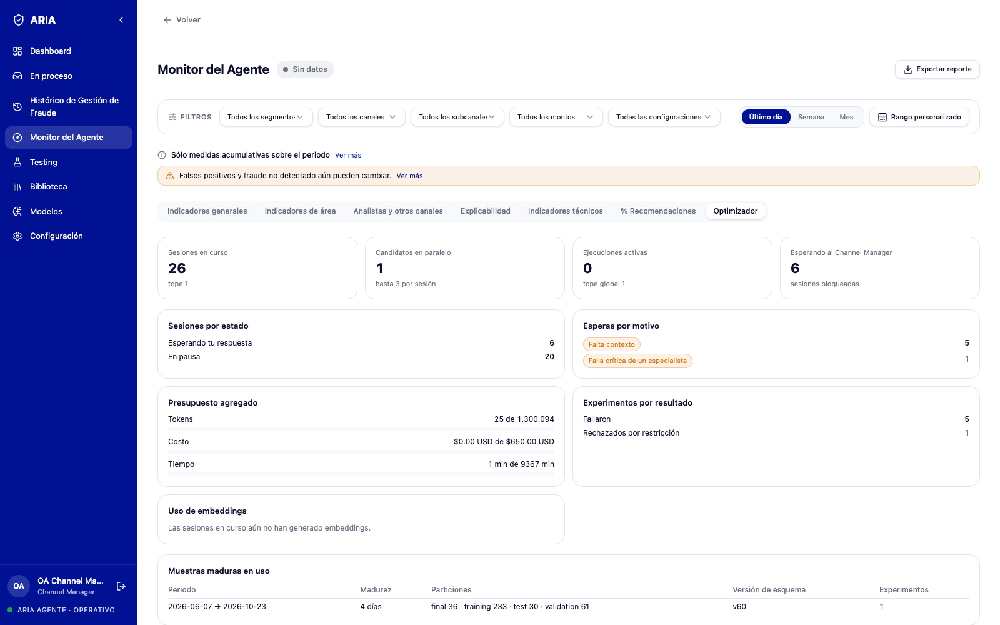

**Acciones del usuario** (9): Aplicar; Cancelar; Columnas; Exportar reporte; Ir al final; Ir al inicio; Limpiar filtros; Página anterior; Página siguiente

### Componentes propios

| Componente | Archivo | Descripción |
|---|---|---|
| `ColumnVisibilityMenu` | `components/ColumnVisibilityMenu.tsx` | Menú desplegable "Columnas" para mostrar/ocultar columnas de una tabla mediante checkboxes. Incluye un hook para persistir la preferencia por tabla en localStorage sin r… |
| `MetricsFilterBar` | `components/MetricsFilterBar.tsx` | Barra de filtros reutilizable para vistas de métricas, basada en selects configurables por dimensión y por rango de fechas. Construye opciones desde fuentes consultadas … |
| `PageHeader` | `components/PageHeader.tsx` | Encabezado fijo para páginas de alertas con filtros: muestra el título (y un badge opcional) a la izquierda y agrupa acciones de la página a la derecha. Su responsabilid… |
| `metrics/MetricsShared` | `components/metrics/MetricsShared.tsx` | Conjunto de componentes reutilizables para pantallas de métricas: control de rango (presets y calendario) y badges/avisos informativos. Su responsabilidad es gestionar l… |
| `optimizer/OptimizerMonitorPanel` | `components/optimizer/OptimizerMonitorPanel.tsx` | Panel de monitoreo del optimizador que consulta periódicamente su estado y lo resume en tarjetas y secciones. Muestra carga (sesiones, candidatos, ejecuciones, bloqueos)… |
| `ui/DataTable` | `components/ui/DataTable.tsx` | Tabla reutilizable: cabeceras ordenables, búsqueda, filtros, paleta de columnas, acciones a la izquierda, paginación con primera/última página y scroll interno. |
| `ui/PaginationFooter` | `components/ui/PaginationFooter.tsx` | Pie de paginación para listas o tablas: muestra un resumen de resultados (rango y total) y controles para navegar entre páginas (inicio, anterior, siguiente, final). Tam… |
| `ui/calendar` | `components/ui/calendar.tsx` | Calendario interactivo basado en DayPicker para seleccionar y navegar fechas. Se encarga del layout, estilos/clases y de los controles de navegación (meses y flechas) us… |
| `ui/dropdown-menu` | `components/ui/dropdown-menu.tsx` | Conjunto de componentes para menús desplegables basados en Radix, con ítems, submenús y opciones tipo checkbox/radio. Se encarga de la estructura, accesibilidad y estilo… |
| `ui/popover` | `components/ui/popover.tsx` | Componentes de popover basados en Radix Popover (root, trigger, anchor y content). Su responsabilidad es mostrar contenido flotante alineado respecto a un disparador con… |
| `ui/select` | `components/ui/select.tsx` | Select desplegable basado en Radix Select para que el usuario elija un valor de una lista. Provee trigger, contenido con viewport y scroll buttons, labels e items con in… |
| `ui/tabs` | `components/ui/tabs.tsx` | Componentes de pestañas basados en Radix (TabsList, TabsTrigger y TabsContent) para organizar contenido en secciones conmutables. Su responsabilidad es renderizar la est… |

### Servicios propios

| Función (frontend) | Método y ruta (backend) | Qué hace | Caso de uso | Request | Response (campos) | Usado en |
|---|---|---|---|---|---|---|
| `channelLibrary.listChannelLibraryEntries` | GET `/api/v0/library/channels` | List Channel Library Entries | `ListChannelLibraryEntriesUseCase` | query: `active_only` | `ChannelLibraryEntrySchema[]`: `id`, `code`, `name`, `description`, `active`, `created_at`, `updated_at` | `MetricsFilterBar` |
| `configurations.listConfigurations` | GET `/api/v0/configurations` | List Configurations | `ListConfigurationsUseCase` | — | `ConfigurationSummaryResponse[]`: `configuration_id`, `version`, `name`, `description`, `active`, `ever_activated`, `ever_tested`, `created_at` … (+2) | `MetricsFilterBar` |
| `operations.getOperationalSettings` | GET `/api/v0/operational-settings` | Get Operational Settings | `GetOperationalSettingsUseCase` | — | `OperationalSettingsSchema-Output`: `agent_enabled`, `analyst_enabled`, `voicebot_enabled`, `max_instances`, `auto_scale`, `voicebot_max_concurrent_calls`, `analyst_capacity`, `queue_max_lifetime_value` … (+16) | `MetricsFilterBar` |
| `operations.listOperationalSettingsHistory` | GET `/api/v0/operational-settings/history` | List Operational Settings History | `ListOperationalSettingsHistoryUseCase` | query: `limit` | `OperationalSettingsChangeResponse[]`: `id`, `changed_by`, `changed_at`, `changes` | `MetricsFilterBar` |
| `agent.getOptimizerStatus` | GET `/api/v0/agent/optimizer-status` | Get Optimizer Status | — | — | `OptimizerStatusResponse`: `sessions`, `blocked_by_reason`, `reason_titles`, `running_candidates`, `active_runs`, `max_concurrent_runs`, `max_parallel_experiments`, `max_concurrent_sessions` … (+5) | `optimizer/OptimizerMonitorPanel` |
| `metrics.getAgentMetrics` | GET `/api/v0/metrics/agent` | Get Agent Metrics | — | query: `from`, `to`, `segment`, `channel`, `subchannel`, `amount_tier`, `status`, `configuration_id`, `resolution_method` | `AgentMetricsResponse`: `range`, `periods`, `warnings`, `totals`, `by_resolution_method`, `fraud_quality`, `resolution_time`, `hourly_profile` … (+1) | `routes/monitor` |
| `metrics.getTechnicalMetrics` | GET `/api/v0/metrics/technical` | Get Technical Metrics | — | query: `step_name`, `model`, `from`, `to`, `segment`, `channel`, `subchannel`, `amount_tier`, `status`, `configuration_id`, `re | `TechnicalMetricsResponse`: `range`, `periods`, `warnings`, `workflow_steps`, `workflow_steps_by_step`, `llm_calls`, `llm_calls_by_model`, `research_calls` … (+3) | `routes/monitor` |
| `metrics.getMetricsOverview` | GET `/api/v0/metrics/overview` | Get Metrics Overview | — | query: `from`, `to`, `segment`, `channel`, `subchannel`, `amount_tier`, `status`, `configuration_id`, `resolution_method` | `MetricsOverviewResponse`: `range`, `periods`, `warnings`, `totals`, `funnel_by_status`, `fraud_quality`, `resolution_time`, `distributions` … (+1) | `components/MetricsFilterBar` |

---

## 4.7 Configuración — `/configuracion`

- **Archivo**: `routes/configuracion.tsx`  
- **Roles**: `manager`, `release_manager`, `channel_manager`  
- **Descripción**: Configuración versionada del agente por segmento (agente, evaluación, rúbricas), esquema de alerta, operación, infraestructura y ajustes del asistente/optimizador. Los cambios se guardan como versión nueva y se despliegan con solicitud y aprobación.
- **Pestañas por rol**: channel_manager ve *Segmento · Agente · Evaluación · Optimizador*; manager/release_manager ven *General · Infraestructura · Operación (inmediata) · Asistente y optimizador · Test · Segmento · Esquema* (+ Agente/Evaluación en release).
- **Navega a**: `/testing`, `/testing/$runId`

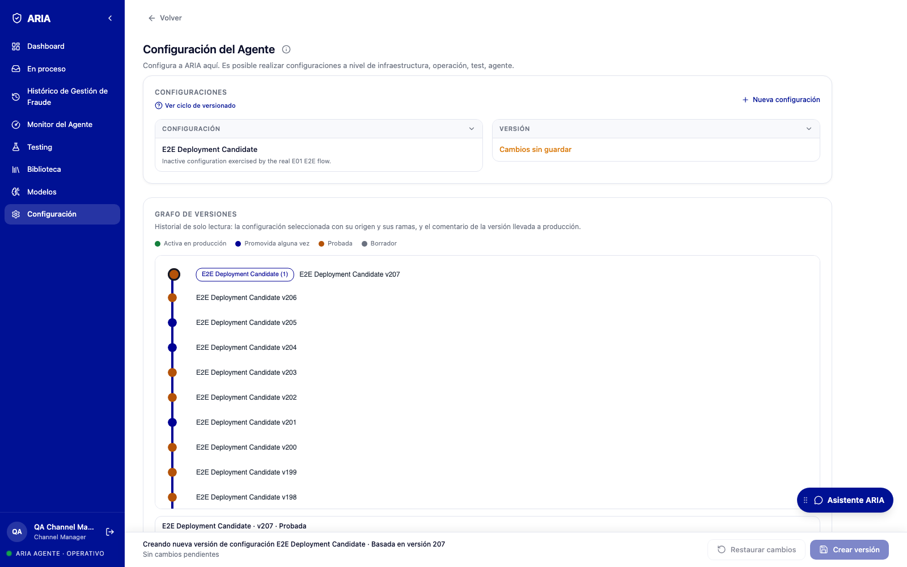

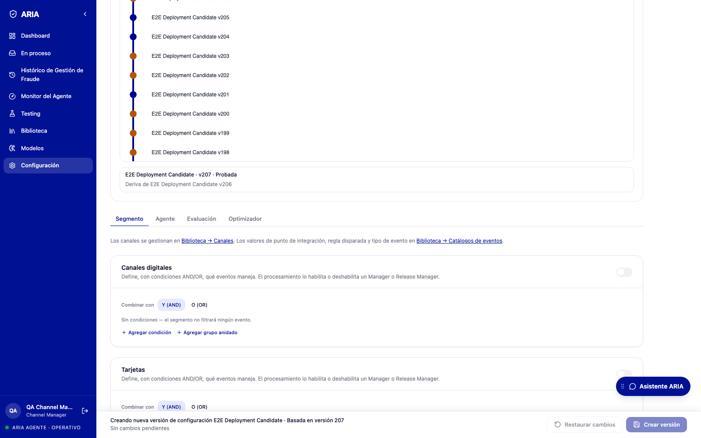

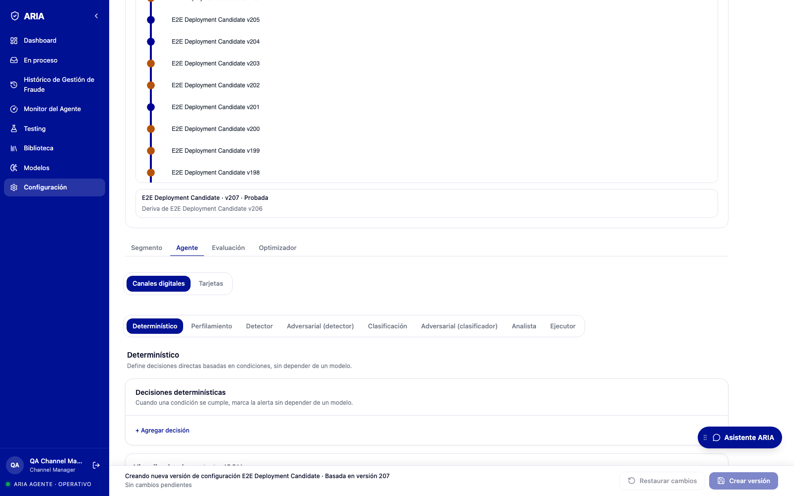

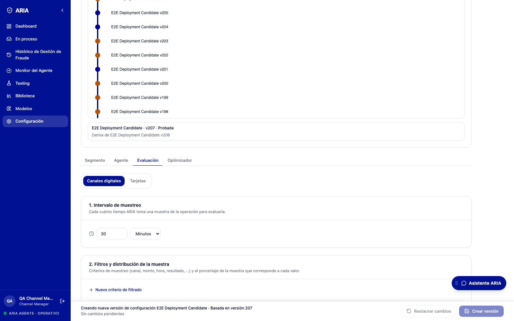

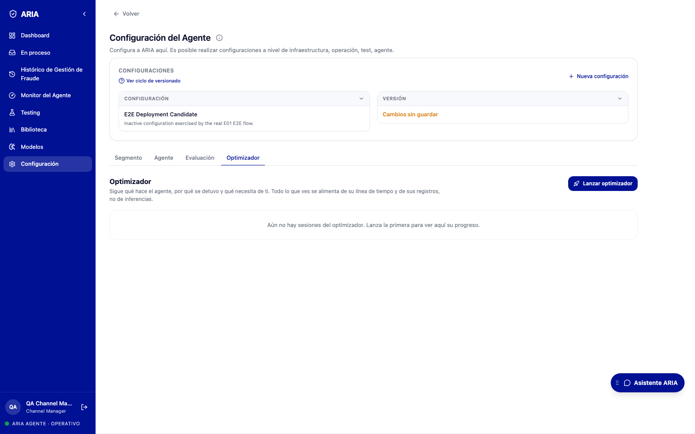

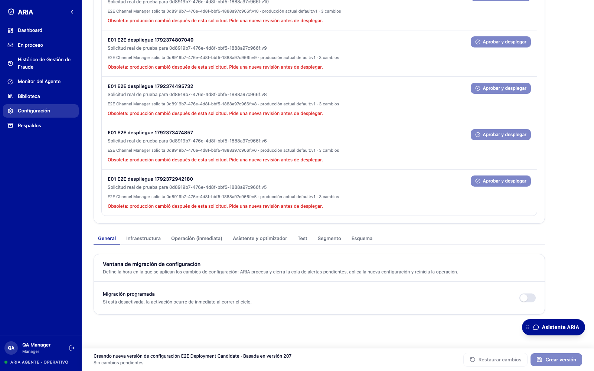

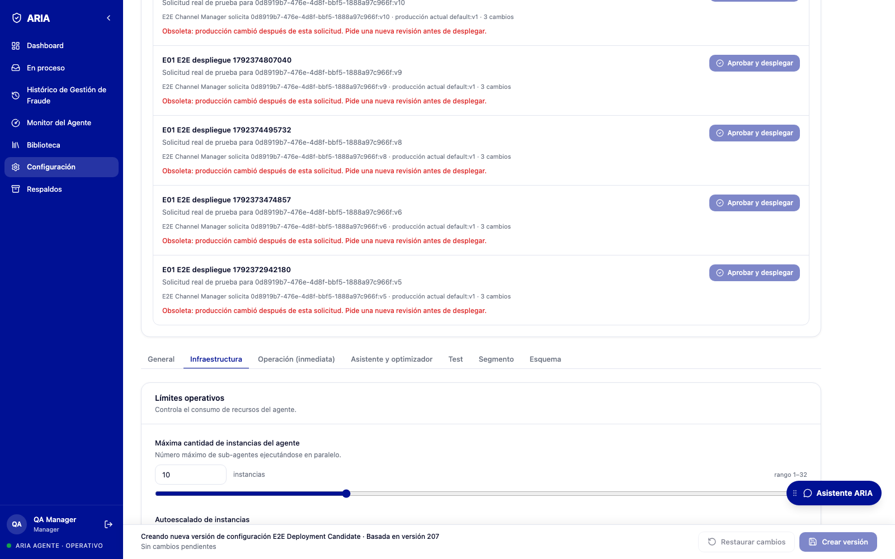

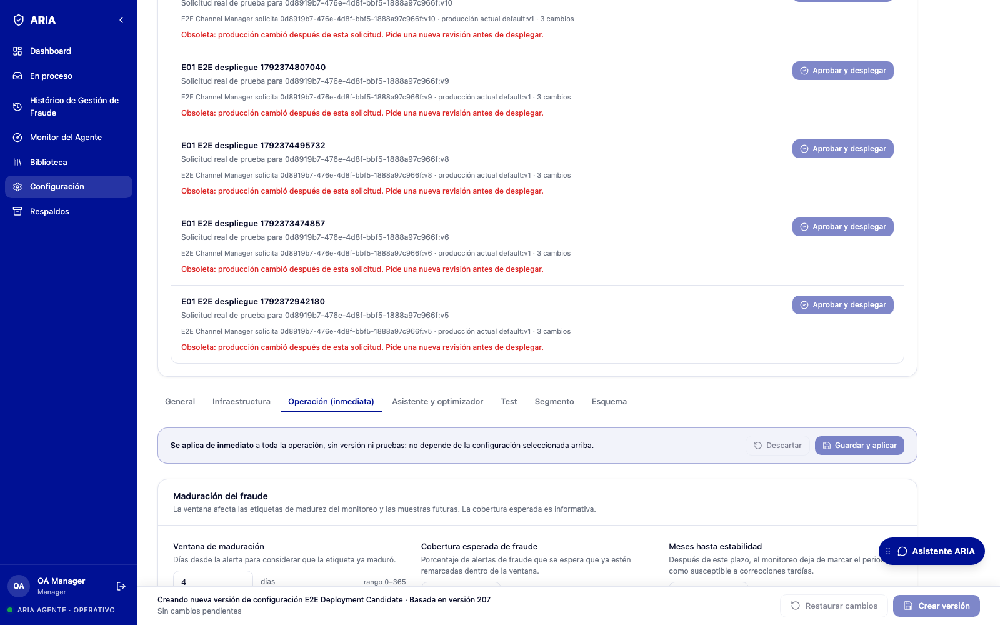

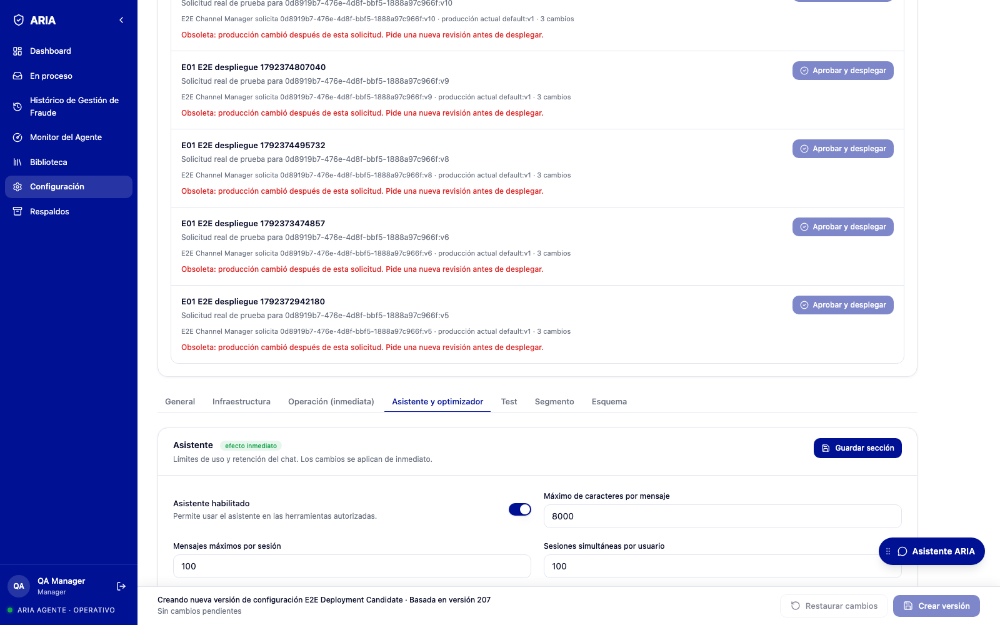

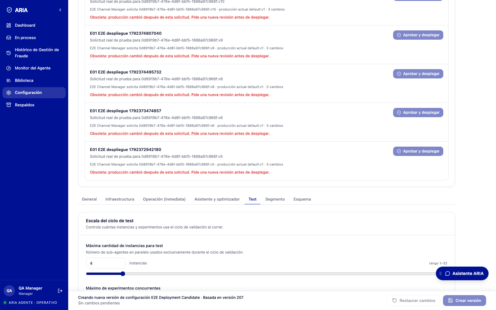

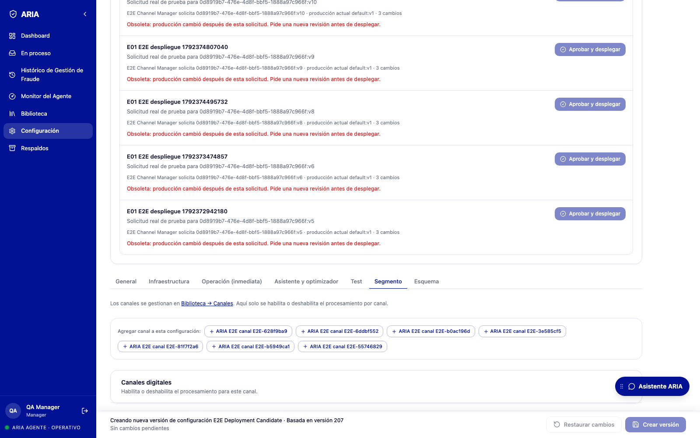

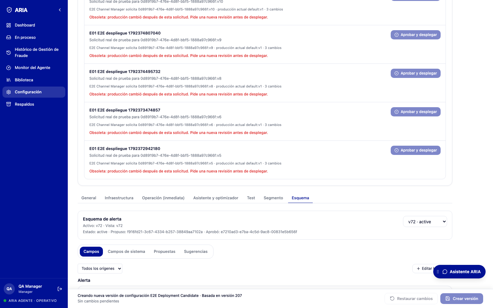

**Acciones del usuario** (96): Actualizar campos del dataset; Agregar; Agregar condición; Agregar grupo anidado; Agregar prompt; Agregar rango; Agregar valor; Aplicar JSON; Aprobar; Aprobar propuesta; Aprobar y desplegar; Aprobar · manager; Avanzar a; Añadir al borrador; Añadir mapeo; Biblioteca → Canales; Biblioteca → Catálogos de eventos; Campo; Cancelar; Cancelar despliegue; Cancelar optimizador; Característica del historial; Cargar muestra del dataset; Colapsar todo; Columnas; Comparar y combinar; Configuración; Conservar mi valor; Copiar JSON; Crear borrador; Crear en SHADOW; Crear muestra madura; Crear nueva versión basada en; Descargar plantilla; Descartar; Descartar y continuar; Desplegar; Duplicar paso; Duplicar receta; Editar borrador …

### Componentes propios

| Componente | Archivo | Descripción |
|---|---|---|
| `ColumnVisibilityMenu` | `components/ColumnVisibilityMenu.tsx` | Menú desplegable "Columnas" para mostrar/ocultar columnas de una tabla mediante checkboxes. Incluye un hook para persistir la preferencia por tabla en localStorage sin r… |
| `agent/AgentReleasePanel` | `components/agent/AgentReleasePanel.tsx` | Panel para gestionar la liberación de experimentos: permite ingresar IDs de sesión y experimento, ejecutar una validación retrospectiva y mostrar avisos/estado. También … |
| `aria/CapabilityInfo` | `components/aria/CapabilityInfo.tsx` | Botón de información (ícono i) que abre diagramas explicativos junto al título: ciclo del evento al aprendizaje en el Dashboard (con conteos vivos por etapa), embudo de … |
| `configuracion/AgentSettingsPanel` | `components/configuracion/AgentSettingsPanel.tsx` | Ajustes del asistente y el optimizador: habilitar el asistente, límites de mensajes y sesiones, retención, y la muestra madura para experimentos. |
| `configuracion/AmountTierEditor` | `components/configuracion/AmountTierEditor.tsx` | Editor tabular de rangos de monto con validación en vivo, permitiendo definir código, etiqueta y límites desde/hasta. Su responsabilidad es facilitar la edición de tiers… |
| `configuracion/AnalystCapacityEditor` | `components/configuracion/AnalystCapacityEditor.tsx` | Disponibilidad de analistas: perfiles por defecto y por día del mes, con importación desde la plantilla Excel. |
| `configuracion/ConfigurationVersionGraph` | `components/configuracion/ConfigurationVersionGraph.tsx` | Renderiza un grafo tipo Git con el historial de versiones de configuraciones y su linaje (incluyendo referencias a padres) para visualizar estados y conexiones. Permite … |
| `configuracion/ConfigurationVersionGuide` | `components/configuracion/ConfigurationVersionGuide.tsx` | Muestra, en un tooltip, una guía visual del ciclo de versionado (configuración → borrador → guardar → probar → desplegar). Su responsabilidad es explicar de forma compac… |
| `configuracion/FilterGroupBuilder` | `components/configuracion/FilterGroupBuilder.tsx` | Editor recursivo para construir árboles de filtros con operadores lógicos AND/OR, condiciones y grupos anidados. Permite agregar, actualizar y eliminar condiciones y sub… |
| `configuracion/MarcacionCatalogManager` | `components/configuracion/MarcacionCatalogManager.tsx` | Panel en SideDrawer para gestionar (crear, editar, activar/desactivar y eliminar) categorías del catálogo de marcación, incluyendo una etiqueta de riesgo por entrada. Pr… |
| `configuracion/OperationsPanel` | `components/configuracion/OperationsPanel.tsx` | Operación en vivo: cupos y capacidad de analistas, voicebot y métodos de resolución, con historial de cambios; se aplica con «Guardar y aplicar». |
| `configuracion/ResolutionMethodCatalogManager` | `components/configuracion/ResolutionMethodCatalogManager.tsx` | Panel en SideDrawer para administrar un catálogo de métodos de resolución con su mapeo a un tag de resolución, con alta, actualización, activación/desactivación y borrad… |
| `configuracion/SegmentAdversarialSection` | `components/configuracion/SegmentAdversarialSection.tsx` | Sección de configuración del componente “adversarial” de un segmento: selección de herramientas y edición del prompt con inserción de variables disponibles. También perm… |
| `configuracion/SegmentAgentSection` | `components/configuracion/SegmentAgentSection.tsx` | Router de subtabs para editar la configuración del agente de un segmento (determinístico, perfilamiento, detector, adversarial, clasificación, analista, ejecutor) mostra… |
| `configuracion/SegmentAgentTab` | `components/configuracion/SegmentAgentTab.tsx` | Pestaña “Agente” que ofrece un selector de segmento basado en los códigos disponibles y renderiza la edición del agente para el segmento elegido. Su responsabilidad es c… |
| `configuracion/SegmentAnalystSection` | `components/configuracion/SegmentAnalystSection.tsx` | Sección para editar el “Prompt del analista” que guía la resolución de una alerta. Permite insertar variables disponibles en el prompt y abrir gestores de catálogos de m… |
| `configuracion/SegmentClassificationSection` | `components/configuracion/SegmentClassificationSection.tsx` | Sección para configurar el agente de clasificación: herramientas disponibles y su prompt. Incluye editor de prompt con resaltado de variables, selector para insertarlas … |
| `configuracion/SegmentDetectorSection` | `components/configuracion/SegmentDetectorSection.tsx` | Sección para configurar el detector de alertas: herramientas del agente (con indicación de puntuación XGBoost) y su prompt. Permite definir etiquetas de salida y gestion… |
| `configuracion/SegmentDeterministicSection` | `components/configuracion/SegmentDeterministicSection.tsx` | Sección para crear y editar reglas de decisiones determinísticas basadas en condiciones. Permite seleccionar la decisión y una acción ARIC asociada, además de agregar nu… |
| `configuracion/SegmentDocumentationSection` | `components/configuracion/SegmentDocumentationSection.tsx` | Sección para elegir y configurar una estrategia de documentación entre “Plantilla” y “Agente”. Ofrece editores de texto/prompt con inserción de variables, habilitando so… |
| `configuracion/SegmentEvaluationSection` | `components/configuracion/SegmentEvaluationSection.tsx` | Sección de “Evaluación” por segmento que agrupa intervalo de muestreo, filtros/distribución y límites de muestras. También incluye campos de prompts e insumos para que e… |
| `configuracion/SegmentEvaluationTab` | `components/configuracion/SegmentEvaluationTab.tsx` | Pestaña de “Evaluación” que permite elegir un segmento mediante un selector y mostrar su configuración. Encapsula la edición de la sección de evaluación y pasa variables… |
| `configuracion/SegmentExecutorSection` | `components/configuracion/SegmentExecutorSection.tsx` | Sección para configurar el “Ejecutor” con múltiples bloques, incluyendo un prompt para marcación ARIC con inserción de variables. Además integra la sección de documentac… |
| `configuracion/SegmentProfilingSection` | `components/configuracion/SegmentProfilingSection.tsx` | Sección para configurar el “profiling” de un segmento: define enriquecimiento de campos y tres estrategias en orden, usando un pool de variables disponible. También inte… |
| `configuracion/SegmentRubricsSection` | `components/configuracion/SegmentRubricsSection.tsx` | Componentes y utilidades para crear y editar rúbricas basadas en condiciones (variable, comparación, valores y puntaje). Incluye cálculo/validación del total de puntos y… |
| `configuracion/SegmentStageJsonInspector` | `components/configuracion/SegmentStageJsonInspector.tsx` | Inspector desplegable que muestra un “contrato JSON” con entradas y salidas esperadas para una etapa (parser, profiling, detector, etc.). Formatea y presenta el JSON en … |
| `configuracion/SegmentoTab` | `components/configuracion/SegmentoTab.tsx` | Pestaña para listar y editar la configuración de segmentos/canales, incluyendo agregar/quitar canales y reordenarlos por drag-and-drop. Expone controles y enlaces relaci… |
| `configuracion/TagMultiSelect` | `components/configuracion/TagMultiSelect.tsx` | Selector múltiple de tags por categoría con búsqueda, que carga opciones desde un catálogo remoto y permite agregar/quitar valores seleccionados. Muestra los tags como c… |
| `configuracion/VariableCatalogManager` | `components/configuracion/VariableCatalogManager.tsx` | Panel lateral para administrar el catálogo de variables de origen: listar, crear, editar descripción, activar/desactivar y eliminar entradas. Mantiene el estado de carga… |
| `configuracion/schema/AlertSchemaEditor` | `components/configuracion/schema/AlertSchemaEditor.tsx` | Editor del esquema de alerta: campos de sistema y del cliente, propuestas y sugerencias que se aprueban o rechazan, con borrador y versión activa. |
| `configuracion/shared/AgentToolsSection` | `components/configuracion/shared/AgentToolsSection.tsx` | Sección de configuración de “Herramientas del agente” que agrupa toggles y campos asociados (p. ej., modelo XGBoost e investigación delegada). Consulta modelos disponibl… |
| `configuracion/shared/FormControls` | `components/configuracion/shared/FormControls.tsx` | Conjunto de controles reutilizables para formularios (Field, SwitchField, LimitField, TagInput y otros) usados en varias secciones de configuración. Encapsula patrones c… |
| `configuracion/shared/PromptEditor` | `components/configuracion/shared/PromptEditor.tsx` | Editor de texto para prompts que resalta visualmente los tokens con formato {variable}. Sincroniza el scroll entre un textarea transparente y una capa de preformateado, … |
| `configuracion/shared/ResolutionMethodPicker` | `components/configuracion/shared/ResolutionMethodPicker.tsx` | Selector desplegable para elegir un método del catálogo de “resolution methods”, mostrando su etiqueta asociada. Permite filtrar por tags permitidos y, opcionalmente, ab… |
| `modelos/FeatureRecipeWorkspace` | `components/modelos/FeatureRecipeWorkspace.tsx` | Espacio de trabajo para construir, previsualizar y gestionar “recetas” de features mediante pasos/operaciones configurables. Centraliza la edición de recetas y el acceso… |
| `optimizer/BlockApprovalDrawer` | `components/optimizer/BlockApprovalDrawer.tsx` | Drawer donde el Channel Manager aprueba lo que el optimizador necesita para continuar: más presupuesto, más iteraciones o contexto nuevo. |
| `optimizer/ExperimentsPanel` | `components/optimizer/ExperimentsPanel.tsx` | Panel que lista los experimentos de una sesión del optimizador y su estado. Compara baseline vs candidato mostrando qué componentes cambiaron, métricas (p. ej., precisió… |
| `optimizer/LearningsPanel` | `components/optimizer/LearningsPanel.tsx` | Vista para consultar aprendizajes guardados de sesiones anteriores filtrados por área, con resumen de evidencia y fechas relevantes. También muestra una tabla con hallaz… |
| `optimizer/OptimizerCenter` | `components/optimizer/OptimizerCenter.tsx` | Centro del optimizador (Configuración → pestaña «Optimizador» del Channel Manager): veredicto de cada sesión (corriendo, bloqueada, falló, inconclusa), ciclo del agente,… |
| `optimizer/OptimizerCycleDiagram` | `components/optimizer/OptimizerCycleDiagram.tsx` | Diagrama del ciclo del optimizador que muestra las etapas del proceso y resalta la etapa correspondiente al último evento recibido. Incluye contadores agregados de hipót… |
| `optimizer/OptimizerLaunchDrawer` | `components/optimizer/OptimizerLaunchDrawer.tsx` | Drawer de lanzamiento en dos pasos para iniciar una sesión del optimizador: seleccionar áreas de investigación, agregar notas iniciales y luego revisar objetivo/presupue… |
| `optimizer/RunTree` | `components/optimizer/RunTree.tsx` | Vista «Corrida» del optimizador: la corrida completa en una estructura con estrategia, configuración base, ganadores y configuración ganadora, y cada candidato con su hi… |
| `optimizer/SessionConversation` | `components/optimizer/SessionConversation.tsx` | Sección de conversación asociada a una sesión que lista los mensajes recientes y permite enviar nuevo contexto mediante un formulario. Refresca periódicamente el histori… |
| `optimizer/SessionTimeline` | `components/optimizer/SessionTimeline.tsx` | Línea de tiempo de una sesión del optimizador, más reciente primero y agrupada por iteración; distingue fallos, esperas y cambios en producción registrados también en el… |
| `optimizer/SessionVerdictCard` | `components/optimizer/SessionVerdictCard.tsx` | Tarjeta de estado de una sesión del optimizador: dice si trabaja, falló o espera una aprobación, por qué y qué hacer; pausar, reanudar, cancelar y aprobar más presupuest… |
| `ui/DataTable` | `components/ui/DataTable.tsx` | Tabla reutilizable: cabeceras ordenables, búsqueda, filtros, paleta de columnas, acciones a la izquierda, paginación con primera/última página y scroll interno. |
| `ui/PaginationFooter` | `components/ui/PaginationFooter.tsx` | Pie de paginación para listas o tablas: muestra un resumen de resultados (rango y total) y controles para navegar entre páginas (inicio, anterior, siguiente, final). Tam… |
| `ui/badge` | `components/ui/badge.tsx` | Insignia/etiqueta pequeña con variantes de estilo (default, secondary, destructive, outline) para resaltar estados o categorías. Su responsabilidad es aplicar clases y e… |
| `ui/collapsible` | `components/ui/collapsible.tsx` | Componentes wrapper de Radix para secciones expandibles/colapsables. Expone Root, Trigger y Content para controlar la visibilidad de contenido asociado. |
| `ui/command` | `components/ui/command.tsx` | Interfaz de comandos/búsqueda (cmdk) para filtrar y seleccionar opciones en una lista. Incluye variante en diálogo (CommandDialog), entrada con icono de búsqueda, grupos… |
| `ui/confirm-delete-dialog` | `components/ui/confirm-delete-dialog.tsx` | Diálogo de confirmación para eliminar un elemento, mostrando el nombre y una descripción de consecuencias. Gestiona estados de carga (pending) y la visualización de un e… |
| `ui/dialog` | `components/ui/dialog.tsx` | Componentes reutilizables para construir un modal (diálogo) con overlay, contenido centrado y botón de cierre. Proporciona encabezado, pie, título y descripción con esti… |
| `ui/dropdown-menu` | `components/ui/dropdown-menu.tsx` | Conjunto de componentes para menús desplegables basados en Radix, con ítems, submenús y opciones tipo checkbox/radio. Se encarga de la estructura, accesibilidad y estilo… |
| `ui/input` | `components/ui/input.tsx` | Campo de entrada HTML reutilizable con estilos consistentes y soporte de ref. Su responsabilidad es renderizar un <input> con clases predefinidas y permitir personalizac… |
| `ui/popover` | `components/ui/popover.tsx` | Componentes de popover basados en Radix Popover (root, trigger, anchor y content). Su responsabilidad es mostrar contenido flotante alineado respecto a un disparador con… |
| `ui/section-tabs` | `components/ui/section-tabs.tsx` | Navegación por secciones mediante botones tipo pestaña, usada como navegación compartida en configuración y un asistente (wizard). Permite cambiar el valor activo, mostr… |
| `ui/switch` | `components/ui/switch.tsx` | Interruptor (toggle) basado en Radix para activar o desactivar una opción. Su responsabilidad es renderizar el root y el thumb con estilos y estados accesibles, propagan… |
| `ui/toggle` | `components/ui/toggle.tsx` | Componente Toggle basado en Radix que permite alternar un estado on/off con estilos configurables por variante (default/outline) y tamaño. Su responsabilidad es renderiz… |
| `ui/toggle-group` | `components/ui/toggle-group.tsx` | Grupo de toggles basado en Radix Toggle Group que organiza varios items y comparte configuración de variante y tamaño mediante contexto. Su responsabilidad es envolver e… |
| `ui/tooltip` | `components/ui/tooltip.tsx` | Conjunto de componentes de tooltip basado en Radix (Provider, Root, Trigger y Content) para mostrar información contextual al interactuar con un elemento. Su responsabil… |

### Servicios propios

| Función (frontend) | Método y ruta (backend) | Qué hace | Caso de uso | Request | Response (campos) | Usado en |
|---|---|---|---|---|---|---|
| `channelLibrary.listChannelLibraryEntries` | GET `/api/v0/library/channels` | List Channel Library Entries | `ListChannelLibraryEntriesUseCase` | query: `active_only` | `ChannelLibraryEntrySchema[]`: `id`, `code`, `name`, `description`, `active`, `created_at`, `updated_at` | `/configuracion` |
| `configurations.activateConfiguration` | POST `/api/v0/configurations/{configuration_id}/versions/{version}/activate` | Activate Configuration | `ActivateConfigurationUseCase`, `GetActiveConfigurationUseCase` | — | `ConfigurationDetailResponse`: `configuration_id`, `version`, `name`, `description`, `active`, `ever_activated`, `ever_tested`, `created_at` … (+8) | `/configuracion` |
| `configurations.approveConfigurationDeployRequest` | POST `/api/v0/configuration-deploy-requests/{request_id}/approve` | Approve Deploy Request | `ActivateConfigurationUseCase` | — | `ConfigurationDeployRequestResponse`: `id`, `target_configuration_id`, `target_version`, `current_configuration_id`, `current_version`, `title`, `message`, `changes` … (+5) | `/configuracion` |
| `configurations.createConfiguration` | POST `/api/v0/configurations` | Create Configuration | `CreateConfigurationUseCase` | `CreateConfigurationRequest`: `name`, `configuration_id`, `based_on_version`, `parent_ref`, `description`, `general`, `infra`, `test` … (+2) | `ConfigurationDetailResponse`: `configuration_id`, `version`, `name`, `description`, `active`, `ever_activated`, `ever_tested`, `created_at` … (+8) | `/configuracion` |
| `configurations.createConfigurationDeployRequest` | POST `/api/v0/configuration-deploy-requests` | Create Deploy Request | — | `CreateConfigurationDeployRequest`: `target_configuration_id`, `target_version`, `title`, `message` | `ConfigurationDeployRequestResponse`: `id`, `target_configuration_id`, `target_version`, `current_configuration_id`, `current_version`, `title`, `message`, `changes` … (+5) | `/configuracion` |
| `configurations.getActiveConfiguration` | GET `/api/v0/configurations/active` | Get Active Configuration | `GetActiveConfigurationUseCase` | — | `ConfigurationDetailResponse`: `configuration_id`, `version`, `name`, `description`, `active`, `ever_activated`, `ever_tested`, `created_at` … (+8) | `/configuracion` |
| `configurations.getConfigurationGraph` | GET `/api/v0/configurations/graph` | Get Configuration Graph | `GetConfigurationGraphUseCase` | — | `ConfigurationGraphNodeResponse[]`: `configuration_id`, `version`, `name`, `description`, `active`, `ever_activated`, `ever_tested`, `created_at` … (+3) | `/configuracion` |
| `configurations.getConfigurationVersion` | GET `/api/v0/configurations/{configuration_id}/versions/{version}` | Get Configuration | `GetConfigurationUseCase` | — | `ConfigurationDetailResponse`: `configuration_id`, `version`, `name`, `description`, `active`, `ever_activated`, `ever_tested`, `created_at` … (+8) | `/configuracion` |
| `configurations.listConfigurationDeployRequests` | GET `/api/v0/configuration-deploy-requests` | List Deploy Requests | — | — | `ConfigurationDeployRequestResponse[]`: `id`, `target_configuration_id`, `target_version`, `current_configuration_id`, `current_version`, `title`, `message`, `changes` … (+5) | `/configuracion` |
| `configurations.listConfigurationVersions` | GET `/api/v0/configurations/{configuration_id}` | List Configuration Versions | `GetActiveConfigurationUseCase` | — | `ConfigurationSummaryResponse[]`: `configuration_id`, `version`, `name`, `description`, `active`, `ever_activated`, `ever_tested`, `created_at` … (+2) | `/configuracion` |
| `configurations.listConfigurations` | GET `/api/v0/configurations` | List Configurations | `ListConfigurationsUseCase` | — | `ConfigurationSummaryResponse[]`: `configuration_id`, `version`, `name`, `description`, `active`, `ever_activated`, `ever_tested`, `created_at` … (+2) | `/configuracion` |
| `configurations.previewConfigurationDeployRequest` | GET `/api/v0/configuration-deploy-requests/preview` | Preview Deploy Request | — | query: `target_configuration_id`, `target_version` | `ConfigurationDeployRequestPreviewResponse`: `target_configuration_id`, `target_version`, `current_configuration_id`, `current_version`, `changes` | `/configuracion` |
| `configurations.testConfiguration` | POST `/api/v0/configuration/test` | Test Configuration | `PreviewConfigurationUseCase` | `CreateConfigurationRequest`: `name`, `configuration_id`, `based_on_version`, `parent_ref`, `description`, `general`, `infra`, `test` … (+2) | `TestConfigurationResponse`: `valid`, `changes`, `warnings` | `/configuracion` |
| `testing.listTestRuns` | GET `/api/v0/test-runs` | List Test Runs | `ListTestRunsUseCase` | query: `order` | `TestRunResponse[]`: `id`, `name`, `dataset_name`, `status`, `total`, `created_at`, `updated_at`, `finished_at` … (+1) | `/configuracion` |
| `assistantOptimizerSettings.getMatureSamplerFields` | GET `/api/v0/assistant-optimizer-settings/sampler/fields` | List Sampler Fields | `PreviewMatureSampleUseCase` | — | `string[]`: — | `configuracion/AgentSettingsPanel` |
| `assistantOptimizerSettings.getMatureSamplerSchemaConfiguration` | GET `/api/v0/assistant-optimizer-settings/sampler/schema-configuration` | Get Sampler Schema Configuration | `GetMatureSamplerSchemaConfigurationUseCase` | — | `MatureSamplerSchemaConfigurationResponse`: `initial_mark_fields`, `initial_marking_date_fields`, `target_fields`, `marking_date_fields`, `mapping` | `configuracion/AgentSettingsPanel` |
| `assistantOptimizerSettings.listAssistantOptimizerSettingsChanges` | GET `/api/v0/assistant-optimizer-settings/changes` | List Changes | `ListAssistantOptimizerSettingsChangesUseCase` | query: `limit` | `AssistantOptimizerSettingsChangeResponse[]`: `id`, `changed_by`, `changed_at`, `changes` | `configuracion/AgentSettingsPanel` |
| `assistantOptimizerSettings.previewMatureSample` | POST `/api/v0/assistant-optimizer-settings/sampler/preview` | Preview Mature Sample | `PreviewMatureSampleUseCase` | — | `MatureSamplePreviewResponse`: `eligible_alerts`, `estimated_sample_size`, `counts_by_stratum`, `active_triggers` | `configuracion/AgentSettingsPanel` |
| `assistantOptimizerSettings.startMatureSample` | POST `/api/v0/assistant-optimizer-settings/sampler/run` | Start Mature Sample | `CreateAsyncOperationUseCase` | — | `AsyncOperationResponse`: `id`, `operation_type`, `status`, `schema_version`, `configuration_ref`, `input`, `labels`, `history_prev_alerta` … (+9) | `configuracion/AgentSettingsPanel` |
| `assistantOptimizerSettings.updateMatureSamplerSchemaConfiguration` | PUT `/api/v0/assistant-optimizer-settings/sampler/schema-configuration` | Update Sampler Schema Configuration | `GetMatureSamplerSchemaConfigurationUseCase`, `UpdateMatureSamplerSchemaConfigurationUseCase` | `MatureSamplerSchemaMappingRequest`: `initial_mark_field`, `initial_marking_date_field`, `target_field`, `marking_date_field`, `label_value_mapping` | `MatureSamplerSchemaConfigurationResponse`: `initial_mark_fields`, `initial_marking_date_fields`, `target_fields`, `marking_date_fields`, `mapping` | `configuracion/AgentSettingsPanel` |
| `operations.getOperationalSettings` | GET `/api/v0/operational-settings` | Get Operational Settings | `GetOperationalSettingsUseCase` | — | `OperationalSettingsSchema-Output`: `agent_enabled`, `analyst_enabled`, `voicebot_enabled`, `max_instances`, `auto_scale`, `voicebot_max_concurrent_calls`, `analyst_capacity`, `queue_max_lifetime_value` … (+16) | `configuracion/OperationsPanel` |
| `operations.getOperationsCapacity` | GET `/api/v0/operations/capacity` | Get Operations Capacity | — | — | `OperationsCapacityResponse`: `analysts`, `voicebot`, `bidi`, `updated_at` | `configuracion/OperationsPanel` |
| `operations.listOperationalSettingsHistory` | GET `/api/v0/operational-settings/history` | List Operational Settings History | `ListOperationalSettingsHistoryUseCase` | query: `limit` | `OperationalSettingsChangeResponse[]`: `id`, `changed_by`, `changed_at`, `changes` | `configuracion/OperationsPanel` |
| `operations.updateOperationalSettings` | PUT `/api/v0/operational-settings` | Update Operational Settings | `UpdateOperationalSettingsUseCase` | `UpdateOperationalSettingsRequest`: `settings`, `changed_by` | `OperationalSettingsSchema-Output`: `agent_enabled`, `analyst_enabled`, `voicebot_enabled`, `max_instances`, `auto_scale`, `voicebot_max_concurrent_calls`, `analyst_capacity`, `queue_max_lifetime_value` … (+16) | `configuracion/OperationsPanel` |
| `resolutionMethod.listResolutionMethods` | GET `/api/v0/resolution-method-catalog` | List Resolution Methods | `ListResolutionMethodsUseCase` | query: `active_only` | `ResolutionMethodSchema[]`: `id`, `value`, `resolution_tag`, `active`, `created_at`, `updated_at` | `configuracion/OperationsPanel`, `configuracion/ResolutionMethodCatalogManager` |
| `alertSchema.approveAlertSchema` | POST `/api/v0/alert-schema/versions/{version}/approve` | Approve Schema Version | `ApproveAlertSchemaUseCase` | `ApproveAlertSchemaRequest`: `impact_acknowledged` | `AlertSchemaVersionResponse`: `version`, `status`, `fields`, `field_roles`, `proposed_by`, `proposed_at`, `approved_by`, `approved_at` … (+4) | `configuracion/schema/AlertSchemaEditor` |
| `alertSchema.getActiveAlertSchema` | GET `/api/v0/alert-schema/active` | Get Active Schema | `GetActiveAlertSchemaUseCase` | — | `AlertSchemaVersionResponse`: `version`, `status`, `fields`, `field_roles`, `proposed_by`, `proposed_at`, `approved_by`, `approved_at` … (+4) | `configuracion/schema/AlertSchemaEditor` |
| `alertSchema.getAlertSchemaPresence` | GET `/api/v0/alert-schema/presence` | Get Presence Report | — | — | `AlertSchemaPresenceResponse`: `report_day`, `generated_at`, `schema_version`, `alert_count`, `fields`, `unknown_locations` | `configuracion/schema/AlertSchemaEditor` |
| `alertSchema.listAlertSchemaSuggestions` | GET `/api/v0/alert-schema/suggestions` | List Suggestions | `ListAlertSchemaSuggestionsUseCase` | — | `AlertSchemaSuggestionResponse[]`: `id`, `alert_id`, `field`, `location`, `comment`, `created_by`, `created_at` | `configuracion/schema/AlertSchemaEditor` |
| `alertSchema.listAlertSchemaVersions` | GET `/api/v0/alert-schema/versions` | List Schema Versions | `ListAlertSchemaVersionsUseCase` | — | `AlertSchemaVersionResponse[]`: `version`, `status`, `fields`, `field_roles`, `proposed_by`, `proposed_at`, `approved_by`, `approved_at` … (+4) | `configuracion/schema/AlertSchemaEditor` |
| `alertSchema.proposeAlertSchema` | POST `/api/v0/alert-schema/versions/{version}/propose` | Propose Schema Version | `ProposeAlertSchemaUseCase` | — | `AlertSchemaVersionResponse`: `version`, `status`, `fields`, `field_roles`, `proposed_by`, `proposed_at`, `approved_by`, `approved_at` … (+4) | `configuracion/schema/AlertSchemaEditor` |
| `alertSchema.rejectAlertSchema` | POST `/api/v0/alert-schema/versions/{version}/reject` | Reject Schema Version | `RejectAlertSchemaUseCase` | — | `AlertSchemaVersionResponse`: `version`, `status`, `fields`, `field_roles`, `proposed_by`, `proposed_at`, `approved_by`, `approved_at` … (+4) | `configuracion/schema/AlertSchemaEditor` |
| `alertSchema.saveAlertSchemaDraft` | POST `/api/v0/alert-schema/drafts` | Save Schema Draft | `SaveAlertSchemaDraftUseCase` | `CreateAlertSchemaDraft`: `version`, `fields`, `field_roles`, `based_on_version` | `AlertSchemaVersionResponse`: `version`, `status`, `fields`, `field_roles`, `proposed_by`, `proposed_at`, `approved_by`, `approved_at` … (+4) | `configuracion/schema/AlertSchemaEditor` |
| `watchlist.listWatchlists` | GET `/api/v0/watchlists` | List Watchlists | `ListWatchlistsUseCase` | query: `list_type`, `active_only` | `WatchlistSchema[]`: `id`, `name`, `description`, `list_type`, `element_count`, `active`, `created_at`, `updated_at` | `configuracion/shared/FormControls` |
| `agent.controlOptimizerSession` | POST `/api/v0/agent/sessions/{session_id}/start` `/api/v0/agent/sessions/{session_id}/pause` `/api/v0/agent/sessions/{session_id}/resume` `/api/v0/agent/sessions/{session_id}/cancel` | Cancel Session \| Pause Session \| Resume Session \| Start Session | `GenerateFlagDraftUseCase` | — | `AgentSessionResponse`: `session_id`, `mode`, `status`, `created_at`, `updated_at`, `scope`, `objective_id`, `objective_version` … (+7) | `optimizer/OptimizerCenter` |
| `agent.getAgentSessionOverview` | GET `/api/v0/agent/sessions/{session_id}/overview` | Get Session Overview | — | — | `AgentSessionOverviewResponse`: `session_id`, `status`, `verdict`, `health`, `iterations`, `hypotheses`, `experiments`, `events_total` … (+1) | `optimizer/OptimizerCenter` |
| `agent.getOptimizationRun` | GET `/api/v0/agent/optimization-runs/{session_id}` | Get Optimization Run | — | — | `OptimizationRunResponse`: `run_id`, `status`, `created_at`, `updated_at`, `objective_id`, `objective_version`, `baseline_components`, `budget_limits` … (+10) | `optimizer/OptimizerCenter` |
| `agent.listAgentEvents` | GET `/api/v0/agent/sessions/{session_id}/events` | List Session Events | — | query: `after_seq`, `limit` | `AgentEventsPageResponse`: `items`, `last_seq` | `optimizer/OptimizerCenter` |
| `agent.listAgentFailureCatalog` | GET `/api/v0/agent/failure-catalog` | List Failure Catalog | — | — | `AgentFailureResponse[]`: `code`, `title`, `detail`, `action`, `retryable`, `approval` | `optimizer/OptimizerCenter` |
| `agent.listAgentFindings` | GET `/api/v0/agent/sessions/{session_id}/findings` | List Session Findings | — | — | `AgentFindingResponse[]`: `finding_id`, `kind`, `dimension`, `dimension_value`, `sample_count`, `metrics`, `source`, `created_at` … (+1) | `optimizer/OptimizerCenter` |
| `agent.listAgentInsights` | GET `/api/v0/agent/sessions/{session_id}/insights` | List Insights | `ManageAgentInsightUseCase` | — | `AgentInsightResponse[]`: `insight_id`, `kind`, `statement`, `scope`, `status`, `proposed_by`, `source_message_id`, `created_at` … (+1) | `optimizer/OptimizerCenter` |
| `agent.listAgentIterations` | GET `/api/v0/agent/sessions/{session_id}/iterations` | List Session Iterations | — | — | — | `optimizer/OptimizerCenter` |
| `agent.listAgentSessions` | GET `/api/v0/agent/sessions` | List Sessions | — | query: `limit` | `AgentSessionResponse[]`: `session_id`, `mode`, `status`, `created_at`, `updated_at`, `scope`, `objective_id`, `objective_version` … (+7) | `optimizer/OptimizerCenter`, `optimizer/OptimizerLaunchDrawer` |
| `agent.getRetrospectiveValidation` | GET `/api/v0/agent/releases/retrospective-validations/{validation_id}` | Get Retrospective Validation | — | — | `RetrospectiveValidationResponse`: `validation_id`, `session_id`, `experiment_id`, `status`, `snapshot_id`, `snapshot_sha256`, `component_pins`, `baseline_component_pins` … (+5) | `agent/AgentReleasePanel` |
| `agent.listAgentReleases` | GET `/api/v0/agent/releases` | List Releases | — | — | `AgentReleaseResponse[]`: `release_id`, `validation_id`, `session_id`, `experiment_id`, `status`, `candidate_component_pins`, `previous_component_pins`, `requested_by` … (+15) | `agent/AgentReleasePanel` |
| `agent.requestAgentRelease` | POST `/api/v0/agent/releases` | Request Release | `ManageAgentReleaseUseCase` | `ReleaseRequest`: `validation_id`, `title`, `reason` | `AgentReleaseResponse`: `release_id`, `validation_id`, `session_id`, `experiment_id`, `status`, `candidate_component_pins`, `previous_component_pins`, `requested_by` … (+15) | `agent/AgentReleasePanel` |
| `agent.transitionAgentRelease` | POST `/api/v0/agent/releases/{release_id}/submit` `/api/v0/agent/releases/{release_id}/approve` `/api/v0/agent/releases/{release_id}/advance` `/api/v0/agent/releases/{release_id}/rollback` | Advance Release \| Approve Release \| Rollback Release \| Submit Release For Approval | `ManageAgentReleaseUseCase` | `ReleaseTransitionRequest`: `expected_version`, `reason` | `AgentReleaseResponse`: `release_id`, `validation_id`, `session_id`, `experiment_id`, `status`, `candidate_component_pins`, `previous_component_pins`, `requested_by` … (+15) | `agent/AgentReleasePanel` |
| `agent.validateAgentExperiment` | POST `/api/v0/agent/releases/retrospective-validations` | Validate Retrospective | `ValidateRetrospectiveReleaseUseCase` | `RetrospectiveValidationRequest`: `session_id`, `experiment_id` | `RetrospectiveValidationResponse`: `validation_id`, `session_id`, `experiment_id`, `status`, `snapshot_id`, `snapshot_sha256`, `component_pins`, `baseline_component_pins` … (+5) | `agent/AgentReleasePanel` |
| `agent.resolveAgentBlock` | POST `/api/v0/agent/sessions/{session_id}/block/resolve` | Resolve Session Block | `ResolveAgentBlockUseCase` | `ResolveAgentBlockRequest`: `kind`, `additions`, `allowance`, `note` | `AgentSessionResponse`: `session_id`, `mode`, `status`, `created_at`, `updated_at`, `scope`, `objective_id`, `objective_version` … (+7) | `optimizer/BlockApprovalDrawer` |
| `agent.listOptimizerMemory` | GET `/api/v0/agent/memory` | List Optimizer Memory | — | query: `area` | `OptimizerInsightResponse[]`: `insight_id`, `statement`, `kind`, `scope_key`, `status`, `sample_count`, `evidence_summary`, `last_evaluated_at` … (+2) | `optimizer/LearningsPanel` |
| `agent.createOptimizerSession` | POST `/api/v0/agent/sessions` | Create Session | `CreateAgentSessionUseCase` | `CreateAgentSessionRequest`: `mode`, `scope`, `requested_budget` | `AgentSessionResponse`: `session_id`, `mode`, `status`, `created_at`, `updated_at`, `scope`, `objective_id`, `objective_version` … (+7) | `optimizer/OptimizerLaunchDrawer` |
| `agent.getActiveAgentObjective` | GET `/api/v0/agent/objectives/active` | Get Active Objective | — | — | `AgentObjectiveResponse`: `objective_id`, `version`, `success_label`, `positive_label`, `negative_label`, `maturing_days`, `expected_coverage_pct`, `stable_months` … (+14) | `optimizer/OptimizerLaunchDrawer` |
| `agent.getOptimizerLaunchLimits` | GET `/api/v0/agent/optimizer-launch-limits` | Get Optimizer Launch Limits | — | — | `OptimizerLaunchLimitsResponse`: `enabled`, `max_concurrent_sessions`, `budget_ceiling` | `optimizer/OptimizerLaunchDrawer` |
| `agent.sendAgentMessage` | POST `/api/v0/agent/sessions/{session_id}/messages` | Send Message | `ChatWithAgentUseCase` | `SendAgentMessageRequest`: `client_message_id`, `content`, `page_path` | `AgentChatTurnResponse`: `user_message`, `assistant_message`, `proposed_insights` | `optimizer/OptimizerLaunchDrawer`, `optimizer/SessionConversation` |
| `agent.startOptimizerSession` | POST `/api/v0/agent/sessions/{session_id}/start` | Start Session | — | — | `AgentSessionResponse`: `session_id`, `mode`, `status`, `created_at`, `updated_at`, `scope`, `objective_id`, `objective_version` … (+7) | `optimizer/OptimizerLaunchDrawer` |
| `agent.listExperimentEvents` | GET `/api/v0/agent/sessions/{session_id}/experiments/{experiment_id}/events` | List Experiment Events | — | query: `after_seq`, `limit` | `AgentEventsPageResponse`: `items`, `last_seq` | `optimizer/RunTree` |
| `agent.listAgentMessages` | GET `/api/v0/agent/sessions/{session_id}/messages` | List Messages | — | query: `after_seq`, `limit` | `AgentMessageResponse[]`: `message_id`, `client_message_id`, `seq`, `role`, `content`, `created_at`, `redaction_counts`, `extracted_insight_ids` … (+2) | `optimizer/SessionConversation` |
| `variable.createVariable` | POST `/api/v0/variable-catalog` | Create Variable | `CreateVariableUseCase` | `CreateVariableRequest`: `value`, `description` | `VariableSchema`: `id`, `value`, `description`, `active`, `created_at`, `updated_at` | `configuracion/VariableCatalogManager` |
| `variable.deleteVariable` | DELETE `/api/v0/variable-catalog/{entry_id}` | Delete Variable | `DeleteVariableUseCase` | — | — | `configuracion/VariableCatalogManager` |
| `variable.listVariables` | GET `/api/v0/variable-catalog` | List Variables | `ListVariablesUseCase` | query: `active_only` | `VariableSchema[]`: `id`, `value`, `description`, `active`, `created_at`, `updated_at` | `configuracion/VariableCatalogManager` |
| `variable.updateVariable` | PATCH `/api/v0/variable-catalog/{entry_id}` | Update Variable | `UpdateVariableUseCase` | `UpdateVariableRequest`: `value`, `description`, `active` | `VariableSchema`: `id`, `value`, `description`, `active`, `created_at`, `updated_at` | `configuracion/VariableCatalogManager` |
| `configuration.listTags` | GET `/api/v0/tag-catalog` | List Tags | `ListTagsUseCase` | query: `category`, `active_only` | `TagEntrySchema[]`: `id`, `category`, `value`, `active`, `created_at`, `updated_at` | `configuracion/TagMultiSelect` |
| `datasets.getDatasetRows` | GET `/api/v0/datasets/{name}/rows` | Get Dataset Rows | `GetDatasetRowsUseCase` | query: `offset`, `limit` | `DatasetRowsResponse`: `rows`, `total` | `modelos/FeatureRecipeWorkspace` |
| `models.getModels` | GET `/api/v0/models` | List Models | `ListModelsUseCase` | — | `ModelResponse[]`: `id`, `tag`, `description`, `status`, `dataset_name`, `target_field`, `positive_labels`, `feature_transforms` … (+11) | `configuracion/shared/AgentToolsSection` |
| `marcacion.createMarcacionCategory` | POST `/api/v0/marcacion-catalog` | Create Marcacion Category | `CreateMarcacionCategoryUseCase` | `CreateMarcacionCategoryRequest`: `value`, `risk_label` | `MarcacionCategorySchema`: `id`, `value`, `risk_label`, `active`, `created_at`, `updated_at` | `configuracion/MarcacionCatalogManager` |
| `marcacion.deleteMarcacionCategory` | DELETE `/api/v0/marcacion-catalog/{entry_id}` | Delete Marcacion Category | `DeleteMarcacionCategoryUseCase` | — | — | `configuracion/MarcacionCatalogManager` |
| `marcacion.listMarcacionCategories` | GET `/api/v0/marcacion-catalog` | List Marcacion Categories | `ListMarcacionCategoriesUseCase` | query: `active_only` | `MarcacionCategorySchema[]`: `id`, `value`, `risk_label`, `active`, `created_at`, `updated_at` | `configuracion/MarcacionCatalogManager` |
| `marcacion.updateMarcacionCategory` | PATCH `/api/v0/marcacion-catalog/{entry_id}` | Update Marcacion Category | `UpdateMarcacionCategoryUseCase` | `UpdateMarcacionCategoryRequest`: `value`, `risk_label`, `active` | `MarcacionCategorySchema`: `id`, `value`, `risk_label`, `active`, `created_at`, `updated_at` | `configuracion/MarcacionCatalogManager` |
| `resolutionMethod.createResolutionMethod` | POST `/api/v0/resolution-method-catalog` | Create Resolution Method | `CreateResolutionMethodUseCase` | `CreateResolutionMethodRequest`: `value`, `resolution_tag` | `ResolutionMethodSchema`: `id`, `value`, `resolution_tag`, `active`, `created_at`, `updated_at` | `configuracion/ResolutionMethodCatalogManager` |
| `resolutionMethod.deleteResolutionMethod` | DELETE `/api/v0/resolution-method-catalog/{entry_id}` | Delete Resolution Method | `DeleteResolutionMethodUseCase` | — | — | `configuracion/ResolutionMethodCatalogManager` |
| `resolutionMethod.updateResolutionMethod` | PATCH `/api/v0/resolution-method-catalog/{entry_id}` | Update Resolution Method | `UpdateResolutionMethodUseCase` | `UpdateResolutionMethodRequest`: `value`, `resolution_tag`, `active` | `ResolutionMethodSchema`: `id`, `value`, `resolution_tag`, `active`, `created_at`, `updated_at` | `configuracion/ResolutionMethodCatalogManager` |
| `analystCapacity.getAnalystCapacityImport` | GET `/api/v0/analyst-capacity/imports/{task_id}` | Get Analyst Capacity Import | `GetAnalystCapacityImportUseCase` | — | `AnalystCapacityImportResponse`: `task_id`, `status`, `profiles`, `day_overrides`, `error` | `configuracion/AnalystCapacityEditor` |
| `analystCapacity.uploadAnalystCapacityImport` | POST `/api/v0/analyst-capacity/imports` | Upload Analyst Capacity Import | `UploadAnalystCapacityImportUseCase` | — | `UploadAnalystCapacityImportResponse`: `task_id`, `status` | `configuracion/AnalystCapacityEditor` |
| `assistantOptimizerSettings.getAssistantOptimizerSettings` | GET `/api/v0/assistant-optimizer-settings` | Get Settings | — | — | `AssistantOptimizerSettingsSchema`: `assistant_enabled`, `assistant_max_message_chars`, `assistant_max_messages_per_session`, `max_sessions_per_user`, `chat_retention_days`, `optimizer_enabled`, `optimizer_max_concurrent_sessions`, `optimizer_max_concurrent_runs` … (+34) | `components/configuracion/AgentSettingsPanel` |
| `assistantOptimizerSettings.updateAssistantOptimizerSettings` | PUT `/api/v0/assistant-optimizer-settings` | Update Settings | — | `AssistantOptimizerSettingsRequest`: `settings` | `AssistantOptimizerSettingsSchema`: `assistant_enabled`, `assistant_max_message_chars`, `assistant_max_messages_per_session`, `max_sessions_per_user`, `chat_retention_days`, `optimizer_enabled`, `optimizer_max_concurrent_sessions`, `optimizer_max_concurrent_runs` … (+34) | `components/configuracion/AgentSettingsPanel` |
| `vectorStoreInstances.addVectorStoreDocument` | POST `/api/v0/vector-store-instances/{instance_id}/documents` | Add Instance Document | — | `AddVectorStoreDocumentRequest`: `asset_type`, `asset_id`, `asset_version` | `VectorStoreDocumentSchema[]`: `relation_id`, `asset_type`, `asset_id`, `asset_version` | `components/configuracion/SegmentExecutorSection`, `components/configuracion/shared/FormControls` |
| `vectorStoreInstances.createVectorStoreInstance` | POST `/api/v0/vector-store-instances` | Create Instance | — | `CreateVectorStoreInstanceRequest`: `name`, `description` | `VectorStoreInstanceSchema`: `id`, `version`, `name`, `description`, `created_at`, `created_by`, `updated_at`, `updated_by` … (+2) | `components/configuracion/SegmentExecutorSection`, `components/configuracion/shared/FormControls` |
| `vectorStoreInstances.listVectorStoreDocuments` | GET `/api/v0/vector-store-instances/{instance_id}/documents` | List Instance Documents | — | — | `VectorStoreDocumentSchema[]`: `relation_id`, `asset_type`, `asset_id`, `asset_version` | `components/configuracion/SegmentExecutorSection`, `components/configuracion/shared/FormControls` |
| `vectorStoreInstances.listVectorStoreInstances` | GET `/api/v0/vector-store-instances` | List Instances | — | — | `VectorStoreInstanceSchema[]`: `id`, `version`, `name`, `description`, `created_at`, `created_by`, `updated_at`, `updated_by` … (+2) | `components/configuracion/SegmentExecutorSection`, `components/configuracion/shared/FormControls` |
| `vectorStoreInstances.listVectorStoreGenerations` | GET `/api/v0/vector-store-instances/{instance_id}/generations` | List Instance Generations | — | — | `VectorStoreGenerationSchema[]`: `instance_id`, `generation`, `status`, `built_by`, `created_at`, `ready_at`, `retired_at`, `fingerprint` … (+6) | `components/configuracion/SegmentExecutorSection`, `components/configuracion/shared/FormControls` |
| `vectorStoreInstances.buildVectorStoreGeneration` | POST `/api/v0/vector-store-instances/{instance_id}/generations` | Build Instance Generation | — | — | `BuildVectorStoreGenerationResponse`: `instance_id`, `generation`, `status`, `built_by`, `created_at`, `ready_at`, `retired_at`, `fingerprint` … (+7) | `components/configuracion/SegmentExecutorSection`, `components/configuracion/shared/FormControls` |
| `vectorStoreInstances.removeVectorStoreDocument` | DELETE `/api/v0/vector-store-instances/{instance_id}/documents/{relation_id}` | Remove Instance Document | — | — | — | `components/configuracion/SegmentExecutorSection`, `components/configuracion/shared/FormControls` |
| `vectorStoreInstances.previewVectorStoreDocument` | POST `/api/v0/vector-store-instances/{instance_id}/documents/preflight` | Preview Add Instance Document | — | `AddVectorStoreDocumentRequest`: `asset_type`, `asset_id`, `asset_version` | — | `components/configuracion/SegmentExecutorSection`, `components/configuracion/shared/FormControls` |
| `agent.getAgentSessionBudget` | GET `/api/v0/agent/sessions/{session_id}/budget` | Get Session Budget | — | — | — | `components/optimizer/OptimizerCenter` |
| `agent.listAgentClaims` | GET `/api/v0/agent/claims/{entity_key}` | List Entity Claims | — | — | `AgentEntityClaimResponse[]`: `entity_key`, `session_id`, `claimed_at`, `heartbeat_at`, `expires_at`, `reason` | `components/optimizer/OptimizerCenter`, `components/optimizer/OptimizerLaunchDrawer` |

---

## 4.8 Biblioteca — `/biblioteca`

- **Archivo**: `routes/biblioteca.tsx`  
- **Roles**: `manager`, `release_manager`, `channel_manager`, `data_analyst`  
- **Descripción**: Biblioteca de conocimiento: Vector store, taxonomías de fraude, modus operandi (con playbook), yellow/red flags y casos similares; además catálogos de eventos, canales, listas negras/blancas, datasets y esquema de alerta.
- **Pestañas**: Base de conocimiento · Catálogos de eventos · Canales · Listas negras/blancas · Datasets · Esquema de alerta (no visible con channel_manager)

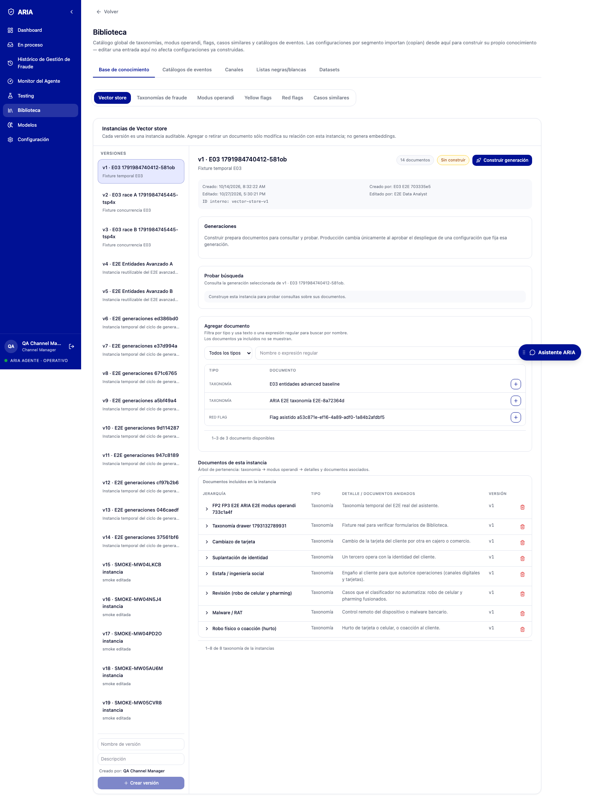

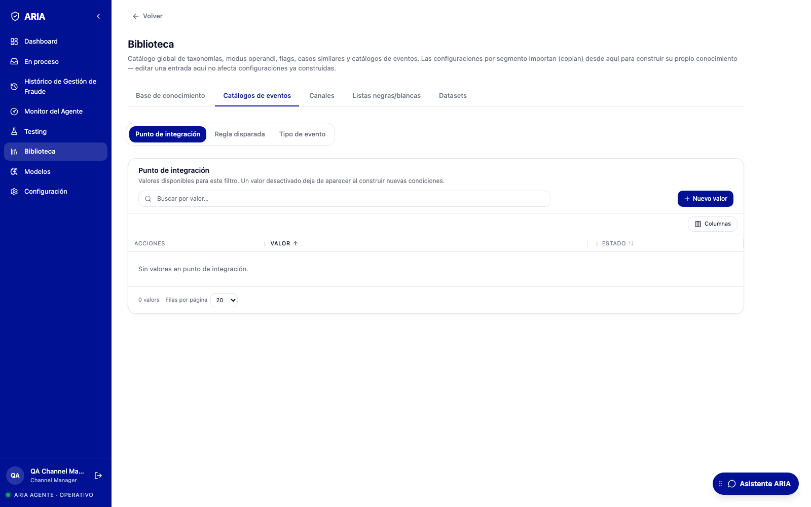

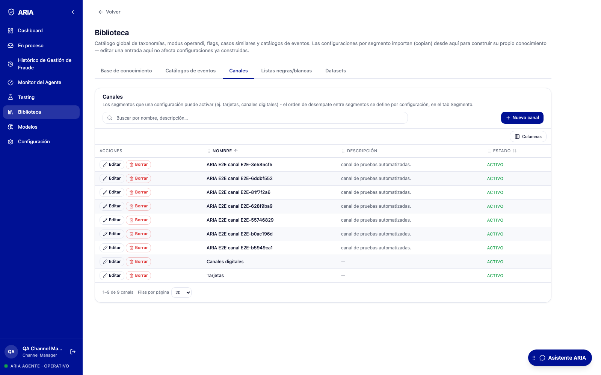

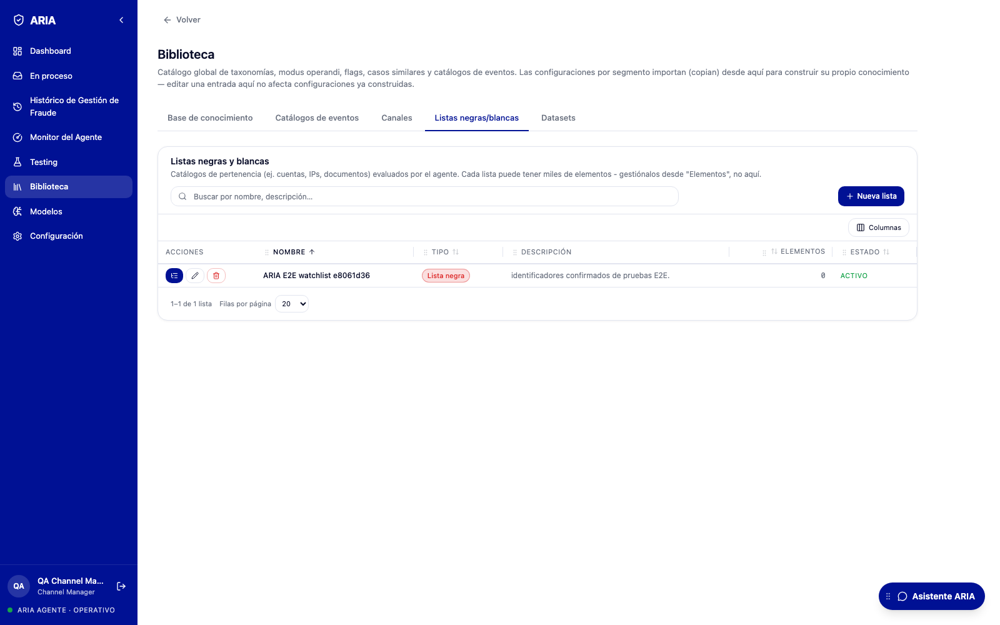

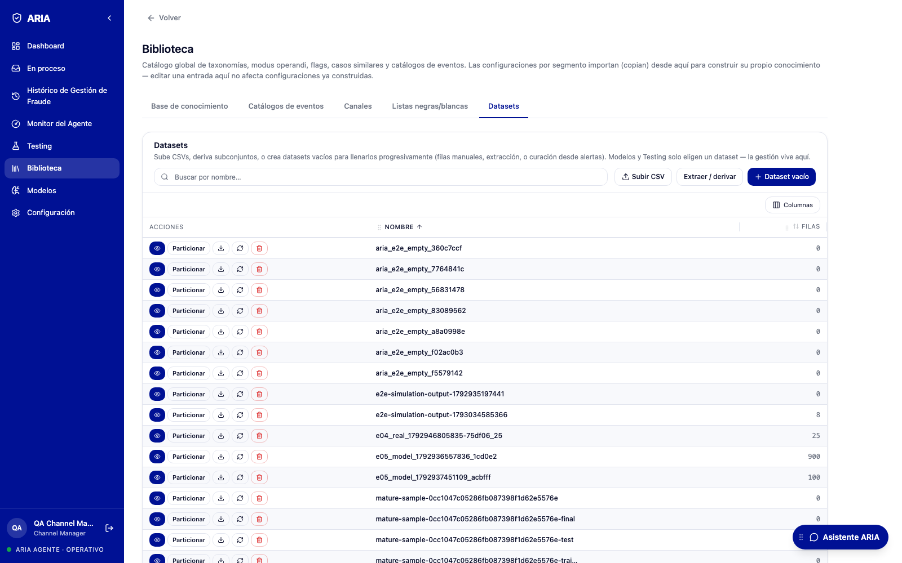

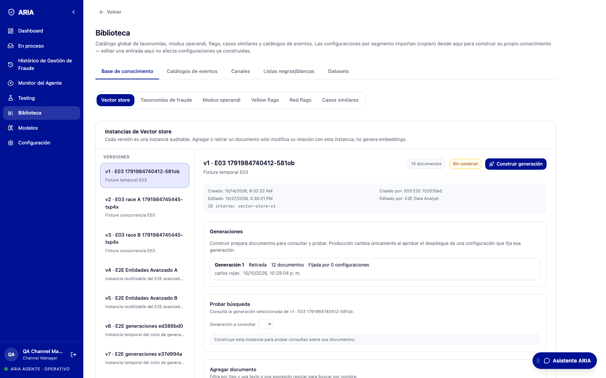

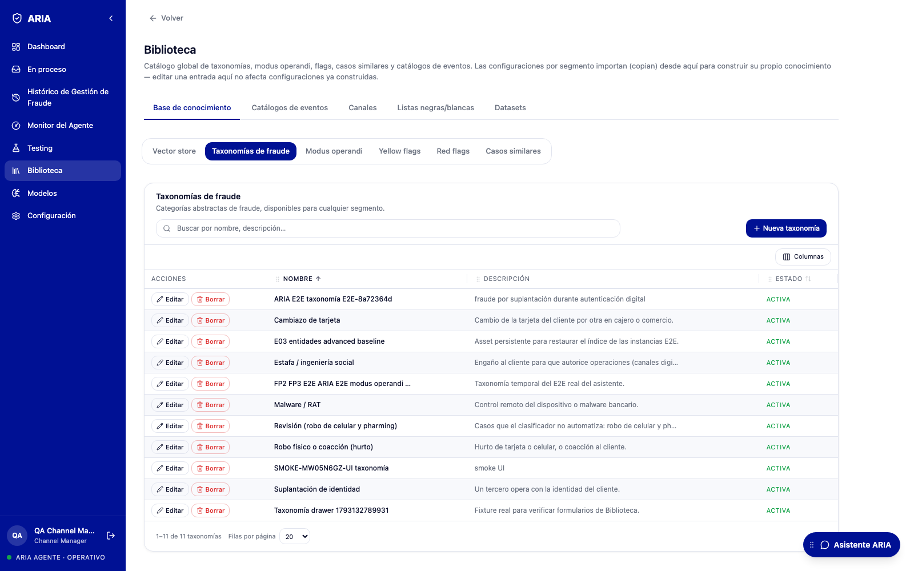

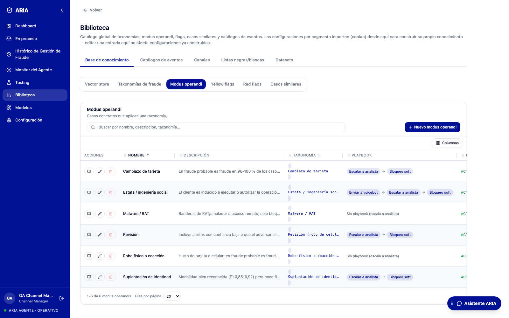

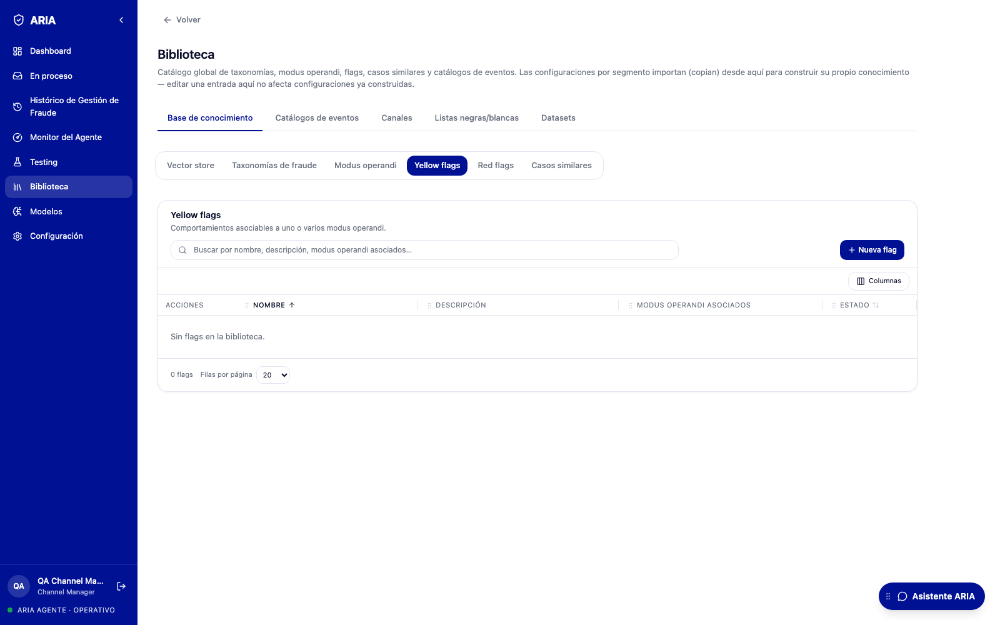

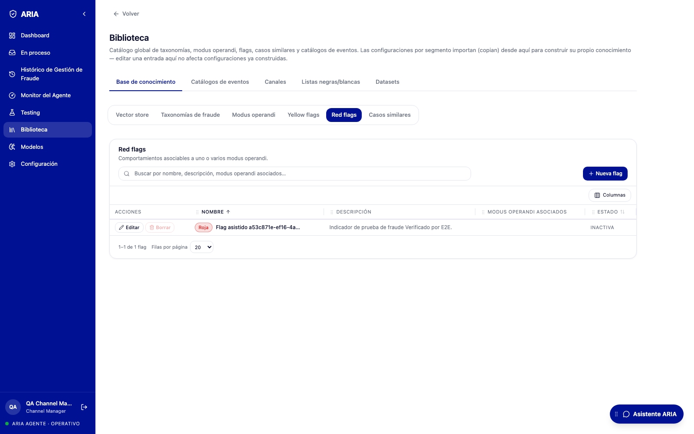

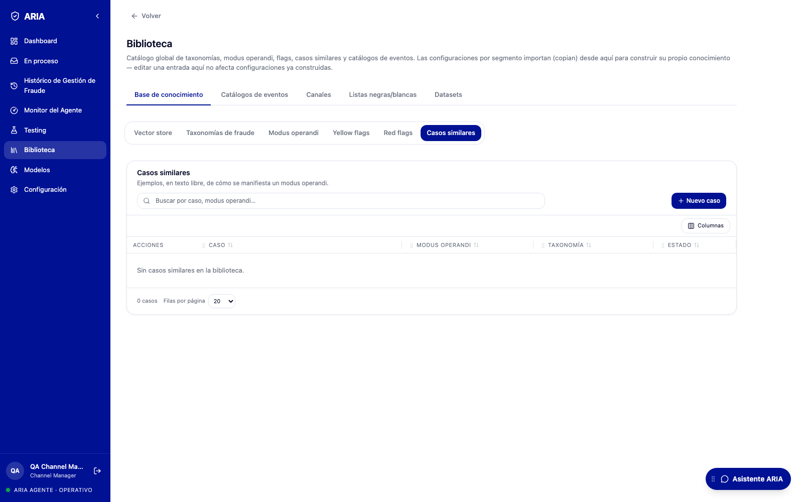

**Acciones del usuario** (41): Agregar; Agregar filtro; Agregar mapeo; Agregar seleccionadas a "; Agregar valor; Analizar; Borrar; Buscar; Cancelar; Columnas; Construir generación; Crear versión; Dataset vacío; Editar; Elegir de otro dataset; Elementos; Extraer / derivar; Gestionar métodos; Guardar playbook; Ir al final; Ir al inicio; Nueva flag; Nueva lista; Nueva taxonomía; Nuevo canal; Nuevo caso; Nuevo criterio de filtrado; Nuevo modus operandi; Nuevo valor; Particionar; Plantilla; Plantilla CSV; Playbook; Página anterior; Página siguiente; Quitar; Re-analizar; Subir CSV; Ver; Ver fila como JSON …

### Componentes propios

| Componente | Archivo | Descripción |
|---|---|---|
| `ColumnVisibilityMenu` | `components/ColumnVisibilityMenu.tsx` | Menú desplegable "Columnas" para mostrar/ocultar columnas de una tabla mediante checkboxes. Incluye un hook para persistir la preferencia por tabla en localStorage sin r… |
| `async/AsyncOperationProgressCard` | `components/async/AsyncOperationProgressCard.tsx` | Tarjeta de progreso para operaciones asíncronas que muestra etapa, porcentaje, filas procesadas y estado de éxito o fallo. Su responsabilidad es consultar el progreso y … |
| `biblioteca/DatasetLibraryManager` | `components/biblioteca/DatasetLibraryManager.tsx` | Biblioteca de datasets: subir un CSV, crear uno vacío, extraer o derivar de otros, analizar, visualizar, descargar la plantilla y ver procesos en segundo plano. |
| `biblioteca/ModusOperandiPlaybookModal` | `components/biblioteca/ModusOperandiPlaybookModal.tsx` | Editor del playbook de un modus operandi: estrategia, método de resolución y qué hacer si no hay voicebot o no hay analista. |
| `biblioteca/VectorStoreGenerationsPanel` | `components/biblioteca/VectorStoreGenerationsPanel.tsx` | Lista las generaciones de una instancia de Vector store con su estado, documentos, autor, si producción la consulta y qué configuraciones la fijan; avisa cuando los docu… |
| `biblioteca/VectorStoreSearchPanel` | `components/biblioteca/VectorStoreSearchPanel.tsx` | Probar la búsqueda semántica sobre una generación lista de una instancia de Vector store: elegir generación, tipo (modus operandi, taxonomía, caso similar, red/yellow fl… |
| `biblioteca/WatchlistElementsModal` | `components/biblioteca/WatchlistElementsModal.tsx` | Modal con los elementos de una lista: agregar un valor, importar un archivo .csv/.txt (carga masiva) y quitar elementos. |
| `biblioteca/WatchlistManager` | `components/biblioteca/WatchlistManager.tsx` | Tabla de listas negras y blancas (watchlists): crear, editar, borrar y abrir los elementos de cada lista. |
| `configuracion/ResolutionMethodCatalogManager` | `components/configuracion/ResolutionMethodCatalogManager.tsx` | Panel en SideDrawer para administrar un catálogo de métodos de resolución con su mapeo a un tag de resolución, con alta, actualización, activación/desactivación y borrad… |
| `configuracion/VariableCatalogManager` | `components/configuracion/VariableCatalogManager.tsx` | Panel lateral para administrar el catálogo de variables de origen: listar, crear, editar descripción, activar/desactivar y eliminar entradas. Mantiene el estado de carga… |
| `configuracion/shared/FormControls` | `components/configuracion/shared/FormControls.tsx` | Conjunto de controles reutilizables para formularios (Field, SwitchField, LimitField, TagInput y otros) usados en varias secciones de configuración. Encapsula patrones c… |
| `configuracion/shared/ResolutionMethodPicker` | `components/configuracion/shared/ResolutionMethodPicker.tsx` | Selector desplegable para elegir un método del catálogo de “resolution methods”, mostrando su etiqueta asociada. Permite filtrar por tags permitidos y, opcionalmente, ab… |
| `datasets/CreateEmptyDatasetModal` | `components/datasets/CreateEmptyDatasetModal.tsx` | Panel lateral para crear un dataset vacío definiendo nombre y columnas mediante entrada de etiquetas. Gestiona el envío, estados de error y reset al cancelar o cerrar. |
| `datasets/DatasetDetailDrawer` | `components/datasets/DatasetDetailDrawer.tsx` | Drawer de detalle de un dataset con pestañas para Resumen, Filas y Mapeo de alertas. Recuerda la pestaña activa por dataset usando localStorage. |
| `datasets/DatasetMappingTab` | `components/datasets/DatasetMappingTab.tsx` | Pestaña para editar y guardar pares de mapeo entre “campo de la alerta” y “columna del dataset”, con sugerencias vía datalist. Carga el mapeo existente y permite agregar… |
| `datasets/DatasetRowsTab` | `components/datasets/DatasetRowsTab.tsx` | Pestaña para listar filas del dataset en una tabla paginada con columnas derivadas de las claves presentes en los registros. Incluye acciones para descargar una plantill… |
| `datasets/DatasetSplitContext` | `components/datasets/DatasetSplitContext.tsx` | Componente informativo que muestra el contexto de una partición de dataset: origen (cargado, catálogo o muestra madura) y detalles asociados cuando aplica. También prese… |
| `datasets/DatasetSplitDrawer` | `components/datasets/DatasetSplitDrawer.tsx` | Drawer para preparar una copia particionada de un dataset configurando nombre destino, proporciones por partición, semilla y campos de estratificación. Muestra una vista… |
| `datasets/DatasetSummaryTab` | `components/datasets/DatasetSummaryTab.tsx` | Pestaña que muestra el resumen de un dataset (estado, origen y distribuciones) y se actualiza periódicamente según el estado. También permite lanzar un análisis bajo dem… |
| `datasets/ExtractDatasetModal` | `components/datasets/ExtractDatasetModal.tsx` | Modal tipo SideDrawer para crear un dataset nuevo derivado de uno o más datasets existentes. Su responsabilidad es recoger datasets fuente, filtros campo=valor, porcenta… |
| `datasets/PickDatasetRecordsModal` | `components/datasets/PickDatasetRecordsModal.tsx` | Modal tipo SideDrawer para navegar filas paginadas de un dataset fuente, buscar dentro de la página cargada y seleccionar registros. Permite agregar las filas selecciona… |
| `datasets/RowJsonModal` | `components/datasets/RowJsonModal.tsx` | Modal que visualiza una fila como JSON formateado, parseando campos con JSON embebido para una lectura más clara. Incluye acción para copiar el JSON al portapapeles y un… |
| `datasets/UploadDatasetModal` | `components/datasets/UploadDatasetModal.tsx` | Modal para subir un archivo CSV como dataset nuevo; avisa si ya existe uno con el mismo nombre. |
| `ui/DataTable` | `components/ui/DataTable.tsx` | Tabla reutilizable: cabeceras ordenables, búsqueda, filtros, paleta de columnas, acciones a la izquierda, paginación con primera/última página y scroll interno. |
| `ui/PaginationFooter` | `components/ui/PaginationFooter.tsx` | Pie de paginación para listas o tablas: muestra un resumen de resultados (rango y total) y controles para navegar entre páginas (inicio, anterior, siguiente, final). Tam… |
| `ui/confirm-delete-dialog` | `components/ui/confirm-delete-dialog.tsx` | Diálogo de confirmación para eliminar un elemento, mostrando el nombre y una descripción de consecuencias. Gestiona estados de carga (pending) y la visualización de un e… |
| `ui/confirm-vector-store-documents-dialog` | `components/ui/confirm-vector-store-documents-dialog.tsx` | Diálogo de confirmación para agregar una lista de documentos relacionados a una instancia, mostrando el recuento y el detalle de cada documento. Permite cancelar o confi… |
| `ui/dropdown-menu` | `components/ui/dropdown-menu.tsx` | Conjunto de componentes para menús desplegables basados en Radix, con ítems, submenús y opciones tipo checkbox/radio. Se encarga de la estructura, accesibilidad y estilo… |
| `ui/input` | `components/ui/input.tsx` | Campo de entrada HTML reutilizable con estilos consistentes y soporte de ref. Su responsabilidad es renderizar un <input> con clases predefinidas y permitir personalizac… |
| `ui/progress` | `components/ui/progress.tsx` | Barra de progreso basada en Radix Progress que representa visualmente un valor. Su responsabilidad es renderizar el contenedor y el indicador ajustando su desplazamiento… |
| `ui/switch` | `components/ui/switch.tsx` | Interruptor (toggle) basado en Radix para activar o desactivar una opción. Su responsabilidad es renderizar el root y el thumb con estilos y estados accesibles, propagan… |
| `ui/tabs` | `components/ui/tabs.tsx` | Componentes de pestañas basados en Radix (TabsList, TabsTrigger y TabsContent) para organizar contenido en secciones conmutables. Su responsabilidad es renderizar la est… |

### Servicios propios

| Función (frontend) | Método y ruta (backend) | Qué hace | Caso de uso | Request | Response (campos) | Usado en |
|---|---|---|---|---|---|---|
| `alertSchema.getActiveAlertSchema` | GET `/api/v0/alert-schema/active` | Get Active Schema | `GetActiveAlertSchemaUseCase` | — | `AlertSchemaVersionResponse`: `version`, `status`, `fields`, `field_roles`, `proposed_by`, `proposed_at`, `approved_by`, `approved_at` … (+4) | `/biblioteca` |
| `channelLibrary.createChannelLibraryEntry` | POST `/api/v0/library/channels` | Create Channel Library Entry | `CreateChannelLibraryEntryUseCase` | `CreateChannelLibraryEntryRequest`: `code`, `name`, `description` | `ChannelLibraryEntrySchema`: `id`, `code`, `name`, `description`, `active`, `created_at`, `updated_at` | `/biblioteca` |
| `channelLibrary.deleteChannelLibraryEntry` | DELETE `/api/v0/library/channels/{entry_id}` | Delete Channel Library Entry | `DeleteChannelLibraryEntryUseCase` | — | — | `/biblioteca` |
| `channelLibrary.listChannelLibraryEntries` | GET `/api/v0/library/channels` | List Channel Library Entries | `ListChannelLibraryEntriesUseCase` | query: `active_only` | `ChannelLibraryEntrySchema[]`: `id`, `code`, `name`, `description`, `active`, `created_at`, `updated_at` | `/biblioteca` |
| `channelLibrary.updateChannelLibraryEntry` | PATCH `/api/v0/library/channels/{entry_id}` | Update Channel Library Entry | `UpdateChannelLibraryEntryUseCase` | `UpdateChannelLibraryEntryRequest`: `code`, `name`, `description`, `active` | `ChannelLibraryEntrySchema`: `id`, `code`, `name`, `description`, `active`, `created_at`, `updated_at` | `/biblioteca` |
| `configuration.createTag` | POST `/api/v0/tag-catalog` | Create Tag | `CreateTagUseCase` | `CreateTagRequest`: `category`, `value` | `TagEntrySchema`: `id`, `category`, `value`, `active`, `created_at`, `updated_at` | `/biblioteca` |
| `configuration.deleteTag` | DELETE `/api/v0/tag-catalog/{category}/{tag_id}` | Delete Tag | `DeleteTagUseCase` | — | — | `/biblioteca` |
| `configuration.listTags` | GET `/api/v0/tag-catalog` | List Tags | `ListTagsUseCase` | query: `category`, `active_only` | `TagEntrySchema[]`: `id`, `category`, `value`, `active`, `created_at`, `updated_at` | `/biblioteca` |
| `configuration.updateTag` | PATCH `/api/v0/tag-catalog/{category}/{tag_id}` | Update Tag | `UpdateTagUseCase` | `UpdateTagRequest`: `value`, `active` | `TagEntrySchema`: `id`, `category`, `value`, `active`, `created_at`, `updated_at` | `/biblioteca` |
| `knowledgeLibrary.createModusOperandiLibraryEntry` | POST `/api/v0/library/modus-operandi` | Create Modus Operandi Library Entry | `CreateModusOperandiLibraryEntryUseCase` | `CreateModusOperandiLibraryEntryRequest`: `title`, `narrative`, `taxonomy_library_id`, `evolved_variables` | `ModusOperandiLibraryEntrySchema`: `id`, `title`, `narrative`, `taxonomy_library_id`, `evolved_variables`, `active`, `created_at`, `updated_at` … (+1) | `/biblioteca` |
| `knowledgeLibrary.createSimilarCaseLibraryEntry` | POST `/api/v0/library/similar-cases` | Create Similar Case Library Entry | `CreateSimilarCaseLibraryEntryUseCase` | `CreateSimilarCaseLibraryEntryRequest`: `text`, `modus_operandi_library_id`, `taxonomy_library_id` | `SimilarCaseLibraryEntrySchema`: `id`, `text`, `modus_operandi_library_id`, `taxonomy_library_id`, `active`, `created_at`, `updated_at` | `/biblioteca` |
| `knowledgeLibrary.createTaxonomyLibraryEntry` | POST `/api/v0/library/taxonomies` | Create Taxonomy Library Entry | `CreateTaxonomyLibraryEntryUseCase` | `CreateTaxonomyLibraryEntryRequest`: `code`, `name`, `description`, `variables`, `examples` | `TaxonomyLibraryEntrySchema`: `id`, `code`, `name`, `description`, `variables`, `examples`, `active`, `created_at` … (+1) | `/biblioteca` |
| `knowledgeLibrary.deleteFlagLibraryEntry` | DELETE `/api/v0/library/flags/{entry_id}` | Delete Flag Library Entry | `DeleteFlagLibraryEntryUseCase` | — | — | `/biblioteca` |
| `knowledgeLibrary.deleteModusOperandiLibraryEntry` | DELETE `/api/v0/library/modus-operandi/{entry_id}` | Delete Modus Operandi Library Entry | `DeleteModusOperandiLibraryEntryUseCase` | — | — | `/biblioteca` |
| `knowledgeLibrary.deleteSimilarCaseLibraryEntry` | DELETE `/api/v0/library/similar-cases/{entry_id}` | Delete Similar Case Library Entry | `DeleteSimilarCaseLibraryEntryUseCase` | — | — | `/biblioteca` |
| `knowledgeLibrary.deleteTaxonomyLibraryEntry` | DELETE `/api/v0/library/taxonomies/{entry_id}` | Delete Taxonomy Library Entry | `DeleteTaxonomyLibraryEntryUseCase` | — | — | `/biblioteca` |
| `knowledgeLibrary.listFlagLibraryEntries` | GET `/api/v0/library/flags` | List Flag Library Entries | `ListFlagLibraryEntriesUseCase` | query: `active_only` | `FlagLibraryEntrySchema[]`: `id`, `flag_type`, `name`, `description`, `evolved_variables`, `modus_operandi_library_ids`, `active`, `created_at` … (+1) | `/biblioteca` |
| `knowledgeLibrary.listModusOperandiLibraryEntries` | GET `/api/v0/library/modus-operandi` | List Modus Operandi Library Entries | `ListModusOperandiLibraryEntriesUseCase` | query: `active_only` | `ModusOperandiLibraryEntrySchema[]`: `id`, `title`, `narrative`, `taxonomy_library_id`, `evolved_variables`, `active`, `created_at`, `updated_at` … (+1) | `/biblioteca` |
| `knowledgeLibrary.listSimilarCaseLibraryEntries` | GET `/api/v0/library/similar-cases` | List Similar Case Library Entries | `ListSimilarCaseLibraryEntriesUseCase` | query: `active_only` | `SimilarCaseLibraryEntrySchema[]`: `id`, `text`, `modus_operandi_library_id`, `taxonomy_library_id`, `active`, `created_at`, `updated_at` | `/biblioteca` |
| `knowledgeLibrary.listTaxonomyLibraryEntries` | GET `/api/v0/library/taxonomies` | List Taxonomy Library Entries | `ListTaxonomyLibraryEntriesUseCase` | query: `active_only` | `TaxonomyLibraryEntrySchema[]`: `id`, `code`, `name`, `description`, `variables`, `examples`, `active`, `created_at` … (+1) | `/biblioteca` |
| `knowledgeLibrary.updateSimilarCaseLibraryEntry` | PATCH `/api/v0/library/similar-cases/{entry_id}` | Update Similar Case Library Entry | `UpdateSimilarCaseLibraryEntryUseCase` | `UpdateSimilarCaseLibraryEntryRequest`: `text`, `modus_operandi_library_id`, `taxonomy_library_id`, `active` | `SimilarCaseLibraryEntrySchema`: `id`, `text`, `modus_operandi_library_id`, `taxonomy_library_id`, `active`, `created_at`, `updated_at` | `/biblioteca` |
| `knowledgeLibrary.updateTaxonomyLibraryEntry` | PATCH `/api/v0/library/taxonomies/{entry_id}` | Update Taxonomy Library Entry | `UpdateTaxonomyLibraryEntryUseCase` | `UpdateTaxonomyLibraryEntryRequest`: `code`, `name`, `description`, `variables`, `examples`, `active` | `TaxonomyLibraryEntrySchema`: `id`, `code`, `name`, `description`, `variables`, `examples`, `active`, `created_at` … (+1) | `/biblioteca` |
| `datasets.analyzeDatasetOnDemand` | POST `/api/v0/datasets/{name}/analyze` | Analyze Dataset On Demand | `AnalyzeDatasetOnDemandUseCase` | — | `UploadDatasetResponse`: `name`, `status`, `async_operation_id` | `biblioteca/DatasetLibraryManager`, `datasets/DatasetSummaryTab` |
| `datasets.deleteDataset` | DELETE `/api/v0/datasets/{name}` | Delete Dataset | `DeleteDatasetUseCase` | — | `DeleteDatasetResponse`: `name`, `deleted`, `async_operation_id` | `biblioteca/DatasetLibraryManager` |
| `datasets.downloadDatasetTemplate` | GET `/api/v0/datasets/{name}/template` | Get Dataset Template | `GetDatasetTemplateUseCase` | — | — | `biblioteca/DatasetLibraryManager`, `datasets/DatasetRowsTab` |
| `datasets.getDatasets` | GET `/api/v0/datasets` | List Datasets | `ListDatasetsUseCase` | — | `DatasetResponse[]`: `name`, `row_count` | `biblioteca/DatasetLibraryManager`, `datasets/ExtractDatasetModal`, `datasets/UploadDatasetModal`, `datasets/PickDatasetRecordsModal` |
| `resolutionMethod.listResolutionMethods` | GET `/api/v0/resolution-method-catalog` | List Resolution Methods | `ListResolutionMethodsUseCase` | query: `active_only` | `ResolutionMethodSchema[]`: `id`, `value`, `resolution_tag`, `active`, `created_at`, `updated_at` | `biblioteca/ModusOperandiPlaybookModal`, `configuracion/ResolutionMethodCatalogManager` |
| `vectorStoreInstances.queryVectorStoreInstance` | GET `/api/v0/vector-store-instances/{instance_id}/query` | Query Vector Store Instance | `SearchFraudKnowledgeUseCase` | query: `query`, `document_type`, `pipeline`, `top_k`, `generation` | — | `biblioteca/VectorStoreSearchPanel` |
| `watchlist.createWatchlist` | POST `/api/v0/watchlists` | Create Watchlist | `CreateWatchlistUseCase` | `CreateWatchlistRequest`: `name`, `description`, `list_type`, `elements` | `WatchlistSchema`: `id`, `name`, `description`, `list_type`, `element_count`, `active`, `created_at`, `updated_at` | `biblioteca/WatchlistManager` |
| `watchlist.deleteWatchlist` | DELETE `/api/v0/watchlists/{watchlist_id}` | Delete Watchlist | `DeleteWatchlistUseCase` | — | — | `biblioteca/WatchlistManager` |
| `watchlist.listWatchlists` | GET `/api/v0/watchlists` | List Watchlists | `ListWatchlistsUseCase` | query: `list_type`, `active_only` | `WatchlistSchema[]`: `id`, `name`, `description`, `list_type`, `element_count`, `active`, `created_at`, `updated_at` | `biblioteca/WatchlistManager`, `configuracion/shared/FormControls` |
| `watchlist.updateWatchlist` | PATCH `/api/v0/watchlists/{watchlist_id}` | Update Watchlist | `UpdateWatchlistUseCase` | `UpdateWatchlistRequest`: `name`, `description`, `active` | `WatchlistSchema`: `id`, `name`, `description`, `list_type`, `element_count`, `active`, `created_at`, `updated_at` | `biblioteca/WatchlistManager` |
| `variable.createVariable` | POST `/api/v0/variable-catalog` | Create Variable | `CreateVariableUseCase` | `CreateVariableRequest`: `value`, `description` | `VariableSchema`: `id`, `value`, `description`, `active`, `created_at`, `updated_at` | `configuracion/VariableCatalogManager` |
| `variable.deleteVariable` | DELETE `/api/v0/variable-catalog/{entry_id}` | Delete Variable | `DeleteVariableUseCase` | — | — | `configuracion/VariableCatalogManager` |
| `variable.listVariables` | GET `/api/v0/variable-catalog` | List Variables | `ListVariablesUseCase` | query: `active_only` | `VariableSchema[]`: `id`, `value`, `description`, `active`, `created_at`, `updated_at` | `configuracion/VariableCatalogManager`, `datasets/DatasetMappingTab` |
| `variable.updateVariable` | PATCH `/api/v0/variable-catalog/{entry_id}` | Update Variable | `UpdateVariableUseCase` | `UpdateVariableRequest`: `value`, `description`, `active` | `VariableSchema`: `id`, `value`, `description`, `active`, `created_at`, `updated_at` | `configuracion/VariableCatalogManager` |
| `watchlist.addWatchlistElements` | POST `/api/v0/watchlists/{watchlist_id}/elements` | Add Watchlist Elements | `AddWatchlistElementsUseCase` | `AddWatchlistElementsRequest`: `values` | `AddWatchlistElementsResponse`: `added` | `biblioteca/WatchlistElementsModal` |
| `watchlist.importWatchlistElements` | POST `/api/v0/watchlists/{watchlist_id}/elements/import` | Import Watchlist Elements | `AddWatchlistElementsUseCase` | — | `AddWatchlistElementsResponse`: `added` | `biblioteca/WatchlistElementsModal` |
| `watchlist.listWatchlistElements` | GET `/api/v0/watchlists/{watchlist_id}/elements` | List Watchlist Elements | `ListWatchlistElementsUseCase` | query: `limit`, `cursor` | `WatchlistElementsPageSchema`: `values`, `next_cursor` | `biblioteca/WatchlistElementsModal` |
| `watchlist.removeWatchlistElements` | DELETE `/api/v0/watchlists/{watchlist_id}/elements` | Remove Watchlist Elements | `RemoveWatchlistElementsUseCase` | `RemoveWatchlistElementsRequest`: `values` | `RemoveWatchlistElementsResponse`: `removed` | `biblioteca/WatchlistElementsModal` |
| `resolutionMethod.createResolutionMethod` | POST `/api/v0/resolution-method-catalog` | Create Resolution Method | `CreateResolutionMethodUseCase` | `CreateResolutionMethodRequest`: `value`, `resolution_tag` | `ResolutionMethodSchema`: `id`, `value`, `resolution_tag`, `active`, `created_at`, `updated_at` | `configuracion/ResolutionMethodCatalogManager` |
| `resolutionMethod.deleteResolutionMethod` | DELETE `/api/v0/resolution-method-catalog/{entry_id}` | Delete Resolution Method | `DeleteResolutionMethodUseCase` | — | — | `configuracion/ResolutionMethodCatalogManager` |
| `resolutionMethod.updateResolutionMethod` | PATCH `/api/v0/resolution-method-catalog/{entry_id}` | Update Resolution Method | `UpdateResolutionMethodUseCase` | `UpdateResolutionMethodRequest`: `value`, `resolution_tag`, `active` | `ResolutionMethodSchema`: `id`, `value`, `resolution_tag`, `active`, `created_at`, `updated_at` | `configuracion/ResolutionMethodCatalogManager` |
| `datasets.createEmptyDataset` | POST `/api/v0/datasets/empty` | Create Empty Dataset | `CreateEmptyDatasetUseCase` | `CreateEmptyDatasetRequest`: `name`, `fields` | `UploadDatasetResponse`: `name`, `status`, `async_operation_id` | `datasets/CreateEmptyDatasetModal` |
| `datasets.prepareDatasetSplit` | POST `/api/v0/datasets/{name}/splits` | Prepare Dataset Split | `PrepareDatasetSplitUseCase` | `PrepareDatasetSplitRequest`: `target_name`, `proportions`, `seed`, `stratify_fields` | `PrepareDatasetSplitResponse`: `dataset_name`, `snapshot_id`, `source_content_sha256`, `partition_field`, `partition_counts`, `proportions`, `seed`, `stratify_fields` … (+4) | `datasets/DatasetSplitDrawer` |
| `datasets.previewDatasetSplit` | POST `/api/v0/datasets/{name}/splits/preview` | Preview Dataset Split | `PrepareDatasetSplitUseCase` | `PreviewDatasetSplitRequest`: `proportions`, `seed`, `stratify_fields` | `PreviewDatasetSplitResponse`: `source_dataset_name`, `source_content_sha256`, `source_row_count`, `partition_counts`, `proportions`, `seed`, `stratify_fields`, `available_fields` … (+4) | `datasets/DatasetSplitDrawer` |
| `datasets.extractDataset` | POST `/api/v0/datasets/extract` | Extract Dataset | `ExtractDatasetUseCase` | `ExtractDatasetRequest`: `source_names`, `filters`, `percentage`, `target_name` | `UploadDatasetResponse`: `name`, `status`, `async_operation_id` | `datasets/ExtractDatasetModal` |
| `datasets.uploadDataset` | POST `/api/v0/datasets/uploads` | Start Dataset Upload | `DatasetUploadChunksUseCase` | `StartDatasetUploadRequest`: `filename`, `total_size_bytes` | `DatasetUploadSessionResponse`: `upload_id`, `name`, `part_size_bytes`, `total_parts`, `expires_at` | `datasets/UploadDatasetModal` |
| `datasets.getAlertFieldMapping` | GET `/api/v0/datasets/{name}/alert-field-mapping` | Get Alert Field Mapping | `GetAlertFieldMappingUseCase` | — | `AlertFieldMappingResponse`: `dataset_name`, `schema_version`, `mappings`, `updated_at` | `datasets/DatasetMappingTab` |
| `datasets.getDatasetSummary` | GET `/api/v0/datasets/{name}/summary` | Get Dataset Summary | `AnalyzeFraudMarkingUseCase`, `GetDatasetSummaryUseCase` | query: `first_mark_field`, `second_mark_field`, `first_mark_time_field`, `second_mark_time_field`, `positive_values` | `DatasetSummaryResponse`: `dataset_name`, `status`, `total_rows`, `field_distributions`, `available_fields`, `uploaded_at`, `updated_at`, `error` … (+5) | `datasets/DatasetMappingTab`, `datasets/DatasetSummaryTab` |
| `datasets.saveAlertFieldMapping` | PUT `/api/v0/datasets/{name}/alert-field-mapping` | Save Alert Field Mapping | `SaveAlertFieldMappingUseCase` | `SaveAlertFieldMappingRequest`: `schema_version`, `mappings` | `AlertFieldMappingResponse`: `dataset_name`, `schema_version`, `mappings`, `updated_at` | `datasets/DatasetMappingTab` |
| `datasets.appendDatasetRows` | POST `/api/v0/datasets/{name}/rows` | Append Dataset Rows | `AppendDatasetRowsUseCase` | `AppendDatasetRowsRequest`: `rows` | `AppendDatasetRowsResponse`: `name`, `total_rows`, `status` | `datasets/DatasetRowsTab`, `datasets/PickDatasetRecordsModal` |
| `datasets.getDatasetRows` | GET `/api/v0/datasets/{name}/rows` | Get Dataset Rows | `GetDatasetRowsUseCase` | query: `offset`, `limit` | `DatasetRowsResponse`: `rows`, `total` | `datasets/DatasetRowsTab`, `datasets/PickDatasetRecordsModal` |
| `vectorStoreInstances.addVectorStoreDocument` | POST `/api/v0/vector-store-instances/{instance_id}/documents` | Add Instance Document | — | `AddVectorStoreDocumentRequest`: `asset_type`, `asset_id`, `asset_version` | `VectorStoreDocumentSchema[]`: `relation_id`, `asset_type`, `asset_id`, `asset_version` | `components/biblioteca/VectorStoreGenerationsPanel`, `components/biblioteca/VectorStoreSearchPanel`, `components/configuracion/shared/FormControls`, `routes/biblioteca` |
| `vectorStoreInstances.createVectorStoreInstance` | POST `/api/v0/vector-store-instances` | Create Instance | — | `CreateVectorStoreInstanceRequest`: `name`, `description` | `VectorStoreInstanceSchema`: `id`, `version`, `name`, `description`, `created_at`, `created_by`, `updated_at`, `updated_by` … (+2) | `components/biblioteca/VectorStoreGenerationsPanel`, `components/biblioteca/VectorStoreSearchPanel`, `components/configuracion/shared/FormControls`, `routes/biblioteca` |
| `vectorStoreInstances.listVectorStoreDocuments` | GET `/api/v0/vector-store-instances/{instance_id}/documents` | List Instance Documents | — | — | `VectorStoreDocumentSchema[]`: `relation_id`, `asset_type`, `asset_id`, `asset_version` | `components/biblioteca/VectorStoreGenerationsPanel`, `components/biblioteca/VectorStoreSearchPanel`, `components/configuracion/shared/FormControls`, `routes/biblioteca` |
| `vectorStoreInstances.listVectorStoreInstances` | GET `/api/v0/vector-store-instances` | List Instances | — | — | `VectorStoreInstanceSchema[]`: `id`, `version`, `name`, `description`, `created_at`, `created_by`, `updated_at`, `updated_by` … (+2) | `components/biblioteca/VectorStoreGenerationsPanel`, `components/biblioteca/VectorStoreSearchPanel`, `components/configuracion/shared/FormControls`, `routes/biblioteca` |
| `vectorStoreInstances.listVectorStoreGenerations` | GET `/api/v0/vector-store-instances/{instance_id}/generations` | List Instance Generations | — | — | `VectorStoreGenerationSchema[]`: `instance_id`, `generation`, `status`, `built_by`, `created_at`, `ready_at`, `retired_at`, `fingerprint` … (+6) | `components/biblioteca/VectorStoreGenerationsPanel`, `components/biblioteca/VectorStoreSearchPanel`, `components/configuracion/shared/FormControls`, `routes/biblioteca` |
| `vectorStoreInstances.buildVectorStoreGeneration` | POST `/api/v0/vector-store-instances/{instance_id}/generations` | Build Instance Generation | — | — | `BuildVectorStoreGenerationResponse`: `instance_id`, `generation`, `status`, `built_by`, `created_at`, `ready_at`, `retired_at`, `fingerprint` … (+7) | `components/biblioteca/VectorStoreGenerationsPanel`, `components/biblioteca/VectorStoreSearchPanel`, `components/configuracion/shared/FormControls`, `routes/biblioteca` |
| `vectorStoreInstances.removeVectorStoreDocument` | DELETE `/api/v0/vector-store-instances/{instance_id}/documents/{relation_id}` | Remove Instance Document | — | — | — | `components/biblioteca/VectorStoreGenerationsPanel`, `components/biblioteca/VectorStoreSearchPanel`, `components/configuracion/shared/FormControls`, `routes/biblioteca` |
| `vectorStoreInstances.previewVectorStoreDocument` | POST `/api/v0/vector-store-instances/{instance_id}/documents/preflight` | Preview Add Instance Document | — | `AddVectorStoreDocumentRequest`: `asset_type`, `asset_id`, `asset_version` | — | `components/biblioteca/VectorStoreGenerationsPanel`, `components/biblioteca/VectorStoreSearchPanel`, `components/configuracion/shared/FormControls`, `routes/biblioteca` |
| `knowledgeLibrary.createFlagLibraryEntry` | POST `/api/v0/library/flags` | Create Flag Library Entry | — | `CreateFlagLibraryEntryRequest`: `flag_type`, `name`, `description`, `evolved_variables`, `modus_operandi_library_ids` | `FlagLibraryEntrySchema`: `id`, `flag_type`, `name`, `description`, `evolved_variables`, `modus_operandi_library_ids`, `active`, `created_at` … (+1) | `routes/biblioteca` |
| `knowledgeLibrary.updateFlagLibraryEntry` | PATCH `/api/v0/library/flags/{entry_id}` | Update Flag Library Entry | — | `UpdateFlagLibraryEntryRequest`: `flag_type`, `name`, `description`, `evolved_variables`, `modus_operandi_library_ids`, `active` | `FlagLibraryEntrySchema`: `id`, `flag_type`, `name`, `description`, `evolved_variables`, `modus_operandi_library_ids`, `active`, `created_at` … (+1) | `routes/biblioteca` |
| `knowledgeLibrary.updateModusOperandiLibraryEntry` | PATCH `/api/v0/library/modus-operandi/{entry_id}` | Update Modus Operandi Library Entry | — | `UpdateModusOperandiLibraryEntryRequest`: `title`, `narrative`, `taxonomy_library_id`, `evolved_variables`, `active`, `playbook` | `ModusOperandiLibraryEntrySchema`: `id`, `title`, `narrative`, `taxonomy_library_id`, `evolved_variables`, `active`, `created_at`, `updated_at` … (+1) | `components/biblioteca/ModusOperandiPlaybookModal`, `routes/biblioteca` |
| `asyncOperations.getAsyncOperation` | GET `/api/v0/async-operations/{operation_id}` | Get Async Operation | — | — | `AsyncOperationResponse`: `id`, `operation_type`, `status`, `schema_version`, `configuration_ref`, `input`, `labels`, `history_prev_alerta` … (+9) | `components/async/AsyncOperationProgressCard` |

---

## 4.9 Testing — `/testing`

- **Archivo**: `routes/testing.tsx`  
- **Roles**: `release_manager`, `channel_manager`, `data_analyst`  
- **Descripción**: Testing del agente: historial de pruebas que ejecutan el pipeline de 7 pasos sobre un dataset controlado. Permite lanzar una prueba nueva, repetir una anterior, filtrar y borrar.
- **Navega a**: `/testing/$runId`, `/testing/scenarios/$scenarioId`

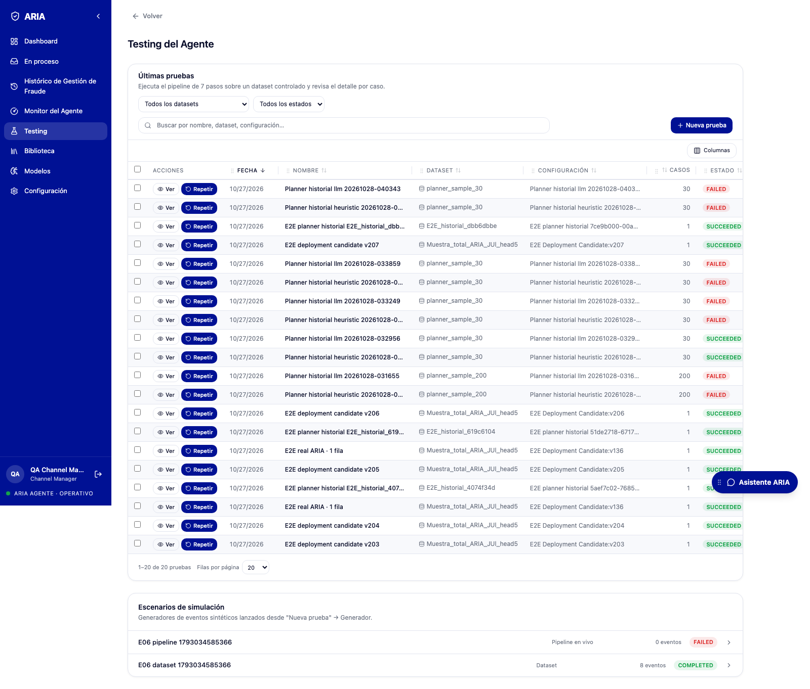

**Acciones del usuario** (27): Agregar campo; Agregar intervalo; Analizar; Cargar ejemplo; Columnas; Crear borrador; Dataset; Descargar dataset; Descartar borrador; Enviar al pipeline; Gestionar en Biblioteca; Iniciar; Iniciar prueba; Ir al final; Ir al inicio; Limpiar; Nueva prueba; Pipeline en vivo; Probar otro evento; Página anterior; Página siguiente; Re-analizar; Repetir; Sembrar desde dataset; Ver; Ver detalle; Vista previa

### Componentes propios

| Componente | Archivo | Descripción |
|---|---|---|
| `ColumnVisibilityMenu` | `components/ColumnVisibilityMenu.tsx` | Menú desplegable "Columnas" para mostrar/ocultar columnas de una tabla mediante checkboxes. Incluye un hook para persistir la preferencia por tabla en localStorage sin r… |
| `async/AsyncOperationProgressCard` | `components/async/AsyncOperationProgressCard.tsx` | Tarjeta de progreso para operaciones asíncronas que muestra etapa, porcentaje, filas procesadas y estado de éxito o fallo. Su responsabilidad es consultar el progreso y … |
| `datasets/DatasetSplitContext` | `components/datasets/DatasetSplitContext.tsx` | Componente informativo que muestra el contexto de una partición de dataset: origen (cargado, catálogo o muestra madura) y detalles asociados cuando aplica. También prese… |
| `datasets/DatasetSummaryTab` | `components/datasets/DatasetSummaryTab.tsx` | Pestaña que muestra el resumen de un dataset (estado, origen y distribuciones) y se actualiza periódicamente según el estado. También permite lanzar un análisis bajo dem… |
| `testing/DatasetDetailModal` | `components/testing/DatasetDetailModal.tsx` | Panel lateral (side drawer) para consultar en modo lectura el detalle de un dataset seleccionado, reutilizando el tab de resumen. Sirve para “ojear” totales y distribuci… |
| `testing/DatasetTestForm` | `components/testing/DatasetTestForm.tsx` | Formulario para configurar y lanzar una prueba basada en un dataset, incluyendo selección de dataset, tamaño de muestra e inputs de configuración/esquema. Se encarga de … |
| `testing/FormularioTestForm` | `components/testing/FormularioTestForm.tsx` | Interfaz para probar una alerta ingresando un payload JSON en un formulario y despacharlo al pipeline, mostrando el progreso de la operación asíncrona. Su responsabilida… |
| `testing/GeneradorScenarioForm` | `components/testing/GeneradorScenarioForm.tsx` | Formulario para crear y configurar un escenario de simulación, definiendo intervalos de tasa y generadores por campo. Permite crear un borrador, ver una vista previa, in… |
| `testing/NewTestRunModal` | `components/testing/NewTestRunModal.tsx` | Modal para lanzar una prueba nueva del pipeline: elegir entre dataset, formulario o generador de escenario. |
| `ui/DataTable` | `components/ui/DataTable.tsx` | Tabla reutilizable: cabeceras ordenables, búsqueda, filtros, paleta de columnas, acciones a la izquierda, paginación con primera/última página y scroll interno. |
| `ui/PaginationFooter` | `components/ui/PaginationFooter.tsx` | Pie de paginación para listas o tablas: muestra un resumen de resultados (rango y total) y controles para navegar entre páginas (inicio, anterior, siguiente, final). Tam… |
| `ui/confirm-delete-dialog` | `components/ui/confirm-delete-dialog.tsx` | Diálogo de confirmación para eliminar un elemento, mostrando el nombre y una descripción de consecuencias. Gestiona estados de carga (pending) y la visualización de un e… |
| `ui/dialog` | `components/ui/dialog.tsx` | Componentes reutilizables para construir un modal (diálogo) con overlay, contenido centrado y botón de cierre. Proporciona encabezado, pie, título y descripción con esti… |
| `ui/dropdown-menu` | `components/ui/dropdown-menu.tsx` | Conjunto de componentes para menús desplegables basados en Radix, con ítems, submenús y opciones tipo checkbox/radio. Se encarga de la estructura, accesibilidad y estilo… |
| `ui/progress` | `components/ui/progress.tsx` | Barra de progreso basada en Radix Progress que representa visualmente un valor. Su responsabilidad es renderizar el contenedor y el indicador ajustando su desplazamiento… |
| `ui/tabs` | `components/ui/tabs.tsx` | Componentes de pestañas basados en Radix (TabsList, TabsTrigger y TabsContent) para organizar contenido en secciones conmutables. Su responsabilidad es renderizar la est… |

### Servicios propios

| Función (frontend) | Método y ruta (backend) | Qué hace | Caso de uso | Request | Response (campos) | Usado en |
|---|---|---|---|---|---|---|
| `configurations.listConfigurations` | GET `/api/v0/configurations` | List Configurations | `ListConfigurationsUseCase` | — | `ConfigurationSummaryResponse[]`: `configuration_id`, `version`, `name`, `description`, `active`, `ever_activated`, `ever_tested`, `created_at` … (+2) | `/testing`, `testing/DatasetTestForm` |
| `eventSimulation.listScenarios` | GET `/api/v0/scenarios` | List Scenarios | `ListSimulationScenariosUseCase` | query: `status` | `SimulationScenarioResponse[]`: `id`, `name`, `status`, `output_mode`, `rate_schedule`, `field_specs`, `target_dataset_name`, `created_by` … (+6) | `/testing` |
| `testing.deleteTestRuns` | DELETE `/api/v0/test-runs` | Delete Test Runs | `DeleteTestRunsUseCase` | `DeleteTestRunsRequest`: `test_run_ids` | `DeleteTestRunsResponse`: `deleted_test_runs`, `deleted_cases` | `/testing` |
| `testing.listTestRuns` | GET `/api/v0/test-runs` | List Test Runs | `ListTestRunsUseCase` | query: `order` | `TestRunResponse[]`: `id`, `name`, `dataset_name`, `status`, `total`, `created_at`, `updated_at`, `finished_at` … (+1) | `/testing` |
| `testing.startTestRun` | POST `/api/v0/test-runs` | Start Test Run | `StartTestRunUseCase` | `StartTestRunRequest`: `name`, `dataset_name`, `config`, `sample_size`, `sample_distribution` | `StartTestRunResponse`: `test_run_id`, `dispatched_count` | `/testing`, `testing/DatasetTestForm` |
| `alertSchema.listAlertSchemaVersions` | GET `/api/v0/alert-schema/versions` | List Schema Versions | `ListAlertSchemaVersionsUseCase` | — | `AlertSchemaVersionResponse[]`: `version`, `status`, `fields`, `field_roles`, `proposed_by`, `proposed_at`, `approved_by`, `approved_at` … (+4) | `testing/DatasetTestForm` |
| `configurations.listConfigurationVersions` | GET `/api/v0/configurations/{configuration_id}` | List Configuration Versions | `GetActiveConfigurationUseCase` | — | `ConfigurationSummaryResponse[]`: `configuration_id`, `version`, `name`, `description`, `active`, `ever_activated`, `ever_tested`, `created_at` … (+2) | `testing/DatasetTestForm` |
| `datasets.getDatasets` | GET `/api/v0/datasets` | List Datasets | `ListDatasetsUseCase` | — | `DatasetResponse[]`: `name`, `row_count` | `testing/DatasetTestForm`, `testing/GeneradorScenarioForm` |
| `datasets.uploadDataset` | POST `/api/v0/datasets/uploads` | Start Dataset Upload | `DatasetUploadChunksUseCase` | `StartDatasetUploadRequest`: `filename`, `total_size_bytes` | `DatasetUploadSessionResponse`: `upload_id`, `name`, `part_size_bytes`, `total_parts`, `expires_at` | `testing/DatasetTestForm` |
| `alerts.startAlertTest` | POST `/api/v0/alerts/test` | Start Alert Test Workflow | `StartAlertTestWorkflowUseCase` | `AlertTestRequest`: `event`, `created_by`, `origin` | `AlertTestResponse`: `alert_id`, `async_operation_id`, `workflow_execution_id`, `status` | `testing/FormularioTestForm` |
| `alertSchema.getActiveAlertSchema` | GET `/api/v0/alert-schema/active` | Get Active Schema | `GetActiveAlertSchemaUseCase` | — | `AlertSchemaVersionResponse`: `version`, `status`, `fields`, `field_roles`, `proposed_by`, `proposed_at`, `approved_by`, `approved_at` … (+4) | `testing/GeneradorScenarioForm` |
| `eventSimulation.createScenario` | POST `/api/v0/scenarios` | Create Scenario | `CreateSimulationScenarioUseCase` | `CreateSimulationScenarioRequest`: `name`, `output_mode`, `rate_schedule`, `field_specs`, `target_dataset_name`, `created_by` | `SimulationScenarioResponse`: `id`, `name`, `status`, `output_mode`, `rate_schedule`, `field_specs`, `target_dataset_name`, `created_by` … (+6) | `testing/GeneradorScenarioForm` |
| `eventSimulation.deleteScenario` | DELETE `/api/v0/scenarios/{scenario_id}` | Delete Scenario | `DeleteSimulationScenarioUseCase` | — | — | `testing/GeneradorScenarioForm` |
| `eventSimulation.previewScenario` | POST `/api/v0/scenarios/{scenario_id}/preview` | Preview Scenario | `GenerateEventBatchUseCase`, `GetSimulationScenarioUseCase` | query: `count` | `object[]`: — | `testing/GeneradorScenarioForm` |
| `eventSimulation.seedScenarioFromDataset` | POST `/api/v0/scenarios/seed-from-dataset` | Seed From Dataset | `SeedSimulationFromDatasetUseCase` | `SeedSimulationFromDatasetRequest`: `dataset_name` | `object`: — | `testing/GeneradorScenarioForm` |
| `eventSimulation.startScenario` | POST `/api/v0/scenarios/{scenario_id}/start` | Start Scenario | `StartSimulationUseCase` | — | `SimulationScenarioResponse`: `id`, `name`, `status`, `output_mode`, `rate_schedule`, `field_specs`, `target_dataset_name`, `created_by` … (+6) | `testing/GeneradorScenarioForm` |
| `datasets.analyzeDatasetOnDemand` | POST `/api/v0/datasets/{name}/analyze` | Analyze Dataset On Demand | `AnalyzeDatasetOnDemandUseCase` | — | `UploadDatasetResponse`: `name`, `status`, `async_operation_id` | `datasets/DatasetSummaryTab` |
| `datasets.getDatasetSummary` | GET `/api/v0/datasets/{name}/summary` | Get Dataset Summary | `AnalyzeFraudMarkingUseCase`, `GetDatasetSummaryUseCase` | query: `first_mark_field`, `second_mark_field`, `first_mark_time_field`, `second_mark_time_field`, `positive_values` | `DatasetSummaryResponse`: `dataset_name`, `status`, `total_rows`, `field_distributions`, `available_fields`, `uploaded_at`, `updated_at`, `error` … (+5) | `datasets/DatasetSummaryTab` |
| `asyncOperations.getAsyncOperation` | GET `/api/v0/async-operations/{operation_id}` | Get Async Operation | — | — | `AsyncOperationResponse`: `id`, `operation_type`, `status`, `schema_version`, `configuration_ref`, `input`, `labels`, `history_prev_alerta` … (+9) | `components/async/AsyncOperationProgressCard`, `components/testing/FormularioTestForm` |

---

## 4.10 Detalle de prueba — `/testing/$runId`

- **Archivo**: `routes/testing.$runId.tsx`  
- **Roles**: `release_manager`, `channel_manager`, `data_analyst`  
- **Descripción**: Detalle de una prueba: avance de casos, métricas de clasificación, tiempos de ejecución y lista compacta de casos con el detalle del caso seleccionado.
- **Navega a**: `/testing`

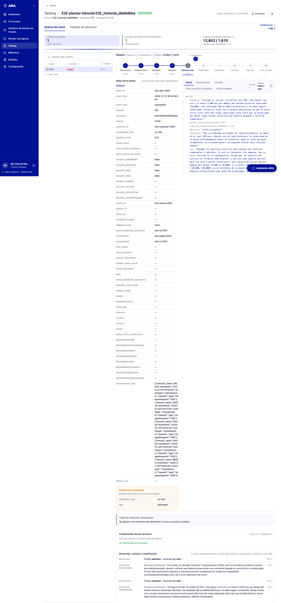

**Acciones del usuario** (9): Actualizar; Columnas; Ir al final; Ir al inicio; Página anterior; Página siguiente; Reportar campo; Testing; Volver a Testing

### Componentes propios

| Componente | Archivo | Descripción |
|---|---|---|
| `ClassificationMetricsSection` | `components/ClassificationMetricsSection.tsx` | Sección para visualizar resultados de clasificación mediante paneles con matriz de confusión y tablas por clase. Presenta dos comparaciones independientes (modelo vs. an… |
| `ColumnVisibilityMenu` | `components/ColumnVisibilityMenu.tsx` | Menú desplegable "Columnas" para mostrar/ocultar columnas de una tabla mediante checkboxes. Incluye un hook para persistir la preferencia por tabla en localStorage sin r… |
| `RefreshControl` | `components/RefreshControl.tsx` | Control de actualización que muestra la hora de la última actualización y un botón "Actualizar" con animación de giro. Su función es disparar la acción de refresco y pre… |
| `alert/AlertSchemaView` | `components/alert/AlertSchemaView.tsx` | Vista para inspeccionar datos de una alerta contra una versión de esquema, organizando campos y formateando valores (incluye locales para números/fechas). Permite marcar… |
| `testing/AlertFullData` | `components/testing/AlertFullData.tsx` | Vista de datos canónicos de una alerta a partir de una salida de preproceso, formateada según el esquema activo. Su responsabilidad es normalizar el objeto de entrada y … |
| `testing/CaseAlertData` | `components/testing/CaseAlertData.tsx` | Panel que muestra los datos de la alerta de un caso (input, labels, historial y salida del agente) usando el esquema activo. También presenta un bloque con las etiquetas… |
| `testing/CaseClassificationLoop` | `components/testing/CaseClassificationLoop.tsx` | Listado de intentos del clasificador y su revisión adversarial dentro de las ejecuciones del caso. Resume para cada paso el resultado (predicción/aprobación/retorno) y l… |
| `testing/CaseDetail` | `components/testing/CaseDetail.tsx` | Vista de detalle de un caso de testing que organiza el pipeline, el selector de ejecuciones y el detalle del paso activo. Integra además el resultado del caso, comparaci… |
| `testing/CaseList` | `components/testing/CaseList.tsx` | Tabla compacta para listar casos de testing con búsqueda por IDs, estado y duración. Permite seleccionar un caso haciendo clic en una fila y resalta el caso activo. |
| `testing/CasePipeline` | `components/testing/CasePipeline.tsx` | Diagrama horizontal interactivo del pipeline de pasos para una ejecución, mostrando estado (completado/fallido/en curso/no ejecutado) y duración por nodo. Permite selecc… |
| `testing/CaseResult` | `components/testing/CaseResult.tsx` | Muestra un resumen del resultado de un caso en una caja con tono visual (en proceso, fallido o completado). Su responsabilidad es traducir el estado y los outputs de pas… |
| `testing/CaseStatusFilters` | `components/testing/CaseStatusFilters.tsx` | Renderiza un conjunto de botones/segmentos para filtrar casos por grupos de resultado y ver el conteo y porcentaje de cada grupo. También muestra estadísticas informativ… |
| `testing/CaseStepDetail` | `components/testing/CaseStepDetail.tsx` | Presenta el detalle de un paso del workflow en pestañas (salida, entrada, error, razonamiento y JSONs relacionados). Su función principal es permitir inspeccionar y copi… |
| `testing/CasesPanel` | `components/testing/CasesPanel.tsx` | Panel de casos de una prueba: filtro por desenlace y lista compacta de casos con detalle. |
| `testing/CopyButton` | `components/testing/CopyButton.tsx` | Botón reutilizable para copiar un texto al portapapeles con feedback temporal de “Copiado”. Su responsabilidad es ejecutar la acción de copia y mostrar un hint/estado vi… |
| `testing/ExecutionMarkers` | `components/testing/ExecutionMarkers.tsx` | Muestra marcadores numerados para navegar entre múltiples ejecuciones/intentos de un caso, con tooltips de resumen. Su responsabilidad es indicar visualmente estado de c… |
| `testing/Hint` | `components/testing/Hint.tsx` | Componente de ayuda contextual que muestra un tooltip al interactuar con un elemento disparador. Incluye una variante "InfoHint" que renderiza un icono accesible para de… |
| `testing/JsonTree` | `components/testing/JsonTree.tsx` | Visor de datos JSON en formato árbol, con expansión/colapso por niveles para facilitar la lectura. Resalta valores primitivos y evita abrir completamente estructuras gra… |
| `testing/LegendStat` | `components/testing/LegendStat.tsx` | Tarjeta/ítem de estadística con etiqueta, valor y texto auxiliar, pensada para resúmenes en dashboards. Puede mostrar un tooltip de ayuda y aplicar un estilo de color co… |
| `testing/RunDetailTabs` | `components/testing/RunDetailTabs.tsx` | Navegación por pestañas para alternar entre secciones de detalle de una ejecución, mostrando el contenido asociado a cada tab. Opcionalmente incluye una estadística dest… |
| `testing/RunDurationSummary` | `components/testing/RunDurationSummary.tsx` | Resumen visual de métricas de duración agregadas (totales y por etapa), con indicadores y una tabla de tiempos por paso. Calcula y presenta duraciones formateadas y prop… |
| `testing/SchemaComparison` | `components/testing/SchemaComparison.tsx` | Sección que compara la entrada de pre-proceso entre un esquema activo y uno candidato, listando campos que aparecen, desaparecen o cambian. Presenta versiones y un estad… |
| `testing/SectionDivider` | `components/testing/SectionDivider.tsx` | Divisor visual horizontal con efecto de brillo animado para separar secciones de la interfaz. Es decorativo y se marca como no relevante para lectores de pantalla. |
| `ui/DataTable` | `components/ui/DataTable.tsx` | Tabla reutilizable: cabeceras ordenables, búsqueda, filtros, paleta de columnas, acciones a la izquierda, paginación con primera/última página y scroll interno. |
| `ui/PaginationFooter` | `components/ui/PaginationFooter.tsx` | Pie de paginación para listas o tablas: muestra un resumen de resultados (rango y total) y controles para navegar entre páginas (inicio, anterior, siguiente, final). Tam… |
| `ui/dropdown-menu` | `components/ui/dropdown-menu.tsx` | Conjunto de componentes para menús desplegables basados en Radix, con ítems, submenús y opciones tipo checkbox/radio. Se encarga de la estructura, accesibilidad y estilo… |
| `ui/tooltip` | `components/ui/tooltip.tsx` | Conjunto de componentes de tooltip basado en Radix (Provider, Root, Trigger y Content) para mostrar información contextual al interactuar con un elemento. Su responsabil… |

### Servicios propios

| Función (frontend) | Método y ruta (backend) | Qué hace | Caso de uso | Request | Response (campos) | Usado en |
|---|---|---|---|---|---|---|
| `testing.getTestCase` | GET `/api/v0/test-runs/{test_run_id}/cases/{workflow_execution_id}` | Get Test Case Detail | `GetTestCaseDetailUseCase` | — | `TestCaseDetailResponse`: `workflow_execution_id`, `alert_id`, `status`, `input_tokens`, `output_tokens`, `steps`, `schema_comparison`, `schema_version` … (+1) | `/testing/$runId` |
| `testing.getTestRun` | GET `/api/v0/test-runs/{test_run_id}` | Get Test Run | `GetTestRunUseCase` | — | `TestRunDetailResponse`: `id`, `name`, `dataset_name`, `config`, `status`, `total`, `succeeded`, `failed` … (+9) | `/testing/$runId` |
| `alertSchema.getActiveAlertSchema` | GET `/api/v0/alert-schema/active` | Get Active Schema | `GetActiveAlertSchemaUseCase` | — | `AlertSchemaVersionResponse`: `version`, `status`, `fields`, `field_roles`, `proposed_by`, `proposed_at`, `approved_by`, `approved_at` … (+4) | `testing/CaseAlertData`, `testing/AlertFullData` |
| `alertSchema.createAlertSchemaSuggestion` | POST `/api/v0/alert-schema/suggestions` | Create Suggestion | `CreateAlertSchemaSuggestionUseCase` | `CreateAlertSchemaSuggestionRequest`: `alert_id`, `field`, `location`, `comment` | `AlertSchemaSuggestionResponse`: `id`, `alert_id`, `field`, `location`, `comment`, `created_by`, `created_at` | `alert/AlertSchemaView` |

---

## 4.11 Escenario de simulación — `/testing/scenarios/$scenarioId`

- **Archivo**: `routes/testing.scenarios.$scenarioId.tsx`  
- **Roles**: `release_manager`, `channel_manager`, `data_analyst`  
- **Descripción**: Detalle de un escenario de simulación de eventos: iniciar, pausar, reanudar o detener, con destino, eventos emitidos y curva de llegada.
- **Navega a**: `/testing`

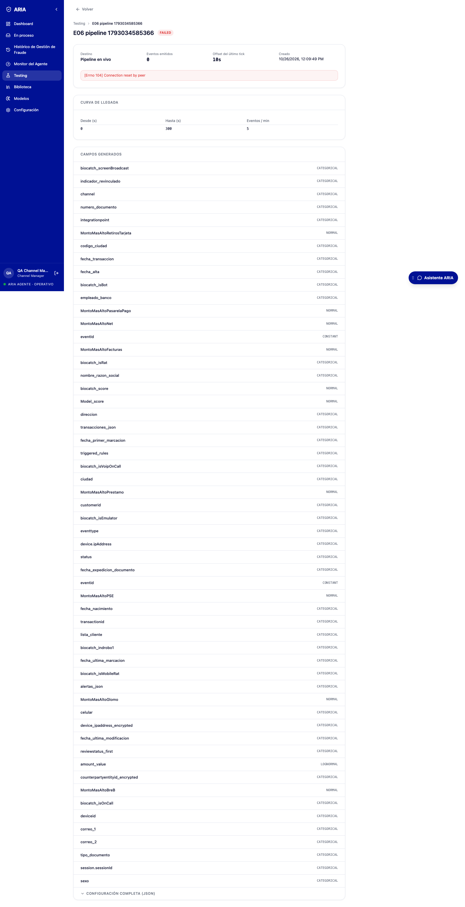

**Acciones del usuario** (5): Detener; Iniciar; Pausar; Reanudar; Testing

### Componentes propios

| Componente | Archivo | Descripción |
|---|---|---|
| `ui/collapsible` | `components/ui/collapsible.tsx` | Componentes wrapper de Radix para secciones expandibles/colapsables. Expone Root, Trigger y Content para controlar la visibilidad de contenido asociado. |

### Servicios propios

| Función (frontend) | Método y ruta (backend) | Qué hace | Caso de uso | Request | Response (campos) | Usado en |
|---|---|---|---|---|---|---|
| `eventSimulation.getScenario` | GET `/api/v0/scenarios/{scenario_id}` | Get Scenario | `GetSimulationScenarioUseCase` | — | `SimulationScenarioResponse`: `id`, `name`, `status`, `output_mode`, `rate_schedule`, `field_specs`, `target_dataset_name`, `created_by` … (+6) | `/testing/scenarios/$scenarioId` |
| `eventSimulation.getScenarioStatus` | GET `/api/v0/scenarios/{scenario_id}/status` | Get Scenario Status | `GetSimulationStatusUseCase` | — | `SimulationStatusResponse`: `scenario_id`, `status`, `events_emitted`, `last_tick_offset_seconds`, `error` | `/testing/scenarios/$scenarioId` |
| `eventSimulation.pauseScenario` | POST `/api/v0/scenarios/{scenario_id}/pause` | Pause Scenario | `PauseSimulationUseCase` | — | `SimulationScenarioResponse`: `id`, `name`, `status`, `output_mode`, `rate_schedule`, `field_specs`, `target_dataset_name`, `created_by` … (+6) | `/testing/scenarios/$scenarioId` |
| `eventSimulation.startScenario` | POST `/api/v0/scenarios/{scenario_id}/start` | Start Scenario | `StartSimulationUseCase` | — | `SimulationScenarioResponse`: `id`, `name`, `status`, `output_mode`, `rate_schedule`, `field_specs`, `target_dataset_name`, `created_by` … (+6) | `/testing/scenarios/$scenarioId` |
| `eventSimulation.stopScenario` | POST `/api/v0/scenarios/{scenario_id}/stop` | Stop Scenario | `StopSimulationUseCase` | — | `SimulationScenarioResponse`: `id`, `name`, `status`, `output_mode`, `rate_schedule`, `field_specs`, `target_dataset_name`, `created_by` … (+6) | `/testing/scenarios/$scenarioId` |

---

## 4.12 Modelos — `/modelos`

- **Archivo**: `routes/modelos.tsx`  
- **Roles**: `channel_manager`, `data_analyst`  
- **Descripción**: Modelos de fraude: catálogo con estado, métricas y fecha de creación; permite crear y entrenar modelos, ver su detalle, activarlos en producción y borrarlos.
- **Pestañas**: Catálogo y resultados · Operaciones

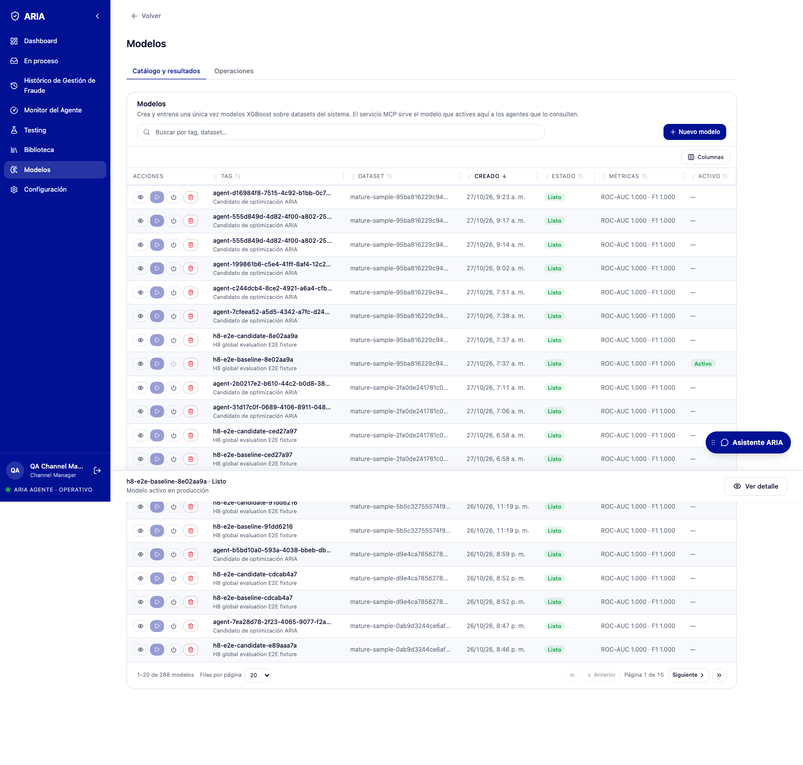

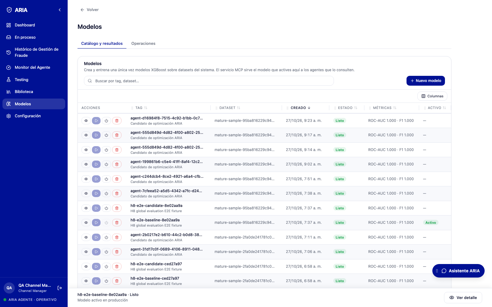

**Acciones del usuario** (48): Activar; Activar en producción; Actividad; Actualizar campos del dataset; Agregar; Agregar valor; Anterior; Aplicar JSON; Añadir mapeo; Borrar; Característica del historial; Cargar muestra del dataset; Colapsar todo; Columnas; Continuar; Copiar JSON; Descartar borrador corrupto; Duplicar paso; Duplicar receta; Ejemplos ficticios; Eliminar condición; Eliminar paso; Eliminar receta; Eliminar regla; Entrenar; Entrenar por única vez; Expandir todo; Exportar; Generar mapeos de todos los campos; Guardar borrador; Guardar plantilla; Inspeccionar la primera fila con error; Ir al final; Ir al inicio; Nuevo criterio de filtrado; Nuevo modelo; Puntuar registro; Página anterior; Página siguiente; Reiniciar …

### Componentes propios

| Componente | Archivo | Descripción |
|---|---|---|
| `ColumnVisibilityMenu` | `components/ColumnVisibilityMenu.tsx` | Menú desplegable "Columnas" para mostrar/ocultar columnas de una tabla mediante checkboxes. Incluye un hook para persistir la preferencia por tabla en localStorage sin r… |
| `configuracion/VariableCatalogManager` | `components/configuracion/VariableCatalogManager.tsx` | Panel lateral para administrar el catálogo de variables de origen: listar, crear, editar descripción, activar/desactivar y eliminar entradas. Mantiene el estado de carga… |
| `configuracion/shared/FormControls` | `components/configuracion/shared/FormControls.tsx` | Conjunto de controles reutilizables para formularios (Field, SwitchField, LimitField, TagInput y otros) usados en varias secciones de configuración. Encapsula patrones c… |
| `modelos/FeatureRecipeWorkspace` | `components/modelos/FeatureRecipeWorkspace.tsx` | Espacio de trabajo para construir, previsualizar y gestionar “recetas” de features mediante pasos/operaciones configurables. Centraliza la edición de recetas y el acceso… |
| `modelos/ModelContractTester` | `components/modelos/ModelContractTester.tsx` | Formulario para probar el contrato de entrada de un modelo generando campos a partir de su configuración guardada. Permite introducir valores (texto/número/JSON), constr… |
| `modelos/ModelTrainingResults` | `components/modelos/ModelTrainingResults.tsx` | Detalle de un modelo entrenado: desempeño, curvas, características, ejecución y receta, y prueba del contrato. |
| `modelos/ModelTrainingWizard` | `components/modelos/ModelTrainingWizard.tsx` | Asistente por pasos para crear y entrenar un modelo: nombre, dataset, mapeo de campos y entrenamiento, con guardado de borrador y reintento. |
| `ui/DataTable` | `components/ui/DataTable.tsx` | Tabla reutilizable: cabeceras ordenables, búsqueda, filtros, paleta de columnas, acciones a la izquierda, paginación con primera/última página y scroll interno. |
| `ui/PaginationFooter` | `components/ui/PaginationFooter.tsx` | Pie de paginación para listas o tablas: muestra un resumen de resultados (rango y total) y controles para navegar entre páginas (inicio, anterior, siguiente, final). Tam… |
| `ui/confirm-delete-dialog` | `components/ui/confirm-delete-dialog.tsx` | Diálogo de confirmación para eliminar un elemento, mostrando el nombre y una descripción de consecuencias. Gestiona estados de carga (pending) y la visualización de un e… |
| `ui/dialog` | `components/ui/dialog.tsx` | Componentes reutilizables para construir un modal (diálogo) con overlay, contenido centrado y botón de cierre. Proporciona encabezado, pie, título y descripción con esti… |
| `ui/dropdown-menu` | `components/ui/dropdown-menu.tsx` | Conjunto de componentes para menús desplegables basados en Radix, con ítems, submenús y opciones tipo checkbox/radio. Se encarga de la estructura, accesibilidad y estilo… |
| `ui/input` | `components/ui/input.tsx` | Campo de entrada HTML reutilizable con estilos consistentes y soporte de ref. Su responsabilidad es renderizar un <input> con clases predefinidas y permitir personalizac… |
| `ui/progress` | `components/ui/progress.tsx` | Barra de progreso basada en Radix Progress que representa visualmente un valor. Su responsabilidad es renderizar el contenedor y el indicador ajustando su desplazamiento… |
| `ui/section-tabs` | `components/ui/section-tabs.tsx` | Navegación por secciones mediante botones tipo pestaña, usada como navegación compartida en configuración y un asistente (wizard). Permite cambiar el valor activo, mostr… |
| `ui/switch` | `components/ui/switch.tsx` | Interruptor (toggle) basado en Radix para activar o desactivar una opción. Su responsabilidad es renderizar el root y el thumb con estilos y estados accesibles, propagan… |

### Servicios propios

| Función (frontend) | Método y ruta (backend) | Qué hace | Caso de uso | Request | Response (campos) | Usado en |
|---|---|---|---|---|---|---|
| `asyncOperations.listAsyncOperations` | GET `/api/v0/async-operations` | List Async Operations | `ListAsyncOperationsUseCase` | query: `status`, `limit` | `AsyncOperationResponse[]`: `id`, `operation_type`, `status`, `schema_version`, `configuration_ref`, `input`, `labels`, `history_prev_alerta` … (+9) | `/modelos` |
| `models.activateModel` | POST `/api/v0/models/{model_id}/activate` | Activate Model | `ActivateModelUseCase` | — | `ModelResponse`: `id`, `tag`, `description`, `status`, `dataset_name`, `target_field`, `positive_labels`, `feature_transforms` … (+11) | `/modelos` |
| `models.deleteModel` | DELETE `/api/v0/models/{model_id}` | Delete Model | `DeleteModelUseCase` | — | `DeleteModelResponse`: `id`, `deleted` | `/modelos` |
| `models.getModels` | GET `/api/v0/models` | List Models | `ListModelsUseCase` | — | `ModelResponse[]`: `id`, `tag`, `description`, `status`, `dataset_name`, `target_field`, `positive_labels`, `feature_transforms` … (+11) | `/modelos` |
| `models.trainModel` | POST `/api/v0/models/{model_id}/train` | Train Model | `StartModelTrainingUseCase` | — | `StartModelTrainingResponse`: `async_operation_id`, `model_id` | `/modelos`, `modelos/ModelTrainingWizard` |
| `models.getModel` | GET `/api/v0/models/{model_id}` | Get Model | `FeatureTemplatesUseCase` | — | `ModelResponse`: `id`, `tag`, `description`, `status`, `dataset_name`, `target_field`, `positive_labels`, `feature_transforms` … (+11) | `modelos/ModelTrainingResults` |
| `datasets.getAlertFieldMapping` | GET `/api/v0/datasets/{name}/alert-field-mapping` | Get Alert Field Mapping | `GetAlertFieldMappingUseCase` | — | `AlertFieldMappingResponse`: `dataset_name`, `schema_version`, `mappings`, `updated_at` | `modelos/ModelTrainingWizard` |
| `datasets.getDatasetSummary` | GET `/api/v0/datasets/{name}/summary` | Get Dataset Summary | `AnalyzeFraudMarkingUseCase`, `GetDatasetSummaryUseCase` | query: `first_mark_field`, `second_mark_field`, `first_mark_time_field`, `second_mark_time_field`, `positive_values` | `DatasetSummaryResponse`: `dataset_name`, `status`, `total_rows`, `field_distributions`, `available_fields`, `uploaded_at`, `updated_at`, `error` … (+5) | `modelos/ModelTrainingWizard` |
| `datasets.getDatasets` | GET `/api/v0/datasets` | List Datasets | `ListDatasetsUseCase` | — | `DatasetResponse[]`: `name`, `row_count` | `modelos/ModelTrainingWizard` |
| `models.createModel` | POST `/api/v0/models` | Create Model | `CreateModelUseCase` | `CreateModelRequest`: `tag`, `description`, `dataset_name`, `target_field`, `positive_labels`, `feature_transforms`, `created_by`, `historical_features` … (+2) | `ModelResponse`: `id`, `tag`, `description`, `status`, `dataset_name`, `target_field`, `positive_labels`, `feature_transforms` … (+11) | `modelos/ModelTrainingWizard` |
| `watchlist.listWatchlists` | GET `/api/v0/watchlists` | List Watchlists | `ListWatchlistsUseCase` | query: `list_type`, `active_only` | `WatchlistSchema[]`: `id`, `name`, `description`, `list_type`, `element_count`, `active`, `created_at`, `updated_at` | `configuracion/shared/FormControls` |
| `datasets.getDatasetRows` | GET `/api/v0/datasets/{name}/rows` | Get Dataset Rows | `GetDatasetRowsUseCase` | query: `offset`, `limit` | `DatasetRowsResponse`: `rows`, `total` | `modelos/FeatureRecipeWorkspace` |
| `variable.createVariable` | POST `/api/v0/variable-catalog` | Create Variable | `CreateVariableUseCase` | `CreateVariableRequest`: `value`, `description` | `VariableSchema`: `id`, `value`, `description`, `active`, `created_at`, `updated_at` | `configuracion/VariableCatalogManager` |
| `variable.deleteVariable` | DELETE `/api/v0/variable-catalog/{entry_id}` | Delete Variable | `DeleteVariableUseCase` | — | — | `configuracion/VariableCatalogManager` |
| `variable.listVariables` | GET `/api/v0/variable-catalog` | List Variables | `ListVariablesUseCase` | query: `active_only` | `VariableSchema[]`: `id`, `value`, `description`, `active`, `created_at`, `updated_at` | `configuracion/VariableCatalogManager` |
| `variable.updateVariable` | PATCH `/api/v0/variable-catalog/{entry_id}` | Update Variable | `UpdateVariableUseCase` | `UpdateVariableRequest`: `value`, `description`, `active` | `VariableSchema`: `id`, `value`, `description`, `active`, `created_at`, `updated_at` | `configuracion/VariableCatalogManager` |
| `models.scoreModel` | POST `/api/v0/models/{model_id}/score` | Score Model | `GetModelUseCase` | `ScoreModelRequest`: `row` | `ScoreModelResponse`: `model_id`, `model_tag`, `score`, `score_raw`, `threshold`, `predicted_positive`, `top_features` | `modelos/ModelContractTester` |
| `vectorStoreInstances.addVectorStoreDocument` | POST `/api/v0/vector-store-instances/{instance_id}/documents` | Add Instance Document | — | `AddVectorStoreDocumentRequest`: `asset_type`, `asset_id`, `asset_version` | `VectorStoreDocumentSchema[]`: `relation_id`, `asset_type`, `asset_id`, `asset_version` | `components/configuracion/shared/FormControls` |
| `vectorStoreInstances.createVectorStoreInstance` | POST `/api/v0/vector-store-instances` | Create Instance | — | `CreateVectorStoreInstanceRequest`: `name`, `description` | `VectorStoreInstanceSchema`: `id`, `version`, `name`, `description`, `created_at`, `created_by`, `updated_at`, `updated_by` … (+2) | `components/configuracion/shared/FormControls` |
| `vectorStoreInstances.listVectorStoreDocuments` | GET `/api/v0/vector-store-instances/{instance_id}/documents` | List Instance Documents | — | — | `VectorStoreDocumentSchema[]`: `relation_id`, `asset_type`, `asset_id`, `asset_version` | `components/configuracion/shared/FormControls` |
| `vectorStoreInstances.listVectorStoreInstances` | GET `/api/v0/vector-store-instances` | List Instances | — | — | `VectorStoreInstanceSchema[]`: `id`, `version`, `name`, `description`, `created_at`, `created_by`, `updated_at`, `updated_by` … (+2) | `components/configuracion/shared/FormControls` |
| `vectorStoreInstances.listVectorStoreGenerations` | GET `/api/v0/vector-store-instances/{instance_id}/generations` | List Instance Generations | — | — | `VectorStoreGenerationSchema[]`: `instance_id`, `generation`, `status`, `built_by`, `created_at`, `ready_at`, `retired_at`, `fingerprint` … (+6) | `components/configuracion/shared/FormControls` |
| `vectorStoreInstances.buildVectorStoreGeneration` | POST `/api/v0/vector-store-instances/{instance_id}/generations` | Build Instance Generation | — | — | `BuildVectorStoreGenerationResponse`: `instance_id`, `generation`, `status`, `built_by`, `created_at`, `ready_at`, `retired_at`, `fingerprint` … (+7) | `components/configuracion/shared/FormControls` |
| `vectorStoreInstances.removeVectorStoreDocument` | DELETE `/api/v0/vector-store-instances/{instance_id}/documents/{relation_id}` | Remove Instance Document | — | — | — | `components/configuracion/shared/FormControls` |
| `vectorStoreInstances.previewVectorStoreDocument` | POST `/api/v0/vector-store-instances/{instance_id}/documents/preflight` | Preview Add Instance Document | — | `AddVectorStoreDocumentRequest`: `asset_type`, `asset_id`, `asset_version` | — | `components/configuracion/shared/FormControls` |

---

## 4.13 Respaldos — `/backups`

- **Archivo**: `routes/backups.tsx`  
- **Roles**: `manager`  
- **Descripción**: Respaldos: crea y consulta copias de DynamoDB, OpenSearch y almacenamiento de objetos, con su estado.

**Acciones del usuario** (3): Actualizar; Actualizar lista; Crear respaldo

### Servicios propios

| Función (frontend) | Método y ruta (backend) | Qué hace | Caso de uso | Request | Response (campos) | Usado en |
|---|---|---|---|---|---|---|
| `backups.listBackups` | GET `/api/v0/backups` | List Backups | `ListBackupsUseCase` | — | `BackupResponse[]`: `backup_id`, `directory`, `requested_by`, `created_at`, `updated_at`, `status`, `error`, `dynamodb_items` … (+2) | `/backups` |
| `backups.requestBackup` | POST `/api/v0/backups` | Request Backup | `RequestBackupUseCase` | — | `BackupResponse`: `backup_id`, `directory`, `requested_by`, `created_at`, `updated_at`, `status`, `error`, `dynamodb_items` … (+2) | `/backups` |

---

## 4.14 Inicio — `/`

- **Archivo**: `routes/index.tsx`  
- **Roles**: —  
- **Descripción**: Punto de entrada: redirige al usuario a su primera vista disponible según su rol, o al login si no hay sesión.

_Sin llamadas propias (`/` solo redirige según el rol)._

---

## 5. Anexo A — Schemas de response/request referenciados

**`AnalystQueueAlertResponse`**

| Campo | Tipo | Requerido |
|---|---|---|
| `alert_id` | string | sí |
| `event_id` | string | sí |
| `event_type` | string | sí |
| `status` | string | sí |
| `customer_id` | string | null | sí |
| `created_at` | string | sí |
| `schema_version` | integer | null | no |
| `configuration_ref` | object | null | no |
| `input` | object | no |
| `labels` | object | no |
| `history_prev_alerta` | array<object> | no |
| `agent_output` | object | no |
| `reservation` | ResourceReservationResponse | null | no |

**`ResourceReservationResponse`**

| Campo | Tipo | Requerido |
|---|---|---|
| `id` | string | sí |
| `resource` | string | sí |
| `alert_id` | string | sí |
| `holder` | string | sí |
| `holder_name` | string | null | no |
| `reserved_at` | string | sí |
| `expires_at` | string | sí |
| `status` | string | sí |
| `released_at` | string | null | no |
| `release_reason` | string | null | no |
| `detail` | object | no |

**`AgentInsightResponse`**

| Campo | Tipo | Requerido |
|---|---|---|
| `insight_id` | string | sí |
| `kind` | string | sí |
| `statement` | string | sí |
| `scope` | object | sí |
| `status` | string | sí |
| `proposed_by` | string | sí |
| `source_message_id` | string | null | sí |
| `created_at` | string | sí |
| `confidence` | number | null | sí |

**`ConfirmFlagDraftRequest`**

| Campo | Tipo | Requerido |
|---|---|---|
| `item_id` | string | sí |

**`ConfirmAgentDraftResponse`**

| Campo | Tipo | Requerido |
|---|---|---|
| `confirmation_id` | string | sí |
| `package_id` | string | sí |
| `item_id` | string | sí |
| `entity_id` | string | sí |

**`ConfirmAgentDraftRequest`**

| Campo | Tipo | Requerido |
|---|---|---|
| `item_id` | string | sí |

**`ConfirmResourceDraftRequest`**

| Campo | Tipo | Requerido |
|---|---|---|
| `item_id` | string | sí |

**`ConfirmSimilarCaseDraftRequest`**

| Campo | Tipo | Requerido |
|---|---|---|
| `item_id` | string | sí |

**`ConfirmTaxonomyDraftRequest`**

| Campo | Tipo | Requerido |
|---|---|---|
| `item_id` | string | sí |

**`ConfirmWatchlistDraftRequest`**

| Campo | Tipo | Requerido |
|---|---|---|
| `item_id` | string | sí |

**`AgentSessionResponse`**

| Campo | Tipo | Requerido |
|---|---|---|
| `session_id` | string | sí |
| `mode` | string | sí |
| `status` | string | sí |
| `created_at` | string | sí |
| `updated_at` | string | sí |
| `scope` | object | no |
| `objective_id` | string | null | no |
| `objective_version` | integer | null | no |
| `budget_limits` | object | sí |
| `prompt_versions` | object | sí |
| `rev` | integer | sí |
| `budget_renewals` | integer | no |
| `candidate_allowance` | integer | no |
| `block` | object | no |
| `lease` | AgentLeaseResponse | no |

**`CreateAgentSessionRequest`**

| Campo | Tipo | Requerido |
|---|---|---|
| `mode` | string | sí |
| `scope` | array<string> | no |
| `requested_budget` | object | no |

**`GenerateFlagDraftRequest`**

| Campo | Tipo | Requerido |
|---|---|---|
| `client_message_id` | string | sí |
| `operation` | string | sí |
| `target_id` | string | null | no |

**`AgentDraftPackageResponse`**

| Campo | Tipo | Requerido |
|---|---|---|
| `package_id` | string | sí |
| `session_id` | string | sí |
| `status` | string | sí |
| `content_hash` | string | null | sí |
| `content` | object | sí |
| `verifications` | array<AgentDraftVerificationResponse> | sí |

**`GenerateModusOperandiDraftRequest`**

| Campo | Tipo | Requerido |
|---|---|---|
| `client_message_id` | string | sí |
| `operation` | string | sí |
| `target_id` | string | null | no |

**`GenerateResourceDraftRequest`**

| Campo | Tipo | Requerido |
|---|---|---|
| `client_message_id` | string | sí |
| `resource` | string | sí |

**`GenerateSimilarCaseDraftRequest`**

| Campo | Tipo | Requerido |
|---|---|---|
| `client_message_id` | string | sí |
| `operation` | string | sí |
| `target_id` | string | null | no |

**`AgentSessionSummaryResponse`**

| Campo | Tipo | Requerido |
|---|---|---|
| `session_id` | string | sí |
| `version` | integer | sí |
| `content` | object | sí |
| `covers_seq_from` | integer | sí |
| `covers_seq_to` | integer | sí |
| `created_at` | string | sí |

**`AgentMessageResponse`**

| Campo | Tipo | Requerido |
|---|---|---|
| `message_id` | string | sí |
| `client_message_id` | string | sí |
| `seq` | integer | sí |
| `role` | string | sí |
| `content` | string | sí |
| `created_at` | string | sí |
| `redaction_counts` | object | sí |
| `extracted_insight_ids` | array<string> | no |
| `references` | array<AgentMessageReferenceResponse> | no |
| `context_used` | array<AgentMessageReferenceResponse> | no |

**`AgentChatTurnResponse`**

| Campo | Tipo | Requerido |
|---|---|---|
| `user_message` | AgentMessageResponse | sí |
| `assistant_message` | AgentMessageResponse | null | sí |
| `proposed_insights` | array<AgentInsightResponse> | no |

**`SendAgentMessageRequest`**

| Campo | Tipo | Requerido |
|---|---|---|
| `client_message_id` | string | sí |
| `content` | string | sí |
| `page_path` | string | no |

**`FlagLibraryEntrySchema`**

| Campo | Tipo | Requerido |
|---|---|---|
| `id` | string | sí |
| `flag_type` | FlagType | sí |
| `name` | string | sí |
| `description` | string | sí |
| `evolved_variables` | array<string> | no |
| `modus_operandi_library_ids` | array<string> | no |
| `active` | boolean | sí |
| `created_at` | string | sí |
| `updated_at` | string | sí |

**`ModusOperandiLibraryEntrySchema`**

| Campo | Tipo | Requerido |
|---|---|---|
| `id` | string | sí |
| `title` | string | sí |
| `narrative` | string | sí |
| `taxonomy_library_id` | string | sí |
| `evolved_variables` | array<string> | no |
| `active` | boolean | sí |
| `created_at` | string | sí |
| `updated_at` | string | sí |
| `playbook` | ModusOperandiPlaybookSchema-Output | null | no |

**`SimilarCaseLibraryEntrySchema`**

| Campo | Tipo | Requerido |
|---|---|---|
| `id` | string | sí |
| `text` | string | sí |
| `modus_operandi_library_id` | string | sí |
| `taxonomy_library_id` | string | sí |
| `active` | boolean | sí |
| `created_at` | string | sí |
| `updated_at` | string | sí |

**`TaxonomyLibraryEntrySchema`**

| Campo | Tipo | Requerido |
|---|---|---|
| `id` | string | sí |
| `code` | string | sí |
| `name` | string | sí |
| `description` | string | sí |
| `variables` | array<string> | no |
| `examples` | array<string> | no |
| `active` | boolean | sí |
| `created_at` | string | sí |
| `updated_at` | string | sí |

**`WatchlistSchema`**

| Campo | Tipo | Requerido |
|---|---|---|
| `id` | string | sí |
| `name` | string | sí |
| `description` | string | sí |
| `list_type` | WatchlistType | sí |
| `element_count` | integer | sí |
| `active` | boolean | sí |
| `created_at` | string | sí |
| `updated_at` | string | sí |

**`UserResponse`**

| Campo | Tipo | Requerido |
|---|---|---|
| `id` | string | sí |
| `email` | string | sí |
| `name` | string | sí |
| `role` | LocalRole | sí |
| `permissions` | array<string> | sí |

**`LoginResponse`**

| Campo | Tipo | Requerido |
|---|---|---|
| `id` | string | sí |
| `email` | string | sí |
| `name` | string | sí |
| `role` | LocalRole | sí |
| `permissions` | array<string> | sí |
| `access_token` | string | sí |
| `token_type` | string | no |
| `expires_in` | integer | sí |

**`LoginRequest`**

| Campo | Tipo | Requerido |
|---|---|---|
| `email` | string | sí |
| `password` | string | sí |

**`LiveAlertFunnelResponse`**

| Campo | Tipo | Requerido |
|---|---|---|
| `received` | integer | sí |
| `processing` | integer | sí |
| `escalated` | integer | sí |
| `voicebot_in_call` | integer | sí |
| `measured_at` | string | sí |

**`OperationsCapacityResponse`**

| Campo | Tipo | Requerido |
|---|---|---|
| `analysts` | ChannelCapacitySchema | sí |
| `voicebot` | ChannelCapacitySchema | sí |
| `bidi` | ChannelCapacitySchema | sí |
| `updated_at` | string | sí |

**`ChannelLibraryEntrySchema`**

| Campo | Tipo | Requerido |
|---|---|---|
| `id` | string | sí |
| `code` | string | sí |
| `name` | string | sí |
| `description` | string | sí |
| `active` | boolean | sí |
| `created_at` | string | sí |
| `updated_at` | string | sí |

**`ConfigurationSummaryResponse`**

| Campo | Tipo | Requerido |
|---|---|---|
| `configuration_id` | string | sí |
| `version` | integer | sí |
| `name` | string | sí |
| `description` | string | sí |
| `active` | boolean | sí |
| `ever_activated` | boolean | sí |
| `ever_tested` | boolean | no |
| `created_at` | string | sí |
| `updated_at` | string | sí |
| `parent_ref` | object | null | no |

**`OperationalSettingsSchema-Output`**

| Campo | Tipo | Requerido |
|---|---|---|
| `agent_enabled` | boolean | no |
| `analyst_enabled` | boolean | no |
| `voicebot_enabled` | boolean | no |
| `max_instances` | integer | no |
| `auto_scale` | boolean | no |
| `voicebot_max_concurrent_calls` | integer | no |
| `analyst_capacity` | AnalystCapacitySchema | no |
| `queue_max_lifetime_value` | integer | no |
| `queue_max_lifetime_unit` | SamplingIntervalUnit | no |
| `queue_discard_amount_threshold` | number | no |
| `queue_rule_filter_enabled` | boolean | no |
| `queue_rule_filter_mode` | ListMembershipMode | no |
| `queue_allowed_triggered_rules` | array<string> | no |
| `queue_discard_behavior` | ShortageBehaviorSchema | no |
| `max_test_instances` | integer | no |
| `max_concurrent_experiments` | integer | no |
| `experiment_timeout_minutes` | integer | no |
| `max_stored_test_runs` | integer | no |
| `test_cleanup_policy` | TestCleanupPolicy | no |
| `amount_tiers` | array | null | no |
| `reasoning_evaluation_sample_rate` | number | no |
| `maturing_days` | integer | no |
| `expected_coverage_pct` | number | no |
| `stable_months` | integer | no |

**`OperationalSettingsChangeResponse`**

| Campo | Tipo | Requerido |
|---|---|---|
| `id` | string | sí |
| `changed_by` | string | null | sí |
| `changed_at` | string | sí |
| `changes` | array<SettingChangeResponse> | sí |

**`MetricsOverviewResponse`**

| Campo | Tipo | Requerido |
|---|---|---|
| `range` | MetricsRangeSchema | sí |
| `periods` | array<MetricsPeriodSchema> | sí |
| `warnings` | array<MetricsWarningSchema> | sí |
| `totals` | MetricsTotalsSchema | sí |
| `funnel_by_status` | array<DimensionBucketSchema> | sí |
| `fraud_quality` | FraudQualityStatsSchema | sí |
| `resolution_time` | ResolutionTimeStatsSchema | sí |
| `distributions` | object | sí |
| `hourly_profile` | array<HourlyProfileSlotSchema> | sí |

**`VersionEventResponse`**

| Campo | Tipo | Requerido |
|---|---|---|
| `kind` | string | sí |
| `label` | string | sí |
| `version` | integer | sí |
| `configuration_id` | string | null | no |
| `at` | string | sí |

**`AlertSchemaVersionResponse`**

| Campo | Tipo | Requerido |
|---|---|---|
| `version` | integer | sí |
| `status` | AlertSchemaStatus | sí |
| `fields` | array<AlertSchemaFieldSchema> | sí |
| `field_roles` | object | sí |
| `proposed_by` | string | null | sí |
| `proposed_at` | string | null | sí |
| `approved_by` | string | null | sí |
| `approved_at` | string | null | sí |
| `impact_acknowledged` | boolean | sí |
| `based_on_version` | integer | null | sí |
| `comparison` | object | no |
| `impact` | array<object> | no |

**`InProcessAlertResponse`**

| Campo | Tipo | Requerido |
|---|---|---|
| `alert_id` | string | sí |
| `event_id` | string | sí |
| `event_type` | string | sí |
| `status` | string | sí |
| `customer_id` | string | null | sí |
| `created_at` | string | sí |
| `schema_version` | integer | null | no |
| `input` | object | no |
| `workflow_status` | string | null | no |
| `current_step` | string | null | no |

**`AlertSchemaSuggestionResponse`**

| Campo | Tipo | Requerido |
|---|---|---|
| `id` | string | sí |
| `alert_id` | string | sí |
| `field` | string | sí |
| `location` | string | sí |
| `comment` | string | sí |
| `created_by` | string | sí |
| `created_at` | string | sí |

**`CreateAlertSchemaSuggestionRequest`**

| Campo | Tipo | Requerido |
|---|---|---|
| `alert_id` | string | sí |
| `field` | string | sí |
| `location` | string | sí |
| `comment` | string | sí |

**`CurateAlertToDatasetResponse`**

| Campo | Tipo | Requerido |
|---|---|---|
| `dataset_name` | string | sí |
| `total_rows` | integer | sí |
| `status` | DatasetAnalysisStatus | sí |
| `feedback_id` | string | sí |
| `configuration_id` | string | sí |
| `version` | integer | sí |

**`CurateAlertToDatasetRequest`**

| Campo | Tipo | Requerido |
|---|---|---|
| `dataset_name` | string | sí |
| `justification` | string | sí |
| `configuration_id` | string | null | no |
| `version` | integer | null | no |

**`DatasetResponse`**

| Campo | Tipo | Requerido |
|---|---|---|
| `name` | string | sí |
| `row_count` | integer | sí |

**`AlertDetailResponse`**

| Campo | Tipo | Requerido |
|---|---|---|
| `alert_id` | string | sí |
| `event_id` | string | sí |
| `event_type` | string | sí |
| `status` | string | sí |
| `customer_id` | string | null | sí |
| `created_at` | string | sí |
| `schema_version` | integer | null | no |
| `configuration_ref` | object | null | no |
| `input` | object | no |
| `labels` | object | no |
| `history_prev_alerta` | array<object> | no |
| `agent_output` | object | no |
| `reservation` | ResourceReservationResponse | null | no |
| `workflow_execution_id` | string | null | no |
| `workflow_status` | string | null | no |
| `workflow_output` | object | null | no |
| `steps` | array<AlertStepResponse> | no |
| `analyst_resolution` | AnalystResolutionResponse | null | no |

**`ResolveEscalatedAlertRequest`**

| Campo | Tipo | Requerido |
|---|---|---|
| `decision` | string | sí |
| `notes` | string | no |

**`FraudLabelReviewSchema`**

| Campo | Tipo | Requerido |
|---|---|---|
| `id` | string | sí |
| `alert_id` | string | sí |
| `from_label` | string | sí |
| `to_label` | string | sí |
| `reviewed_by` | string | sí |
| `reviewed_at` | string | sí |
| `channel` | string | sí |
| `note` | string | sí |

**`FraudReviewResponse`**

| Campo | Tipo | Requerido |
|---|---|---|
| `review` | FraudLabelReviewSchema | sí |
| `mark` | string | sí |
| `fraud_label` | string | sí |
| `marked_at` | string | null | sí |
| `fraud_reviewed_at` | string | null | sí |
| `fraud_review_count` | integer | sí |

**`FraudReviewRequest`**

| Campo | Tipo | Requerido |
|---|---|---|
| `fraud_label` | string | sí |
| `note` | string | no |

**`FraudLabelReviewImportResponse`**

| Campo | Tipo | Requerido |
|---|---|---|
| `task_id` | string | sí |
| `status` | string | sí |
| `total` | integer | sí |
| `applied` | integer | sí |
| `failed` | integer | sí |
| `rows` | array<FraudLabelReviewRowResultSchema> | sí |
| `error` | string | null | no |

**`UploadFraudLabelReviewImportResponse`**

| Campo | Tipo | Requerido |
|---|---|---|
| `task_id` | string | sí |
| `status` | string | sí |

**`OptimizerStatusResponse`**

| Campo | Tipo | Requerido |
|---|---|---|
| `sessions` | object | sí |
| `blocked_by_reason` | object | sí |
| `reason_titles` | object | no |
| `running_candidates` | integer | sí |
| `active_runs` | integer | sí |
| `max_concurrent_runs` | integer | sí |
| `max_parallel_experiments` | integer | sí |
| `max_concurrent_sessions` | integer | sí |
| `budget` | object | sí |
| `embedding_usage` | object | no |
| `sessions_with_embeddings` | integer | no |
| `experiments` | object | sí |
| `samples` | array<OptimizerSampleUseResponse> | sí |

**`AgentMetricsResponse`**

| Campo | Tipo | Requerido |
|---|---|---|
| `range` | MetricsRangeSchema | sí |
| `periods` | array<MetricsPeriodSchema> | sí |
| `warnings` | array<MetricsWarningSchema> | sí |
| `totals` | MetricsTotalsSchema | sí |
| `by_resolution_method` | array<ResolutionMethodStatsSchema> | sí |
| `fraud_quality` | FraudQualityStatsSchema | sí |
| `resolution_time` | ResolutionTimeStatsSchema | sí |
| `hourly_profile` | array<HourlyProfileSlotSchema> | sí |
| `recommendations` | RecommendationAcceptanceSchema | sí |

**`TechnicalMetricsResponse`**

| Campo | Tipo | Requerido |
|---|---|---|
| `range` | MetricsRangeSchema | sí |
| `periods` | array<TechnicalPeriodSchema> | sí |
| `warnings` | array<MetricsWarningSchema> | sí |
| `workflow_steps` | WorkflowStepStatsSchema | sí |
| `workflow_steps_by_step` | array<WorkflowStepStatsSchema> | sí |
| `llm_calls` | LLMCallStatsSchema | sí |
| `llm_calls_by_model` | array<LLMCallStatsSchema> | sí |
| `research_calls` | ResearchCallStatsSchema | sí |
| `research_calls_by_source` | array<ResearchCallStatsSchema> | sí |
| `evaluations` | EvaluationStatsSchema | sí |
| `hourly_profile` | array<TechnicalHourSlotSchema> | sí |

**`ConfigurationDetailResponse`**

| Campo | Tipo | Requerido |
|---|---|---|
| `configuration_id` | string | sí |
| `version` | integer | sí |
| `name` | string | sí |
| `description` | string | sí |
| `active` | boolean | sí |
| `ever_activated` | boolean | sí |
| `ever_tested` | boolean | no |
| `created_at` | string | sí |
| `updated_at` | string | sí |
| `parent_ref` | object | null | no |
| `general` | GeneralSettingsSchema | sí |
| `infra` | InfraSettingsSchema | sí |
| `test` | TestSettingsSchema | sí |
| `segments` | object | no |
| `created_by` | string | null | no |
| `schema_version_at_creation` | integer | null | no |

**`ConfigurationDeployRequestResponse`**

| Campo | Tipo | Requerido |
|---|---|---|
| `id` | string | sí |
| `target_configuration_id` | string | sí |
| `target_version` | integer | sí |
| `current_configuration_id` | string | null | sí |
| `current_version` | integer | null | sí |
| `title` | string | sí |
| `message` | string | sí |
| `changes` | array<ConfigurationChangeResponse> | sí |
| `requested_by` | string | sí |
| `requested_at` | string | sí |
| `status` | string | sí |
| `approved_by` | string | null | no |
| `approved_at` | string | null | no |

**`CreateConfigurationRequest`**

| Campo | Tipo | Requerido |
|---|---|---|
| `name` | string | sí |
| `configuration_id` | string | null | no |
| `based_on_version` | integer | null | no |
| `parent_ref` | object | null | no |
| `description` | string | no |
| `general` | GeneralSettingsSchema | no |
| `infra` | InfraSettingsSchema | no |
| `test` | TestSettingsSchema | no |
| `created_by` | string | null | no |
| `segments` | object | no |

**`CreateConfigurationDeployRequest`**

| Campo | Tipo | Requerido |
|---|---|---|
| `target_configuration_id` | string | sí |
| `target_version` | integer | sí |
| `title` | string | sí |
| `message` | string | sí |

**`ConfigurationGraphNodeResponse`**

| Campo | Tipo | Requerido |
|---|---|---|
| `configuration_id` | string | sí |
| `version` | integer | sí |
| `name` | string | sí |
| `description` | string | sí |
| `active` | boolean | sí |
| `ever_activated` | boolean | sí |
| `ever_tested` | boolean | no |
| `created_at` | string | sí |
| `updated_at` | string | sí |
| `parent_ref` | object | null | no |
| `promotion_comment` | string | null | no |

**`ConfigurationDeployRequestPreviewResponse`**

| Campo | Tipo | Requerido |
|---|---|---|
| `target_configuration_id` | string | sí |
| `target_version` | integer | sí |
| `current_configuration_id` | string | null | sí |
| `current_version` | integer | null | sí |
| `changes` | array<ConfigurationChangeResponse> | sí |

**`TestConfigurationResponse`**

| Campo | Tipo | Requerido |
|---|---|---|
| `valid` | boolean | sí |
| `changes` | array<ConfigurationChangeResponse> | sí |
| `warnings` | array<string> | sí |

**`TestRunResponse`**

| Campo | Tipo | Requerido |
|---|---|---|
| `id` | string | sí |
| `name` | string | sí |
| `dataset_name` | string | sí |
| `status` | TestRunStatus | sí |
| `total` | integer | sí |
| `created_at` | string | sí |
| `updated_at` | string | sí |
| `finished_at` | string | null | sí |
| `config` | TestRunConfigRequest | sí |

**`MatureSamplerSchemaConfigurationResponse`**

| Campo | Tipo | Requerido |
|---|---|---|
| `initial_mark_fields` | array<MatureSamplerSchemaFieldOption> | sí |
| `initial_marking_date_fields` | array<MatureSamplerSchemaFieldOption> | sí |
| `target_fields` | array<MatureSamplerSchemaFieldOption> | sí |
| `marking_date_fields` | array<MatureSamplerSchemaFieldOption> | sí |
| `mapping` | MatureSamplerSchemaMappingRequest | sí |

**`AssistantOptimizerSettingsChangeResponse`**

| Campo | Tipo | Requerido |
|---|---|---|
| `id` | string | sí |
| `changed_by` | string | sí |
| `changed_at` | string | sí |
| `changes` | array<AssistantOptimizerSettingChangeSchema> | sí |

**`MatureSamplePreviewResponse`**

| Campo | Tipo | Requerido |
|---|---|---|
| `eligible_alerts` | integer | sí |
| `estimated_sample_size` | integer | sí |
| `counts_by_stratum` | object | sí |
| `active_triggers` | array<string> | sí |

**`AsyncOperationResponse`**

| Campo | Tipo | Requerido |
|---|---|---|
| `id` | string | sí |
| `operation_type` | string | sí |
| `status` | AsyncOperationStatus | sí |
| `schema_version` | integer | null | no |
| `configuration_ref` | object | null | no |
| `input` | object | no |
| `labels` | object | no |
| `history_prev_alerta` | array<object> | no |
| `agent_output` | object | no |
| `result` | object | null | sí |
| `error` | string | null | sí |
| `created_at` | string | sí |
| `updated_at` | string | sí |
| `created_by` | string | null | sí |
| `dispatched_at` | string | null | sí |
| `execution_backend` | string | null | sí |
| `external_id` | string | null | sí |

**`MatureSamplerSchemaMappingRequest`**

| Campo | Tipo | Requerido |
|---|---|---|
| `initial_mark_field` | string | no |
| `initial_marking_date_field` | string | no |
| `target_field` | string | sí |
| `marking_date_field` | string | sí |
| `label_value_mapping` | object | sí |

**`UpdateOperationalSettingsRequest`**

| Campo | Tipo | Requerido |
|---|---|---|
| `settings` | OperationalSettingsSchema-Input | sí |
| `changed_by` | string | null | no |

**`ResolutionMethodSchema`**

| Campo | Tipo | Requerido |
|---|---|---|
| `id` | string | sí |
| `value` | string | sí |
| `resolution_tag` | ResolutionTag | sí |
| `active` | boolean | sí |
| `created_at` | string | sí |
| `updated_at` | string | sí |

**`ApproveAlertSchemaRequest`**

| Campo | Tipo | Requerido |
|---|---|---|
| `impact_acknowledged` | boolean | no |

**`AlertSchemaPresenceResponse`**

| Campo | Tipo | Requerido |
|---|---|---|
| `report_day` | string | sí |
| `generated_at` | string | sí |
| `schema_version` | integer | sí |
| `alert_count` | integer | sí |
| `fields` | array<AlertSchemaPresenceFieldResponse> | sí |
| `unknown_locations` | array<AlertSchemaUnknownLocationResponse> | sí |

**`CreateAlertSchemaDraft`**

| Campo | Tipo | Requerido |
|---|---|---|
| `version` | integer | null | no |
| `fields` | array<AlertSchemaFieldSchema> | no |
| `field_roles` | object | no |
| `based_on_version` | integer | null | no |

**`AgentSessionOverviewResponse`**

| Campo | Tipo | Requerido |
|---|---|---|
| `session_id` | string | sí |
| `status` | string | sí |
| `verdict` | AgentVerdictResponse | sí |
| `health` | AgentHealthResponse | sí |
| `iterations` | object | no |
| `hypotheses` | object | no |
| `experiments` | object | no |
| `events_total` | integer | no |
| `block` | object | no |

**`OptimizationRunResponse`**

| Campo | Tipo | Requerido |
|---|---|---|
| `run_id` | string | sí |
| `status` | string | sí |
| `created_at` | string | sí |
| `updated_at` | string | sí |
| `objective_id` | string | null | no |
| `objective_version` | integer | null | no |
| `baseline_components` | array<ComponentVersionReferenceResponse> | no |
| `budget_limits` | object | no |
| `optimizer_settings` | object | no |
| `scope_areas` | array<string> | no |
| `insight_ids` | array<string> | no |
| `memory_insight_ids` | array<string> | no |
| `winners` | array<RunWinnerResponse> | no |
| `winning_components` | array<ComponentVersionReferenceResponse> | no |
| `strategy` | object | no |
| `events_stream` | string | no |
| `candidates` | array<RunCandidateResponse> | no |
| `findings` | array<AgentFindingResponse> | no |

**`AgentEventsPageResponse`**

| Campo | Tipo | Requerido |
|---|---|---|
| `items` | array<AgentEventResponse> | sí |
| `last_seq` | integer | sí |

**`AgentFailureResponse`**

| Campo | Tipo | Requerido |
|---|---|---|
| `code` | string | sí |
| `title` | string | sí |
| `detail` | string | sí |
| `action` | string | sí |
| `retryable` | boolean | sí |
| `approval` | string | null | no |

**`AgentFindingResponse`**

| Campo | Tipo | Requerido |
|---|---|---|
| `finding_id` | string | sí |
| `kind` | string | sí |
| `dimension` | string | sí |
| `dimension_value` | string | sí |
| `sample_count` | integer | sí |
| `metrics` | object | sí |
| `source` | string | sí |
| `created_at` | string | sí |
| `opaque_refs` | object | no |

**`RetrospectiveValidationResponse`**

| Campo | Tipo | Requerido |
|---|---|---|
| `validation_id` | string | sí |
| `session_id` | string | sí |
| `experiment_id` | string | sí |
| `status` | string | sí |
| `snapshot_id` | string | sí |
| `snapshot_sha256` | string | sí |
| `component_pins` | array<ComponentPinResponse> | sí |
| `baseline_component_pins` | array<ComponentPinResponse> | sí |
| `evidence` | object | sí |
| `created_by` | string | sí |
| `created_by_id` | string | sí |
| `created_at` | string | sí |
| `error_code` | string | null | no |

**`AgentReleaseResponse`**

| Campo | Tipo | Requerido |
|---|---|---|
| `release_id` | string | sí |
| `validation_id` | string | sí |
| `session_id` | string | sí |
| `experiment_id` | string | sí |
| `status` | string | sí |
| `candidate_component_pins` | array<ComponentPinResponse> | sí |
| `previous_component_pins` | array<ComponentPinResponse> | sí |
| `requested_by` | string | sí |
| `requested_by_id` | string | sí |
| `requested_at` | string | sí |
| `title` | string | sí |
| `reason` | string | sí |
| `snapshot_id` | string | sí |
| `snapshot_sha256` | string | sí |
| `rollout_policy_version` | string | sí |
| `version` | integer | sí |
| `approved_by` | string | null | no |
| `approved_by_id` | string | null | no |
| `approved_at` | string | null | no |
| `updated_at` | string | null | no |
| `observations` | object | sí |
| `rollback_reason` | string | null | no |
| `handoffs` | object | no |

**`ReleaseRequest`**

| Campo | Tipo | Requerido |
|---|---|---|
| `validation_id` | string | sí |
| `title` | string | sí |
| `reason` | string | sí |

**`ReleaseTransitionRequest`**

| Campo | Tipo | Requerido |
|---|---|---|
| `expected_version` | integer | sí |
| `reason` | string | sí |

**`RetrospectiveValidationRequest`**

| Campo | Tipo | Requerido |
|---|---|---|
| `session_id` | string | sí |
| `experiment_id` | string | sí |

**`ResolveAgentBlockRequest`**

| Campo | Tipo | Requerido |
|---|---|---|
| `kind` | string | sí |
| `additions` | object | null | no |
| `allowance` | integer | null | no |
| `note` | string | null | no |

**`OptimizerInsightResponse`**

| Campo | Tipo | Requerido |
|---|---|---|
| `insight_id` | string | sí |
| `statement` | string | sí |
| `kind` | string | sí |
| `scope_key` | string | sí |
| `status` | string | sí |
| `sample_count` | integer | sí |
| `evidence_summary` | object | no |
| `last_evaluated_at` | string | sí |
| `review_after` | string | sí |
| `origin_session_id` | string | null | no |

**`AgentObjectiveResponse`**

| Campo | Tipo | Requerido |
|---|---|---|
| `objective_id` | string | sí |
| `version` | integer | sí |
| `success_label` | string | sí |
| `positive_label` | string | sí |
| `negative_label` | string | sí |
| `maturing_days` | integer | sí |
| `expected_coverage_pct` | number | sí |
| `stable_months` | integer | sí |
| `primary_metrics` | array<string> | sí |
| `precision_floor` | number | sí |
| `minimum_support_per_segment` | integer | sí |
| `minimum_global_support` | integer | sí |
| `minimum_count_to_publish_aggregates` | integer | sí |
| `minimum_mature_alert_coverage_pct` | number | sí |
| `unlabeled_rule` | string | sí |
| `schema_mapping` | object | sí |
| `status` | AgentObjectiveStatus | sí |
| `created_by` | string | sí |
| `created_at` | string | sí |
| `approved_by` | string | null | sí |
| `activated_at` | string | null | sí |
| `knowledge_decision_policy` | string | sí |

**`OptimizerLaunchLimitsResponse`**

| Campo | Tipo | Requerido |
|---|---|---|
| `enabled` | boolean | sí |
| `max_concurrent_sessions` | integer | sí |
| `budget_ceiling` | object | sí |

**`VariableSchema`**

| Campo | Tipo | Requerido |
|---|---|---|
| `id` | string | sí |
| `value` | string | sí |
| `description` | string | sí |
| `active` | boolean | sí |
| `created_at` | string | sí |
| `updated_at` | string | sí |

**`CreateVariableRequest`**

| Campo | Tipo | Requerido |
|---|---|---|
| `value` | string | sí |
| `description` | string | no |

**`UpdateVariableRequest`**

| Campo | Tipo | Requerido |
|---|---|---|
| `value` | string | null | no |
| `description` | string | null | no |
| `active` | boolean | null | no |

**`TagEntrySchema`**

| Campo | Tipo | Requerido |
|---|---|---|
| `id` | string | sí |
| `category` | TagCategory | sí |
| `value` | string | sí |
| `active` | boolean | sí |
| `created_at` | string | sí |
| `updated_at` | string | sí |

**`DatasetRowsResponse`**

| Campo | Tipo | Requerido |
|---|---|---|
| `rows` | array<object> | sí |
| `total` | integer | sí |

**`ModelResponse`**

| Campo | Tipo | Requerido |
|---|---|---|
| `id` | string | sí |
| `tag` | string | sí |
| `description` | string | sí |
| `status` | ModelStatus | sí |
| `dataset_name` | string | sí |
| `target_field` | string | sí |
| `positive_labels` | array<string> | sí |
| `feature_transforms` | array<FieldTransformResponse> | sí |
| `active` | boolean | sí |
| `metrics` | object | null | sí |
| `storage_ref` | string | null | sí |
| `created_at` | string | sí |
| `updated_at` | string | sí |
| `created_by` | string | null | sí |
| `error` | string | null | sí |
| `historical_features` | array<HistoricalFeatureRequest> | no |
| `feature_configuration` | object | null | no |
| `training_config` | TrainingConfigRequest | no |
| `training_report` | object | null | no |

**`MarcacionCategorySchema`**

| Campo | Tipo | Requerido |
|---|---|---|
| `id` | string | sí |
| `value` | string | sí |
| `risk_label` | RiskLabel | sí |
| `active` | boolean | sí |
| `created_at` | string | sí |
| `updated_at` | string | sí |

**`CreateMarcacionCategoryRequest`**

| Campo | Tipo | Requerido |
|---|---|---|
| `value` | string | sí |
| `risk_label` | RiskLabel | sí |

**`UpdateMarcacionCategoryRequest`**

| Campo | Tipo | Requerido |
|---|---|---|
| `value` | string | null | no |
| `risk_label` | RiskLabel | null | no |
| `active` | boolean | null | no |

**`CreateResolutionMethodRequest`**

| Campo | Tipo | Requerido |
|---|---|---|
| `value` | string | sí |
| `resolution_tag` | ResolutionTag | sí |

**`UpdateResolutionMethodRequest`**

| Campo | Tipo | Requerido |
|---|---|---|
| `value` | string | null | no |
| `resolution_tag` | ResolutionTag | null | no |
| `active` | boolean | null | no |

**`AnalystCapacityImportResponse`**

| Campo | Tipo | Requerido |
|---|---|---|
| `task_id` | string | sí |
| `status` | AnalystCapacityImportStatus | sí |
| `profiles` | array<AnalystCapacityImportProfileSchema> | no |
| `day_overrides` | object | no |
| `error` | string | null | no |

**`UploadAnalystCapacityImportResponse`**

| Campo | Tipo | Requerido |
|---|---|---|
| `task_id` | string | sí |
| `status` | AnalystCapacityImportStatus | sí |

**`AssistantOptimizerSettingsSchema`**

| Campo | Tipo | Requerido |
|---|---|---|
| `assistant_enabled` | boolean | sí |
| `assistant_max_message_chars` | integer | sí |
| `assistant_max_messages_per_session` | integer | sí |
| `max_sessions_per_user` | integer | sí |
| `chat_retention_days` | integer | sí |
| `optimizer_enabled` | boolean | sí |
| `optimizer_max_concurrent_sessions` | integer | sí |
| `optimizer_max_concurrent_runs` | integer | sí |
| `optimizer_max_parallel_experiments` | integer | sí |
| `optimizer_max_candidates_per_session` | integer | sí |
| `optimizer_session_budget_ceiling_tokens` | integer | sí |
| `optimizer_session_budget_ceiling_usd` | number | sí |
| `optimizer_session_budget_ceiling_seconds` | integer | sí |
| `optimizer_budget_renewal_requires_approval` | boolean | sí |
| `optimizer_max_budget_renewals` | integer | sí |
| `optimizer_iterations_without_improvement` | integer | sí |
| `optimizer_stop_on_critical_failure` | boolean | sí |
| `optimizer_max_retryable_failures` | integer | sí |
| `objective_precision_floor` | number | sí |
| `objective_minimum_support_per_segment` | integer | sí |
| `objective_minimum_count_to_publish_aggregates` | integer | sí |
| `objective_minimum_mature_alert_coverage_pct` | number | sí |
| `sampler_enabled` | boolean | sí |
| `sampler_period_trigger_enabled` | boolean | sí |
| `sampler_period_trigger_interval_days` | integer | sí |
| `sampler_volume_trigger_enabled` | boolean | sí |
| `sampler_statistical_trigger_enabled` | boolean | sí |
| `sampler_statistical_trigger_threshold` | number | sí |
| `sampler_cooldown_days` | integer | sí |
| `sampler_period_days` | integer | sí |
| `sampler_volume_threshold` | integer | sí |
| `sampler_error_margin_pct` | number | sí |
| `sampler_confidence_pct` | number | sí |
| `sampler_strata` | array<string> | sí |
| `sampler_minimum_per_stratum` | integer | sí |
| `sampler_fraud_oversampling_ratio` | number | sí |
| `sampler_train_proportion` | number | sí |
| `sampler_validation_proportion` | number | sí |
| `sampler_test_proportion` | number | sí |
| `sampler_seed_policy` | string | sí |
| `sampler_max_retained_samples` | integer | sí |
| `sampler_compatible_schema_versions` | array<string> | sí |

**`AssistantOptimizerSettingsRequest`**

| Campo | Tipo | Requerido |
|---|---|---|
| `settings` | AssistantOptimizerSettingsSchema | sí |

**`VectorStoreDocumentSchema`**

| Campo | Tipo | Requerido |
|---|---|---|
| `relation_id` | string | sí |
| `asset_type` | KnowledgeAssetType | sí |
| `asset_id` | string | sí |
| `asset_version` | integer | sí |

**`AddVectorStoreDocumentRequest`**

| Campo | Tipo | Requerido |
|---|---|---|
| `asset_type` | KnowledgeAssetType | sí |
| `asset_id` | string | sí |
| `asset_version` | integer | no |

**`VectorStoreInstanceSchema`**

| Campo | Tipo | Requerido |
|---|---|---|
| `id` | string | sí |
| `version` | integer | sí |
| `name` | string | sí |
| `description` | string | sí |
| `created_at` | string | sí |
| `created_by` | string | sí |
| `updated_at` | string | null | sí |
| `updated_by` | string | null | sí |
| `latest_generation` | integer | null | no |
| `production_generations` | array<integer> | no |

**`CreateVectorStoreInstanceRequest`**

| Campo | Tipo | Requerido |
|---|---|---|
| `name` | string | sí |
| `description` | string | no |

**`VectorStoreGenerationSchema`**

| Campo | Tipo | Requerido |
|---|---|---|
| `instance_id` | string | sí |
| `generation` | integer | sí |
| `status` | string | sí |
| `built_by` | string | sí |
| `created_at` | string | sí |
| `ready_at` | string | null | no |
| `retired_at` | string | null | no |
| `fingerprint` | string | sí |
| `document_count` | integer | sí |
| `error` | string | null | no |
| `migrated` | boolean | no |
| `in_production` | boolean | no |
| `pinned_by` | array<string> | no |
| `matches_manifest` | boolean | null | no |

**`BuildVectorStoreGenerationResponse`**

| Campo | Tipo | Requerido |
|---|---|---|
| `instance_id` | string | sí |
| `generation` | integer | sí |
| `status` | string | sí |
| `built_by` | string | sí |
| `created_at` | string | sí |
| `ready_at` | string | null | no |
| `retired_at` | string | null | no |
| `fingerprint` | string | sí |
| `document_count` | integer | sí |
| `error` | string | null | no |
| `migrated` | boolean | no |
| `in_production` | boolean | no |
| `pinned_by` | array<string> | no |
| `matches_manifest` | boolean | null | no |
| `built` | boolean | sí |

**`AgentEntityClaimResponse`**

| Campo | Tipo | Requerido |
|---|---|---|
| `entity_key` | string | sí |
| `session_id` | string | sí |
| `claimed_at` | string | sí |
| `heartbeat_at` | string | sí |
| `expires_at` | string | sí |
| `reason` | string | sí |

**`CreateChannelLibraryEntryRequest`**

| Campo | Tipo | Requerido |
|---|---|---|
| `code` | string | sí |
| `name` | string | sí |
| `description` | string | no |

**`UpdateChannelLibraryEntryRequest`**

| Campo | Tipo | Requerido |
|---|---|---|
| `code` | string | null | no |
| `name` | string | null | no |
| `description` | string | null | no |
| `active` | boolean | null | no |

**`CreateTagRequest`**

| Campo | Tipo | Requerido |
|---|---|---|
| `category` | TagCategory | sí |
| `value` | string | sí |

**`UpdateTagRequest`**

| Campo | Tipo | Requerido |
|---|---|---|
| `value` | string | null | no |
| `active` | boolean | null | no |

**`CreateModusOperandiLibraryEntryRequest`**

| Campo | Tipo | Requerido |
|---|---|---|
| `title` | string | sí |
| `narrative` | string | sí |
| `taxonomy_library_id` | string | sí |
| `evolved_variables` | array<string> | no |

**`CreateSimilarCaseLibraryEntryRequest`**

| Campo | Tipo | Requerido |
|---|---|---|
| `text` | string | sí |
| `modus_operandi_library_id` | string | sí |
| `taxonomy_library_id` | string | sí |

**`CreateTaxonomyLibraryEntryRequest`**

| Campo | Tipo | Requerido |
|---|---|---|
| `code` | string | sí |
| `name` | string | sí |
| `description` | string | no |
| `variables` | array<string> | no |
| `examples` | array<string> | no |

**`UpdateSimilarCaseLibraryEntryRequest`**

| Campo | Tipo | Requerido |
|---|---|---|
| `text` | string | null | no |
| `modus_operandi_library_id` | string | null | no |
| `taxonomy_library_id` | string | null | no |
| `active` | boolean | null | no |

**`UpdateTaxonomyLibraryEntryRequest`**

| Campo | Tipo | Requerido |
|---|---|---|
| `code` | string | null | no |
| `name` | string | null | no |
| `description` | string | null | no |
| `variables` | array | null | no |
| `examples` | array | null | no |
| `active` | boolean | null | no |

**`UploadDatasetResponse`**

| Campo | Tipo | Requerido |
|---|---|---|
| `name` | string | sí |
| `status` | DatasetAnalysisStatus | sí |
| `async_operation_id` | string | null | no |

**`DeleteDatasetResponse`**

| Campo | Tipo | Requerido |
|---|---|---|
| `name` | string | sí |
| `deleted` | boolean | sí |
| `async_operation_id` | string | null | no |

**`CreateWatchlistRequest`**

| Campo | Tipo | Requerido |
|---|---|---|
| `name` | string | sí |
| `description` | string | sí |
| `list_type` | WatchlistType | sí |
| `elements` | array<string> | no |

**`UpdateWatchlistRequest`**

| Campo | Tipo | Requerido |
|---|---|---|
| `name` | string | null | no |
| `description` | string | null | no |
| `active` | boolean | null | no |

**`AddWatchlistElementsResponse`**

| Campo | Tipo | Requerido |
|---|---|---|
| `added` | integer | sí |

**`AddWatchlistElementsRequest`**

| Campo | Tipo | Requerido |
|---|---|---|
| `values` | array<string> | sí |

**`WatchlistElementsPageSchema`**

| Campo | Tipo | Requerido |
|---|---|---|
| `values` | array<string> | sí |
| `next_cursor` | string | null | no |

**`RemoveWatchlistElementsResponse`**

| Campo | Tipo | Requerido |
|---|---|---|
| `removed` | integer | sí |

**`RemoveWatchlistElementsRequest`**

| Campo | Tipo | Requerido |
|---|---|---|
| `values` | array<string> | sí |

**`CreateEmptyDatasetRequest`**

| Campo | Tipo | Requerido |
|---|---|---|
| `name` | string | sí |
| `fields` | array<string> | sí |

**`PrepareDatasetSplitResponse`**

| Campo | Tipo | Requerido |
|---|---|---|
| `dataset_name` | string | sí |
| `snapshot_id` | string | sí |
| `source_content_sha256` | string | sí |
| `partition_field` | string | sí |
| `partition_counts` | object | sí |
| `proportions` | object | sí |
| `seed` | integer | sí |
| `stratify_fields` | array<string> | sí |
| `strata_distribution` | object | no |
| `source_context` | object | no |
| `schema_context` | object | no |
| `warnings` | array<string> | no |

**`PrepareDatasetSplitRequest`**

| Campo | Tipo | Requerido |
|---|---|---|
| `target_name` | string | sí |
| `proportions` | object | no |
| `seed` | integer | no |
| `stratify_fields` | array<string> | no |

**`PreviewDatasetSplitResponse`**

| Campo | Tipo | Requerido |
|---|---|---|
| `source_dataset_name` | string | sí |
| `source_content_sha256` | string | sí |
| `source_row_count` | integer | sí |
| `partition_counts` | object | sí |
| `proportions` | object | sí |
| `seed` | integer | sí |
| `stratify_fields` | array<string> | sí |
| `available_fields` | array<string> | sí |
| `strata_distribution` | object | no |
| `source_context` | object | no |
| `schema_context` | object | no |
| `warnings` | array<string> | no |

**`PreviewDatasetSplitRequest`**

| Campo | Tipo | Requerido |
|---|---|---|
| `proportions` | object | no |
| `seed` | integer | no |
| `stratify_fields` | array<string> | no |

**`ExtractDatasetRequest`**

| Campo | Tipo | Requerido |
|---|---|---|
| `source_names` | array<string> | sí |
| `filters` | object | no |
| `percentage` | number | sí |
| `target_name` | string | sí |

**`DatasetUploadSessionResponse`**

| Campo | Tipo | Requerido |
|---|---|---|
| `upload_id` | string | sí |
| `name` | string | sí |
| `part_size_bytes` | integer | sí |
| `total_parts` | integer | sí |
| `expires_at` | string | sí |

**`StartDatasetUploadRequest`**

| Campo | Tipo | Requerido |
|---|---|---|
| `filename` | string | sí |
| `total_size_bytes` | integer | sí |

**`AlertFieldMappingResponse`**

| Campo | Tipo | Requerido |
|---|---|---|
| `dataset_name` | string | sí |
| `schema_version` | integer | null | sí |
| `mappings` | object | sí |
| `updated_at` | string | null | sí |

**`DatasetSummaryResponse`**

| Campo | Tipo | Requerido |
|---|---|---|
| `dataset_name` | string | sí |
| `status` | DatasetAnalysisStatus | sí |
| `total_rows` | integer | sí |
| `field_distributions` | object | sí |
| `available_fields` | array<string> | sí |
| `uploaded_at` | string | null | sí |
| `updated_at` | string | null | sí |
| `error` | string | null | sí |
| `origin` | DatasetOrigin | sí |
| `source_dataset_names` | array<string> | sí |
| `extraction_filter` | object | null | sí |
| `fraud_marking_analysis` | FraudMarkingAnalysisResponse | null | no |
| `split_metadata` | object | null | no |

**`SaveAlertFieldMappingRequest`**

| Campo | Tipo | Requerido |
|---|---|---|
| `schema_version` | integer | sí |
| `mappings` | object | sí |

**`AppendDatasetRowsResponse`**

| Campo | Tipo | Requerido |
|---|---|---|
| `name` | string | sí |
| `total_rows` | integer | sí |
| `status` | DatasetAnalysisStatus | sí |

**`AppendDatasetRowsRequest`**

| Campo | Tipo | Requerido |
|---|---|---|
| `rows` | array<object> | sí |

**`CreateFlagLibraryEntryRequest`**

| Campo | Tipo | Requerido |
|---|---|---|
| `flag_type` | FlagType | sí |
| `name` | string | sí |
| `description` | string | no |
| `evolved_variables` | array<string> | no |
| `modus_operandi_library_ids` | array<string> | no |

**`UpdateFlagLibraryEntryRequest`**

| Campo | Tipo | Requerido |
|---|---|---|
| `flag_type` | FlagType | null | no |
| `name` | string | null | no |
| `description` | string | null | no |
| `evolved_variables` | array | null | no |
| `modus_operandi_library_ids` | array | null | no |
| `active` | boolean | null | no |

**`UpdateModusOperandiLibraryEntryRequest`**

| Campo | Tipo | Requerido |
|---|---|---|
| `title` | string | null | no |
| `narrative` | string | null | no |
| `taxonomy_library_id` | string | null | no |
| `evolved_variables` | array | null | no |
| `active` | boolean | null | no |
| `playbook` | ModusOperandiPlaybookSchema-Input | null | no |

**`SimulationScenarioResponse`**

| Campo | Tipo | Requerido |
|---|---|---|
| `id` | string | sí |
| `name` | string | sí |
| `status` | ScenarioStatus | sí |
| `output_mode` | OutputMode | sí |
| `rate_schedule` | array<RateIntervalSchema> | sí |
| `field_specs` | object | sí |
| `target_dataset_name` | string | null | sí |
| `created_by` | string | null | sí |
| `created_at` | string | sí |
| `updated_at` | string | sí |
| `started_at` | string | null | sí |
| `events_emitted` | integer | sí |
| `last_tick_offset_seconds` | integer | sí |
| `error` | string | null | sí |

**`DeleteTestRunsResponse`**

| Campo | Tipo | Requerido |
|---|---|---|
| `deleted_test_runs` | integer | sí |
| `deleted_cases` | integer | sí |

**`DeleteTestRunsRequest`**

| Campo | Tipo | Requerido |
|---|---|---|
| `test_run_ids` | array<string> | sí |

**`StartTestRunResponse`**

| Campo | Tipo | Requerido |
|---|---|---|
| `test_run_id` | string | sí |
| `dispatched_count` | integer | sí |

**`StartTestRunRequest`**

| Campo | Tipo | Requerido |
|---|---|---|
| `name` | string | sí |
| `dataset_name` | string | sí |
| `config` | TestRunConfigRequest | no |
| `sample_size` | integer | null | no |
| `sample_distribution` | object | null | no |

**`AlertTestResponse`**

| Campo | Tipo | Requerido |
|---|---|---|
| `alert_id` | string | sí |
| `async_operation_id` | string | sí |
| `workflow_execution_id` | string | sí |
| `status` | string | sí |

**`AlertTestRequest`**

| Campo | Tipo | Requerido |
|---|---|---|
| `event` | object | no |
| `created_by` | string | null | no |
| `origin` | string | no |

**`CreateSimulationScenarioRequest`**

| Campo | Tipo | Requerido |
|---|---|---|
| `name` | string | sí |
| `output_mode` | OutputMode | sí |
| `rate_schedule` | array<RateIntervalSchema> | sí |
| `field_specs` | object | null | no |
| `target_dataset_name` | string | null | no |
| `created_by` | string | null | no |

**`SeedSimulationFromDatasetRequest`**

| Campo | Tipo | Requerido |
|---|---|---|
| `dataset_name` | string | sí |

**`TestCaseDetailResponse`**

| Campo | Tipo | Requerido |
|---|---|---|
| `workflow_execution_id` | string | sí |
| `alert_id` | string | sí |
| `status` | WorkflowStatus | sí |
| `input_tokens` | integer | sí |
| `output_tokens` | integer | sí |
| `steps` | array<WorkflowStepResponse> | sí |
| `schema_comparison` | object | null | no |
| `schema_version` | integer | null | no |
| `configuration_ref` | object | null | no |

**`TestRunDetailResponse`**

| Campo | Tipo | Requerido |
|---|---|---|
| `id` | string | sí |
| `name` | string | sí |
| `dataset_name` | string | sí |
| `config` | TestRunConfigRequest | sí |
| `status` | TestRunStatus | sí |
| `total` | integer | sí |
| `succeeded` | integer | sí |
| `failed` | integer | sí |
| `running` | integer | sí |
| `pending` | integer | sí |
| `input_tokens` | integer | sí |
| `output_tokens` | integer | sí |
| `cases` | array<TestCaseSummaryResponse> | sí |
| `step_duration_stats` | object | sí |
| `total_duration_stats` | DurationStatsResponse | null | sí |
| `analyst_agreement_metrics` | ClassificationMetricsResponse | null | sí |
| `ground_truth_metrics` | ClassificationMetricsResponse | null | sí |

**`SimulationStatusResponse`**

| Campo | Tipo | Requerido |
|---|---|---|
| `scenario_id` | string | sí |
| `status` | ScenarioStatus | sí |
| `events_emitted` | integer | sí |
| `last_tick_offset_seconds` | integer | sí |
| `error` | string | null | sí |

**`DeleteModelResponse`**

| Campo | Tipo | Requerido |
|---|---|---|
| `id` | string | sí |
| `deleted` | boolean | sí |

**`StartModelTrainingResponse`**

| Campo | Tipo | Requerido |
|---|---|---|
| `async_operation_id` | string | sí |
| `model_id` | string | sí |

**`CreateModelRequest`**

| Campo | Tipo | Requerido |
|---|---|---|
| `tag` | string | sí |
| `description` | string | no |
| `dataset_name` | string | sí |
| `target_field` | string | sí |
| `positive_labels` | array<string> | no |
| `feature_transforms` | array<FieldTransformRequest> | no |
| `created_by` | string | null | no |
| `historical_features` | array<HistoricalFeatureRequest> | no |
| `feature_configuration` | object | null | no |
| `training_config` | TrainingConfigRequest | no |

**`ScoreModelResponse`**

| Campo | Tipo | Requerido |
|---|---|---|
| `model_id` | string | sí |
| `model_tag` | string | sí |
| `score` | number | sí |
| `score_raw` | number | sí |
| `threshold` | number | sí |
| `predicted_positive` | boolean | sí |
| `top_features` | array<object> | sí |

**`ScoreModelRequest`**

| Campo | Tipo | Requerido |
|---|---|---|
| `row` | object | sí |

**`BackupResponse`**

| Campo | Tipo | Requerido |
|---|---|---|
| `backup_id` | string | sí |
| `directory` | string | sí |
| `requested_by` | string | sí |
| `created_at` | string | sí |
| `updated_at` | string | sí |
| `status` | string | sí |
| `error` | string | null | no |
| `dynamodb_items` | integer | null | no |
| `opensearch_documents` | integer | null | no |
| `object_storage_objects` | integer | null | no |

## 6. Hallazgos y puntos a confirmar

1. El grafo atribuía a cada vista las ~25 llamadas del `AgentPanel`; aquí se separaron como **comunes** (sección 3). Además el grafo **omite** servicios con URL dinámica (p. ej. `getMetricsOverview`, `getAgentMetrics`); por eso la lista de servicios une el grafo con un escaneo de los `import` reales de `@/lib/api/*.functions` (y de `@/hooks/*`) de cada archivo de la vista. Los hooks pueden sobre-atribuir (un hook importa todo lo que usa, aunque la vista solo use una parte).
2. `UX_FIXES_ARIA.md` (raíz de ARIA) ya inventaría correcciones de UX; no se duplican aquí.
3. El v1.2 describe **5 vistas**; la app actual tiene **13 rutas** (más el asistente).
4. "Esquema de alerta" (Biblioteca) y las pestañas generales de Configuración dependen del rol: se capturaron con `channel_manager` y `manager`; faltan `release_manager`, `data_analyst`, `ops_analyst`, `fraud_analyst`, `fraud_reviewer`.
5. Las capturas usan datos locales de pruebas E2E (nombres como "E2E Deployment Candidate"); para la presentación convendrá sembrar datos más limpios.
6. Hay estados sin capturar: modales (Nueva prueba, Desplegar, Revisar fraude…), estados vacío/error/cargando.
